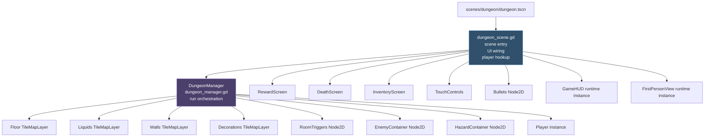
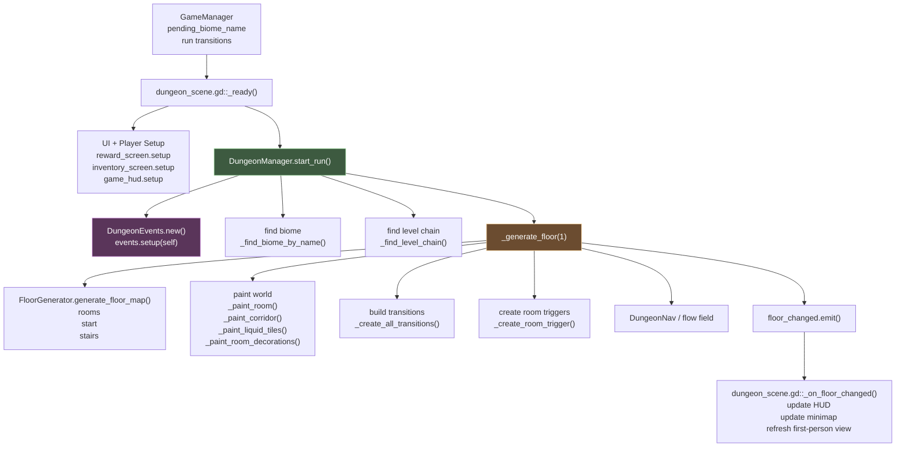
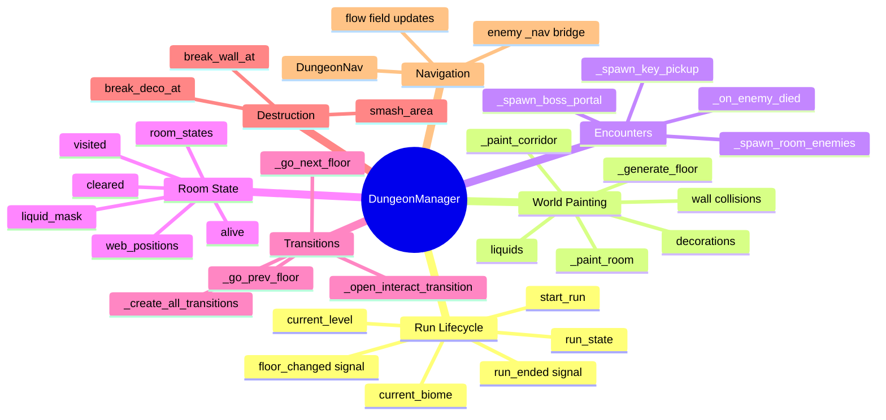
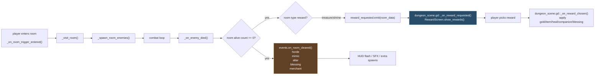
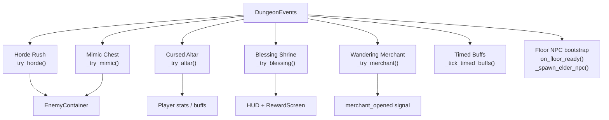
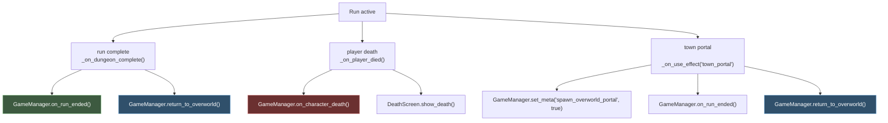

# Dungeon Runtime Map

This diagram is based on the current dungeon scene and its main scripts:

- [dungeon.tscn](/Users/developer-cloudprimero/Desktop/Godot/new-game-project/scenes/dungeon/dungeon.tscn)
- [dungeon_scene.gd](/Users/developer-cloudprimero/Desktop/Godot/new-game-project/scripts/dungeon/dungeon_scene.gd)
- [dungeon_manager.gd](/Users/developer-cloudprimero/Desktop/Godot/new-game-project/scripts/dungeon/dungeon_manager.gd)
- [floor_generator.gd](/Users/developer-cloudprimero/Desktop/Godot/new-game-project/scripts/dungeon/floor_generator.gd)
- [dungeon_events.gd](/Users/developer-cloudprimero/Desktop/Godot/new-game-project/scripts/dungeon/dungeon_events.gd)

Open this file in Cursor and use Markdown preview to view the Mermaid diagrams.

## Scene Structure

## Runtime Flow

## Dungeon Manager Responsibilities

## Room Clear To Reward / Event Flow

## Floor Events Layer

## Exit And Persistence Flow

## Refactor Read

The current dungeon runtime has a clear composition root:

- `dungeon_scene.gd` is the scene-level coordinator.
- `dungeon_manager.gd` is the central system orchestrator.
- `floor_generator.gd` owns layout generation.
- `dungeon_events.gd` owns floor event logic.

The main pressure point is that `dungeon_manager.gd` still owns too many layers at once:

- floor generation
- tile painting
- trap generation
- transitions
- room triggers
- enemy spawning
- boss/key/stairs progression
- destruction and collision rebuilding

That is the right file to split first if you want the dungeon system to become easier to extend.
