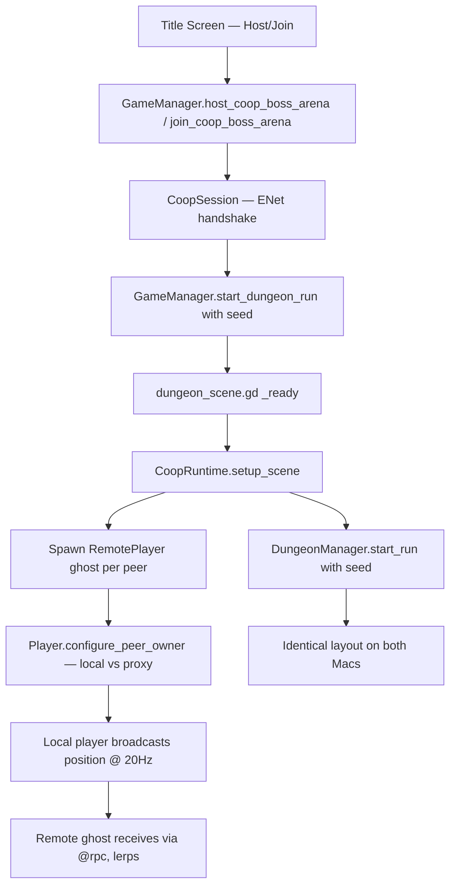

# DESIGN: Coop Dungeon (Boss Arena)

## Goal

Make the existing "Host/Join Boss Arena" path actually let two players play together: same dungeon layout, both players visible and moving, with a path to host-authoritative enemies and bullets in later phases.

## Why This Exists

- Current state: `CoopSession` opens an ENet pipe and both Macs scene-transition into `Test-Arena-Boss`, but **zero gameplay data is sent**. Dungeons are independently generated, only one Player node exists per scene, and `Player.configure_peer_owner()` is defined but never called. Tested 2026-05-24 on two MacBooks — confirmed by code audit (no `@rpc`, no `MultiplayerSpawner/Synchronizer`, no listeners on `peer_joined`).
- This design fills in the missing payload layer on top of the existing transport.
- Must not break: single-player dungeon runs, the overworld → dungeon → overworld loop, the title-screen host/join flow, existing save data, existing `PlayerQuery` consumers.

## Scope

### In Scope (Phase 1 — visibility MVP)

- Host generates a `dungeon_seed`; client receives it before generating geometry, so both Macs build identical layouts.
- One local-player node per peer (host keeps the existing `DungeonManager/Player`; client treats its local instance as its own player).
- Each peer also gets a "remote player" ghost node for every other connected peer, added to the `player` group so existing `PlayerQuery` consumers pick them up.
- Each peer broadcasts its own player position + facing at ~20 Hz via `@rpc("any_peer", "call_remote", "unreliable_ordered")`; remote ghosts lerp to received positions.
- `Player.configure_peer_owner()` is actually called; `is_local_controlled()` already gates input — so remote ghosts won't accept input.
- Coop session limited to `Test-Arena-Boss` biome only (matches current title-screen scope).

### In Scope (Phase 2 — host-authoritative enemies)

- Host owns enemy state. Clients receive enemy spawn / position / HP / death over RPC.
- Clients do not run enemy AI.

### In Scope (Phase 3 — combat sync)

- Bullet spawn / hit / despawn replicated.
- Player damage routed through host; player HP/death replicated.
- Boss state replicated.

### Out Of Scope (entire effort)

- Inventory / equipment / spell-loadout sync (each player uses their own loaded save).
- Loot ownership and pickup arbitration (each peer picks up locally for now).
- Mid-run join (no drop-in/drop-out — late joiners get a "session full" reject).
- Anti-cheat or input validation.
- Lobby polish, friend invites, NAT punch-through (UPnP path stays as-is).
- Persistent run results for the client (only the host's save is mutated by the run).
- Overworld coop.
- Voice / text chat.

## Touched Files

### Phase 1

**New**
- `docs/design/coop_dungeon.md` (this file)
- `docs/workflow/state/coop_dungeon.md`
- `scripts/systems/coop_runtime.gd` — autoload that wires the dungeon scene to multiplayer (peer-player spawn, RPC plumbing, seed delivery). Keeps multiplayer logic out of `dungeon_scene.gd` and `dungeon_manager.gd`.
- `scenes/remote_player.tscn` — visual-only ghost (Sprite + name label + animation node). No input, no collision against world, no hitbox.
- `scripts/remote_player.gd` — receives position RPCs, lerps, exposes `peer_owner_id` so `PlayerQuery` finds it.

**Modified (small, surgical)**
- `scripts/systems/coop_session.gd` — add `pending_dungeon_seed: int`, `dungeon_seed_ready` signal, helper `set_pending_seed(seed)`. (Systems zone, not on the shared-file list.)
- `scripts/systems/game_manager.gd` ⚠️ *shared file* — pass a seed through `start_dungeon_run()` when hosting; pull seed from `CoopSession` when joining. Touch: add one parameter + one branch.
- `scripts/dungeon/dungeon_scene.gd` — call `CoopRuntime.setup_scene(self)` in `_ready` after current setup.
- `scripts/dungeon/dungeon_manager.gd` — add `dungeon_seed: int` field; call `seed(dungeon_seed)` at the top of `start_run()` if non-zero. One-line behavior change, no refactor of the 50+ `randi()` call sites.
- `scripts/player.gd` — call `configure_peer_owner()` from `CoopRuntime` (no change inside player.gd itself), add `@rpc` `receive_remote_position()` and a `_broadcast_position_timer` that fires when `is_local_controlled()` is true.

### Phase 2

- `scripts/enemy.gd` — gate AI tick on `CoopSession.is_host()`; add `@rpc` `receive_remote_state(pos, hp, anim)`; host broadcasts on a tick.
- `scripts/dungeon/dungeon_manager.gd` — when spawning an enemy, also tell `CoopRuntime` to broadcast a spawn event.
- `scripts/systems/coop_runtime.gd` — add enemy-spawn RPC + container.

### Phase 3

- `scripts/weapons/weapon_system.gd`, `scripts/bullet.gd` — host owns bullet lifetime; clients render via spawn RPC.
- `scripts/player.gd` — damage routed via `rpc_id(1, "request_damage", ...)`.
- Boss-specific files under `scripts/enemies/`.

## Architecture

**Transport** — unchanged. `CoopSession` autoload + `ENetMultiplayerPeer` already work.

**Orchestration** — new `CoopRuntime` autoload sits between `CoopSession` (transport + lobby) and per-scene gameplay. `CoopSession` says "we are connected, here are the peers"; `CoopRuntime` says "given the current scene, here is what each peer should see" (configure local player, spawn ghosts, hold the agreed seed, route RPCs). This keeps `dungeon_scene.gd` and `dungeon_manager.gd` from learning multiplayer details directly.

**Ownership model** — host-authoritative. In Phase 1 the only authoritative state is the seed (host picks, client mirrors). Each peer is authoritative for its own *player position* — every other peer sees that player as a proxy ghost driven by the owner's broadcasts. Phase 2 extends host authority to enemy state.

### Mermaid Flow

## State Ownership

- **`CoopSession`** owns the ENet peer, mode (HOST/CLIENT/OFFLINE), and connected-peer list. Source of truth for "are we networked".
- **`CoopRuntime`** owns the per-scene multiplayer rigging: the agreed `dungeon_seed`, the map of `peer_id → RemotePlayer ghost node`, and the position-broadcast RPC funnel. Created at scene setup, torn down on scene exit.
- **`DungeonManager`** owns generated dungeon state — but in coop mode it is *derived* state (deterministic from `dungeon_seed`). Same on every peer.
- **`Player`** (local) owns its position + facing on its owner peer. Remote copies are read-only proxies.
- **Save data** is per-peer and untouched by this design (each player uses their own slot's character).

Write-restricted: `CoopSession.mode` and `multiplayer.multiplayer_peer` are only mutated by `CoopSession` itself. `dungeon_seed` is only written by `CoopRuntime` (set by host at run start, by client on receipt of seed RPC).

## Implementation Phases

### Phase 1 — Visibility MVP (this approval gate)

Goal: both players see each other moving in the same arena.

- Add `CoopRuntime` autoload.
- Add `remote_player.tscn` + `remote_player.gd`.
- Pipe a `dungeon_seed` from host → client → `DungeonManager.start_run()`; call `seed(dungeon_seed)`.
- On scene `_ready`, `CoopRuntime` configures the local `Player` node's `peer_owner_id` and spawns a `RemotePlayer` for every other connected peer.
- Position broadcast at 20 Hz; lerped on receive.

Changed files: as listed in "Touched Files / Phase 1". No save format changes.

Stop point: stop after Phase 1 lands; user runs the host/join test on two Macs to confirm both players move around in the same dungeon.

### Phase 2 — Host-authoritative enemies

Goal: enemies behave identically on both peers and respond to player 2's attacks.

- Gate enemy AI on `CoopSession.is_host()`.
- Host broadcasts enemy spawn (RoomData enemy spawn → enemy spawn RPC) + per-tick state (pos/hp/anim).
- Client renders proxy enemies, does not run AI or pathfinding.

Stop point: user confirms enemies sync.

### Phase 3 — Combat sync

- Bullet spawn/hit replicated.
- Damage requests routed `rpc_id(1, ...)`; HP replicated back.
- Boss + boss attacks replicated.
- Death + return-to-overworld flow handles "host died vs client died vs both died".

### Phase 4 — Cleanup (post-MVP, separate design)

- Refactor `dungeon_manager.gd`'s ~50 `randi()` call sites onto a local `RandomNumberGenerator` for determinism robustness.
- Loot ownership.
- Mid-run join.

## Risks

**Runtime**
- `seed()` mutates the global RNG — any other system that calls `randi()` between scene transition and dungeon generation could pollute the deterministic chain. Mitigation: log the seed; if layouts diverge, refactor to a local `RandomNumberGenerator` (Phase 4).
- Scene transition timing — the client may enter the dungeon scene before the host's seed arrives. Mitigation: `CoopRuntime` blocks `DungeonManager.start_run()` until `dungeon_seed_ready` fires; show "Waiting for host…" briefly.
- The hardcoded `DungeonManager/Player` node has a `Camera2D` child — on the client, this is *the client's* camera. Good. On host, the host's own player camera works. Remote ghosts must not own cameras. Mitigation: `remote_player.tscn` has no Camera2D.
- ENet peer is host-only authoritative for connection state — if the host disconnects, client should fail gracefully back to overworld. Mitigation: existing `server_disconnected` signal in `CoopSession` already triggers `close_session`; verify client returns to title cleanly.

**Save compatibility**
- No save format changes in Phase 1. Each player loads their own save slot independently. Host's slot is the only one whose run results are persisted (Phase 1 acceptable; Phase 3 may need rework).

**Scene coupling**
- `dungeon.tscn` is a verification primary in `VERIFICATION_CHECKLIST.md` (section B). Single-player runs must keep working — `CoopRuntime.setup_scene()` is a no-op when `CoopSession.mode == OFFLINE`.
- `game_manager.gd` is on the shared-file list. The change is one new optional param + one branch in `start_dungeon_run` for host-side seed seeding. No other shared file is touched in Phase 1.

**Parallel-agent**
- Single integration owner (no parallel agents on this feature). `CoopRuntime` is a new file in the systems zone; `RemotePlayer` is in the gameplay zone. If a UI agent later touches title-screen lobby polish, this design isn't blocked.

## Verification

**Phase 1**
- Single-player smoke (verification checklist section B): launch app, pick slot, enter a normal dungeon, kill an enemy, return to overworld. No regressions.
- Coop smoke: on Mac A, Host Boss Arena. On Mac B, Join with Mac A's LAN IP. Both transition into the same arena, layout matches visually, both players move and the other peer sees the movement.
- Console: no `null peer` or `MultiplayerAPI` errors; seed is logged on both peers and matches.
- Disconnect smoke: client closes the game mid-run — host stays alive, returns to overworld or stays in arena without crashing.

**Diff review focus**
- `game_manager.gd` diff must only touch the dungeon-start path and the coop entry points — no save_data changes, no QuestManager changes.
- `dungeon_manager.gd` diff must only add the seed field + one `seed()` call — no other generator changes.
- No `randi()` calls added or rearranged outside that one `seed()` site.

**Rollback**
- Phase 1 isolated to additions + small modifications; revert is a single git revert of the Phase 1 commit. Removing the `CoopRuntime` autoload from `project.godot` neutralizes its effects even before revert.

## Approval Gate

I stop after Phase 1 is implemented and verified. Do not begin Phase 2 (enemy authority) until you've tested Phase 1 on the two Macs and approved.
