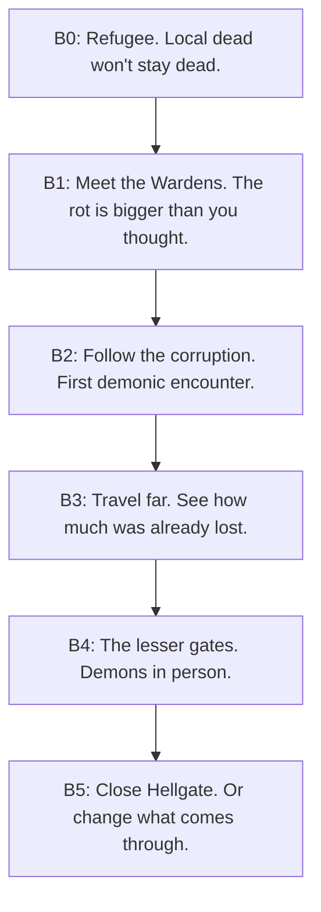

# Story

> Player arc, B0 to B5. Uses existing zone lore: the Sundering, Hellgate, the Wardens, the Ashfields.

## Premise

Something cracked the world open. The locals call it the Sundering. The crack never sealed. Demons leak through it. Frostgrave froze mid-battle. The Ashfields around Ravenhollow burned and never grew back. The Wardens, an old order of rangers, patrol the roads and put down whatever crawls out. They lose ground every year.

You arrive in Ravenhollow as a refugee. The Elder gives you small jobs. You meet a Warden. By the end you walk to the source.

## The acts

## Act beats

### Act 1 — Ash on your boots (B0)
- The Elder welcomes you to Ravenhollow.
- Skeletons rise in the Barrows. You cull them. (`q1`)
- Scarecrows walk the Hollow Fields at night. (`mq01`)
- A bone golem rises in the mausoleum. You put it down. (`mq02`)
- **Reveal:** the dead aren't waking at random. Something pulls at them. The Elder knows more than he says.

### Act 2 — The Wardens know (B1)
- The Elder sends you north into the Wastes for what he calls a simple errand.
- You find the Warden's Camp. They explain corruption and recruit you.
- They send you back to Hollow Fields. The rot has spread.
- **Reveal:** Hellgate is leaking. The closer you are to Ravenhollow, the slower it moves. It is coming anyway.

### Act 3 — Following the cracks (B2)
- Captain Coran sends you to Embermaw, a smaller wound. Fire-corrupted creatures live there.
- You kill the Fire Beast (`q_fire_beast`) and recover something from its hoard.
- Barrows-Crypt opens under the graveyard. What was buried there pre-dates the town.
- **Reveal:** Ravenhollow sits on top of something old. The Elder knew. So did the founders.

### Act 4 — Older wounds (B3)
- The Wardens dispatch you to the Ironspine and Ashheim. Both hide Sundering scars.
- In Frostgrave you walk an army that never finished dying.
- Side trip into the Bone Quarry. The miners dug up something still angry.
- **Reveal:** the Sundering wasn't an accident. Someone opened Hellgate. Their name is on a slab in Frostgrave.

### Act 5 — The gates open (B4)
- Ashglade and the Pit of Gehinnom sit at Hellgate's doorstep.
- You meet demonic factions. The first ones have names and dialogue.
- You fight Moloch. He retreats into the gate before you can finish him.
- **Reveal:** Hellgate is a door. Whatever's behind it wants through.

### Act 6 — Closing the wound (B5)
- You descend Hellgate's 10 floors.
- Final choice: seal the gate (people you saved survive, loose corruption stays loose) or walk through (open ending, NG+ hook).

## Key characters

| Character | Role | First met | Arc |
|-----------|------|-----------|-----|
| The Elder | Ravenhollow leader, knows too much | B0 Haven | Adds a layer each band. Gone by B5. |
| Warden Coran (NEW) | Warden captain, your handler | B1 Wastes | Mentor. Sacrifices himself in B4 by default. |
| Dafydd | Last farmer of Hollow Fields | B0/B1 farm | Existing. Ties the farm to the bigger arc. |
| The Bone Hermit (NEW) | Knows what's buried under Ravenhollow | B2 Barrows-Crypt | Lore exposition. Was a founder. |
| Captain Briard (NEW) | Cynical Warden, opposes Coran | B3 Ironspine | Splits the Wardens. You pick a side in B4. |
| The Speaker (NEW) | Demon ambassador at Hellgate | B5 | Final antagonist. Named on the Frostgrave slab. |

## Tone rules

- Player work is bandaging. The wound stays open.
- Refugee protagonist. No chosen-one framing.
- NPCs remember you. Ravenhollow shifts each band; see `02_world_map.md`.
- Demons argue with each other. They have factions and goals.

## Decisions to lock

1. Two endings (seal / walk through) or three (add "negotiate with the Speaker")?
2. Elder fate: dies, vanishes, betrays, sacrifices? Default: sacrifices in B4.
3. NPC roster above. Cut any you don't want before I draft their quest hooks.
