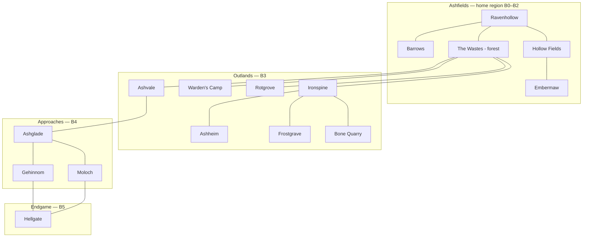
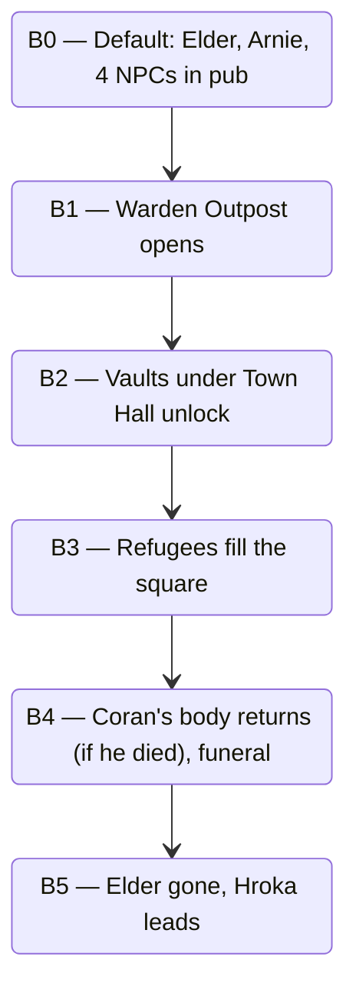

# World Map & Empty Zones

> Zone order and what's missing in each.
> 68 zone .tres files exist. Most have no NPCs and no quests, just dungeon entries.

## Cluster overview

## Early zones (B0–B1)

### Ravenhollow (`haven`)
- **Today:** 15 NPCs, 4 named houses (Arnie's, Town Hall, Crooked Beak inn, Shrowded Orb), Haven-Dungeons (7 floors).
- **Missing:** per-band changes. The hub feels static.
- **Add:** Warden Outpost. New house against the north wall. Locked in B0, opens in B1 after you meet Coran in the Wastes.
- **Add:** the Vaults. New room behind the Town Hall. Opens after `mq02`. Holds the founders' records. Sets up Act 3.

### Barrows (`barrows`)
- **Today:** 0 NPCs, 0 houses. Dungeon spawns + Bone Golem boss.
- **Missing:** any reason to walk the open zone after `q1`.
- **Add:** Skuld the Gravekeeper at the gate. Caretaker's shed (new house). One side quest per band.
- **Add:** Old Hellig's Grave. Sealed crypt, visible from B0. Opens in B2 as the entry to Barrows-Crypt.

### The Wastes (`wastes`)
- **Today:** 5 dungeons, 5 exit zones, 2 enemy spawns (Thief, Wild Dog). 0 NPCs, 0 houses. Description says Wardens patrol it.
- **Missing:** everything. The map is 50×50 and unpopulated.
- **Add (the Wastes content list):**
  - Warden's Camp road. Camp stays in the `wardens` zone; the Wastes holds the road in.
  - The Sleeping Stones. Clearing with standing stones. Sundering lore. No combat.
  - The Hunter's Snare. Abandoned trapper's hut. Loot cache, body, journal.
  - The burning tree. Fire that won't go out. B2 quest hook (first demonic seed).
  - Tira's Goat Farm (NEW NPC). East road. Tira hides refugees. Side quest: hold the farm against night wolves.
  - Wagon ambush. Scripted scene. First corrupted bandits. Fires on first south-to-north crossing.
  - Warden patrols. Small groups on the roads. Tips, occasional small quests.

### Hollow Fields (`duskfarm`)
- **Today:** 4 NPCs (Dafydd, Blaidd, Plentyn, Mabion), 6 dungeons, peaceful cow/sheep spawns.
- **Missing:** a reason to return after the scarecrow quest.
- **Add:** Mabion's barn hides a second floor. Opens in B2 if you bring her a specific pet.
- **Add:** Old Hroma the Reaper (NEW NPC). Night only. Scythe-themed side quest.
- **Add:** The Mill. In the description, not wired yet. Wire as the entrance to Duskfarm-Dungeons F3+, gated to B2.

## B3 cluster — Outlands

| Zone | Status today | Suggested role |
|------|--------------|----------------|
| `wardens` Warden's Camp | description only | Warden HQ. Coran lives here. 4–5 NPCs, training-yard quests. |
| `ironspine` The Ironspine | mountain pass | First B3 hub. A few NPCs, a roadside smithy. |
| `ashheim` Ashheim | volcanic city | Foreign city. Soot-coated locals. Roster of ~8 NPCs. |
| `frostgrave` Frostgrave | frozen battlefield | Combat zone. Walk between frozen soldiers. Lore slab. |
| `bonequarry` Bone Quarry | mining ruin | Side dungeon. One named survivor. |
| `rotgrove` Rotgrove | swamp | Side path. Witch NPC. |
| `ashvale` Ashvale | ash desert | Bridge to B4. Hosts the existing `a3` quest. |

**Pacing:** any order. Two NPCs minimum per zone (quest giver + flavour character).

## B4 cluster — Approaches

| Zone | Status | Suggested role |
|------|--------|----------------|
| `ashglade` Ashglade | empty | B4 hub. First demonic settlement that isn't hostile. Refugees from the gate live here. |
| `moloch` Moloch | empty | Demonic stronghold. Antagonist's home turf. |
| `gehinnom` Gehinnom | description: "demonic whispers rise from impossible depths." Empty. | Five-floor descent. |

**Pacing:** roughly linear. Ashglade, then Moloch's boss, then descend Gehinnom.

## B5 cluster — Endgame

| Zone | Status | Suggested role |
|------|--------|----------------|
| `hellgate` Hellgate | description done. 10 dungeons. | Endgame lives here. Each floor names one demon. |

## How Ravenhollow changes per band

## Fill order

If we author one zone at a time:

1. The Wastes. Empty, blocks B1.
2. Warden's Camp. B1 destination. Needs to exist.
3. Barrows side dressing. Gravekeeper + crypt teaser.
4. Ravenhollow band-state changes. One or two updates per band.
5. Ashheim. B3 anchor.
6. Ashglade. B4 anchor.
7. Everything else as time allows.

## Decisions to lock

1. Wastes content list above (Sleeping Stones, Tira's Farm, Hunter's Snare, burning tree, wagon ambush, patrols). Confirm all or pick a subset.
2. NPC density for B3+: two per zone, or just lore signs?
3. Hellgate bosses: 10 mini-bosses across 10 floors, or 3 big bosses across 3 acts?
