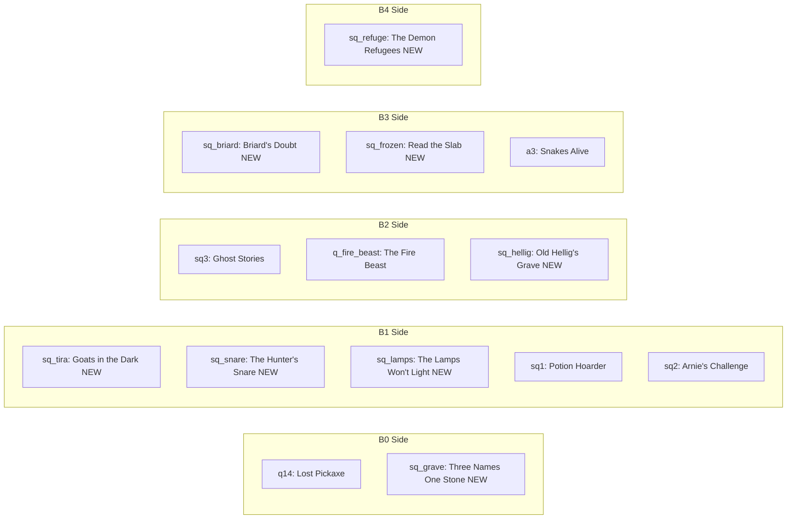

# Quest Flow

> Critical path + side quests as a flow.
> IDs use existing convention: `q*`, `mq*`, `sq*`.

## Critical path

```mermaid
flowchart TD
  q1[q1: Them Bones - B0] --> mq01[mq01: Waking in Ash - B0]
  mq01 --> mq02[mq02: What the Dead Left Behind - B0]
  mq02 --> mq03[mq03: The Elder's Silence - B1]
  mq03 --> mq04[mq04: Find the Wardens - B1 NEW]
  mq04 --> mq05[mq05: The Spreading Rot - B1 NEW]
  mq05 --> mq06[mq06: Embermaw Burns - B2 NEW]
  mq06 --> mq07[mq07: Under the Mausoleum - B2 NEW]
  mq07 --> mq08[mq08: The Founders' Vault - B2/B3 NEW]
  mq08 --> mq09[mq09: Frozen Names - B3 NEW]
  mq09 --> mq10[mq10: The Speaker's Demand - B4 NEW]
  mq10 --> mq11[mq11: Moloch Will Not Die - B4 NEW]
  mq11 --> end[end: Hellgate - B5]
```

## Side quest hooks per band



## Quest one-liners

### B0
- **q1** (existing): the Elder asks you to clear skeletons in the Barrows.
- **mq01** (existing): Dafydd's scarecrows are walking. Cleanse 10.
- **mq02** (existing): the Bone Golem in the mausoleum.
- **q14** (existing, patch rewards): Jimbob lost his pickaxe in the Barrows.
- **sq_grave** (NEW): Skuld forgot three graves' names. Read them aloud.

### B1
- **mq03** (extends existing): the Elder sends you north for a missing scout. Path leads into the Wastes.
- **mq04** (NEW): find the Warden's Camp. Coran sizes you up.
- **mq05** (NEW): Coran sends you back to Hollow Fields. The rot has spread. Cleanse a second, stronger wave.
- **sq_tira** (NEW): Tira's goats vanish at night. Hold the farm.
- **sq_snare** (NEW): find the Hunter's Snare cabin. Read the journal. Cache reward.
- **sq_lamps** (NEW): Salla's lanterns won't light. Investigation that runs from Haven into Hollow Fields.
- **sq1**, **sq2** (existing): author rewards.

### B2
- **mq06** (NEW, folds in `q_fire_beast`): Coran sends you to Embermaw. The Fire Beast is wounded and corrupting the magma. Kill it.
- **mq07** (NEW): a door opens under the mausoleum after `mq06`. Descend Barrows-Crypt. Boss: the Bone Hermit. (Open question: is he buried alive or already dead?)
- **sq_hellig** (NEW): Old Hellig's sealed crypt opens. Read 3 inscriptions. Lore drop.
- **sq3** (existing): author rewards.

### B3
- **mq08** (NEW): the vault under Town Hall opens. The Elder hands you a key only the founders had. Travel to Ashheim and find what they sealed.
- **mq09** (NEW): Frostgrave's slab names the person who opened the Sundering. Bring the name back.
- **sq_briard** (NEW): Captain Briard offers you a deal Coran wouldn't make. Faction-split choice.
- **sq_frozen** (NEW): walk the frozen army. Listen.
- **a3** (existing): folds in here.

### B4
- **mq10** (NEW): the Speaker, a demon ambassador, sends a letter to Ravenhollow. Go to Ashglade.
- **mq11** (NEW): assault Moloch's fortress. The fight ends with him retreating into Hellgate. The Speaker disappears with him.
- **sq_refuge** (NEW): some demons in Ashglade are also refugees from inside the gate. Help them or turn them in to Briard.

### B5
- **end**: Hellgate. 10 floors. Final choice: seal it or walk through.

## Interleave rules

- Side quests never auto-fail. Pick one up in B1, finish in B5 if you want.
- Main chain stays enforced. Each `mq*` unlocks the next.
- `mq06` and `mq07` go in either order. Pick Embermaw or Barrows-Crypt first.
- Choice quests (`sq_briard`, `sq_refuge`) lock the alternative once you commit.

## Reward sizing

| Band | Main XP | Side XP | Main gold | Side gold |
|------|---------|---------|-----------|-----------|
| B0 | 200–400 | 75–150 | 200–500 | 50–200 |
| B1 | 600–1200 | 200–500 | 500–1500 | 200–800 |
| B2 | 2000–4000 | 700–1500 | 2000–5000 | 700–2000 |
| B3 | 6000–12000 | 2500–5000 | 5000–12000 | 2000–6000 |
| B4 | 20k–40k | 7k–15k | 12k–25k | 5k–12k |
| B5 | 60k+ | 25k+ | 25k+ | 10k+ |

## Decisions to lock

1. Coran lives or dies? Tied to `sq_briard`. He sacrifices in `mq11` (Briard leads in B5), or he survives and you pick a captain.
2. `mq06` folds `q_fire_beast` into the critical path. Confirm, or keep `q_fire_beast` optional?
3. Choice quests lock the alternative. OK, or always allow both paths?
