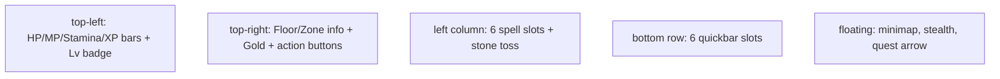
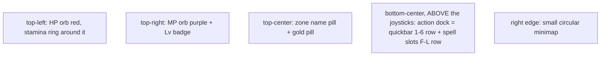
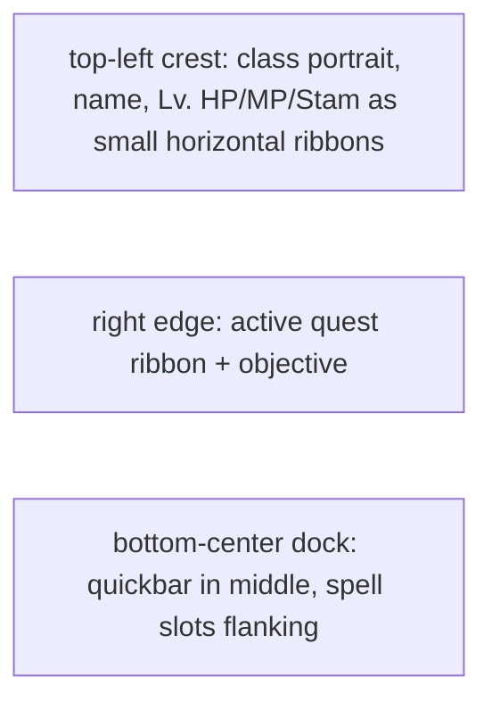
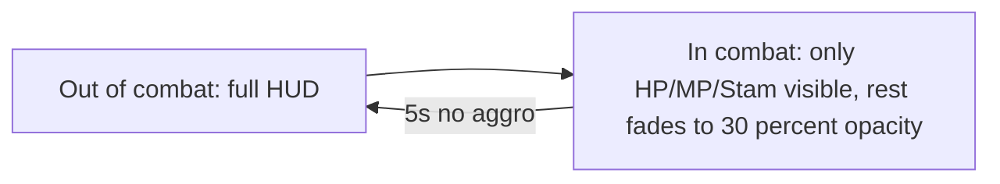
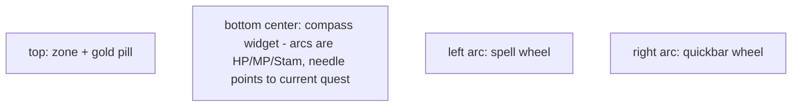
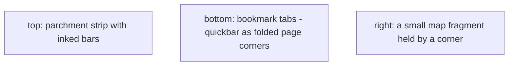
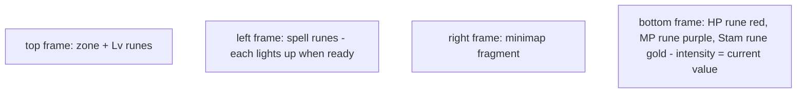
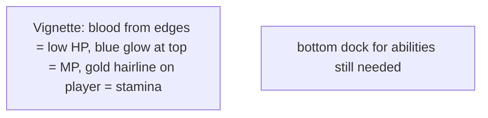

# HUD Concepts

> Brainstorm for the in-game HUD. Pick one, I'll build it.
>
> Target: Eternal Conquests, mobile-first (Android), twin-stick combat. Virtual joysticks live in the bottom corners on touch, so we **cannot** put vitals or quickbar there on mobile.

## What's on screen today

It works but it's noisy and the spell slots on the left feel awkward.

## Constraints

- Mobile: bottom-left and bottom-right corners reserved for virtual joysticks.
- Pixel art world. UI should not fight the art style.
- Player can dash, sprint, push, sneak. We have **at least 4 movement states** to communicate.
- Three vitals: HP, MP, Stamina. Plus XP.
- 6 quickbar + 6 spell slots + stone toss = 13 action items.

## Concepts

### A — Sigil (orbs + dock)

Diablo / classic ARPG. Strongest legibility-per-pixel.

- **Read:** glance top-left = HP, top-right = MP, middle bottom = abilities.
- **Mobile-safe:** orbs go on top corners, dock floats above the joysticks.
- **Cost:** ~1 day. Orbs are radial-shader sprites with an animated wave inside.

### B — Heraldic Crest

Portrait + ribbon bars. Strong identity, more chrome.

- **Vibe:** medieval, hand-drawn. Reads slower than orbs.
- **Cost:** ~1.5 days. Need a portrait frame + the ribbon style.

### C — Combat / Calm adaptive

Same elements, fade in/out based on aggro.

- **Cost:** ~0.5 day. Layered on top of any concept, not a replacement.
- **Risk:** flickering near aggro edges. Needs debounce.

### D — Compass Rose

Central circular widget. Distinct, geometric.

- **Vibe:** unique. Strong identity. Players need a beat to learn it.
- **Cost:** ~2 days. Custom arcs and rotating needle.

### E — Living Tome

Diegetic. The HUD is pages from a journal pinned at the screen edges.

- **Vibe:** narrative-heavy, hand-drawn. Risk: hard to read at speed.
- **Cost:** ~2 days + art. Best paired with a parchment palette swap.

### F — Runic Frame

The viewport itself is bordered by a carved stone frame with glowing runes.

- **Vibe:** atmospheric. Eats screen real estate but feels like a real artifact.
- **Cost:** ~2 days. Mostly art.

### G — Death-Marked vignette

Pure diegetic. HP shown by blood creeping in from the edges. MP as a top glow. Stamina as a hairline around the player.

- **Vibe:** intense, cinematic. Risk: HP value not legible. Best as **second display** on top of small bars somewhere.
- **Cost:** ~1 day. CanvasLayer shader for the vignette.

### H — Hybrid (Sigil + Combat/Calm)

A combined with C. Default = sigil orbs. In combat = minimap and quest tracker fade, orbs amplify slightly.

- **Cost:** ~1.5 days total.
- **Best balance** of legibility and immersion.

## Mobile notes (across all concepts)

- Virtual joysticks live bottom-left + bottom-right at ~120px radius. Reserve the bottom 200px of the screen except a 400px-wide center strip for the action dock.
- Touch targets minimum 44x44 (per ui-ux-pro-max rule).
- Quickbar slot taps should be tappable without re-positioning the joystick thumb. Top edge of the dock should sit ~220px from the bottom on a 1080p portrait phone.

## Recommendation

**H (Sigil + Combat/Calm hybrid).** Two reasons:

1. Sigil orbs are the most legible system at a glance. Players who only just learned the game can read them.
2. Adding the combat/calm fade is a one-day layer that makes the game feel modern without redesigning anything.

If you want maximum gothic identity at the cost of legibility — pick **F (Runic Frame)**.
If you want unique-on-the-store-page identity at the cost of learning curve — pick **D (Compass Rose)**.

## Decisions to lock

1. Pick a concept (A, B, C, D, E, F, G, or H).
2. Orbs (concept A/H): keep stamina as a thin ring around the HP orb, or third orb in the middle? Default: ring.
3. Minimap: keep as today (small circle top-right), or move to corner of the action dock? Default: top-right.
4. Quest arrow on world edges: keep, or replace with a compass strip at the top of the screen? Default: keep.
