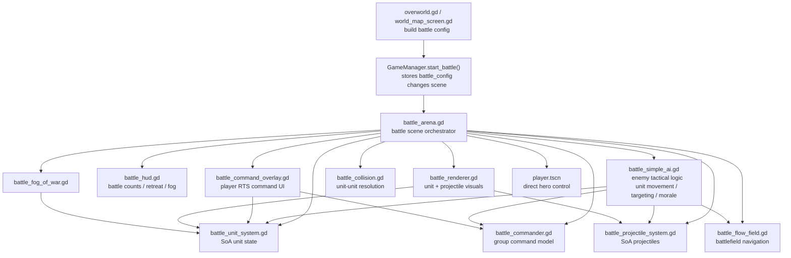

# RTS Battle Overview

## Purpose

This subsystem turns strategic army state into a real-time battle where:

- the player controls a hero directly
- blue units can be selected and commanded in RTS-style command mode
- red units are controlled by a tactical AI layer
- both sides run through a shared SoA battle simulation

## System Topology

## Inputs

- `GameManager.battle_config`
- battle region rects and spawn rects
- player army composition
- enemy army composition
- optional player `army_divisions`
- zone terrain / tileset / enemy scaling metadata

## Outputs

- live battle result
- troop token rewards
- veteran progression updates
- hired fighter loss updates
- `GameManager.on_battle_ended()` consequences

## Key Files

- [battle_arena.gd](/Users/developer-cloudprimero/Desktop/Godot/new-game-project/scripts/battle/battle_arena.gd)
- [battle_simple_ai.gd](/Users/developer-cloudprimero/Desktop/Godot/new-game-project/scripts/battle/battle_simple_ai.gd)
- [battle_command_overlay.gd](/Users/developer-cloudprimero/Desktop/Godot/new-game-project/scripts/battle/battle_command_overlay.gd)
- [battle_commander.gd](/Users/developer-cloudprimero/Desktop/Godot/new-game-project/scripts/battle/battle_commander.gd)

## Key Types

- `BattleCommander.BattleGroup`
- `BattleUnitSystem`
- `BattleProjectileSystem`
- `BattleSimpleAI`

## Reading Order

If you want to understand this system deeply, read in this order:

1. `battle_arena.gd`
2. `battle_commander.gd`
3. `battle_command_overlay.gd`
4. `battle_unit_system.gd`
5. `battle_simple_ai.gd`
6. `battle_projectile_system.gd`
