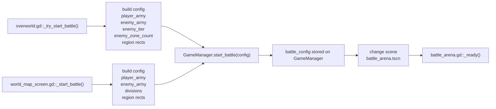
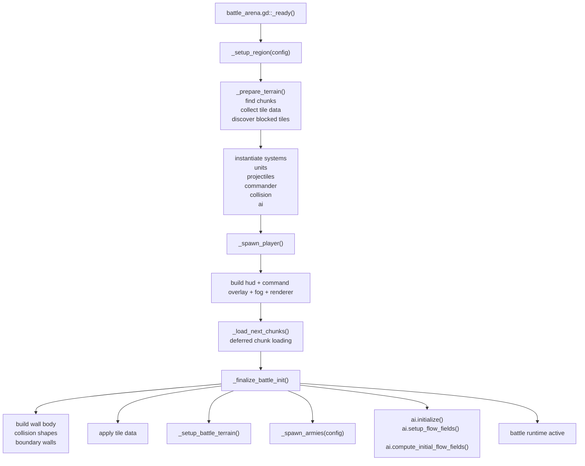

# RTS Battle Entry And Setup

## Battle Entry Flow

## Arena Setup Pipeline

## Related Files

- [overworld.gd](/Users/developer-cloudprimero/Desktop/Godot/new-game-project/scripts/overworld/overworld.gd)
- [world_map_screen.gd](/Users/developer-cloudprimero/Desktop/Godot/new-game-project/scripts/ui/world_map_screen.gd)
- [game_manager.gd](/Users/developer-cloudprimero/Desktop/Godot/new-game-project/scripts/systems/game_manager.gd)
- [battle_arena.gd](/Users/developer-cloudprimero/Desktop/Godot/new-game-project/scripts/battle/battle_arena.gd)
- [battle_arena.tscn](/Users/developer-cloudprimero/Desktop/Godot/new-game-project/scenes/battle/battle_arena.tscn)

## Inputs

- `battle_config.zone_name`
- `battle_config.player_army`
- `battle_config.enemy_army`
- `battle_config.divisions`
- `battle_config.battle_region`
- `battle_config.player_spawn_rect`
- `battle_config.enemy_spawn_rect`
- `battle_config.enemy_tier`
- `battle_config.enemy_zone_count`

## Outputs

- initialized battle systems
- spawned player hero
- spawned blue/red army units
- initial AI objectives and flow fields

## Key Functions

- `overworld.gd::_try_start_battle()`
- `world_map_screen.gd::_start_battle()`
- `game_manager.gd::start_battle()`
- `battle_arena.gd::_ready()`
- `battle_arena.gd::_finalize_battle_init()`
- `battle_arena.gd::_spawn_armies()`
