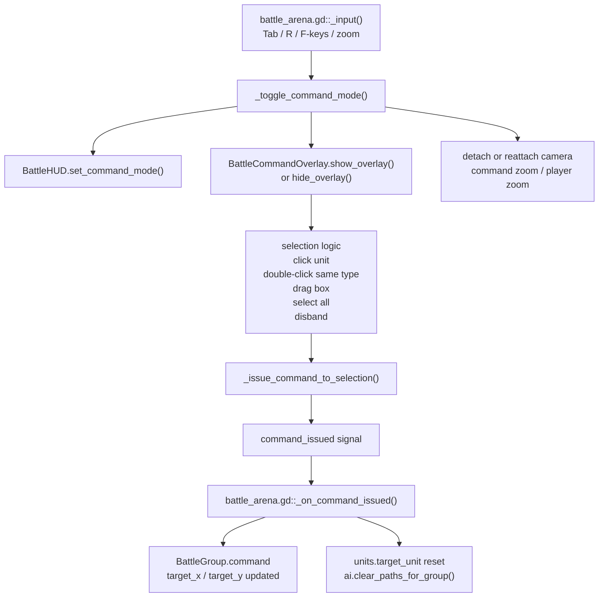
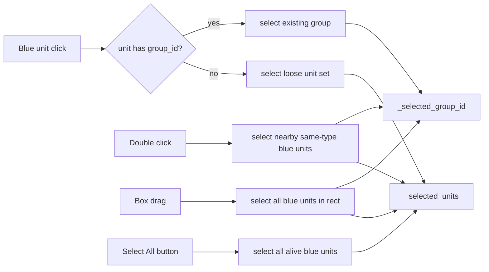
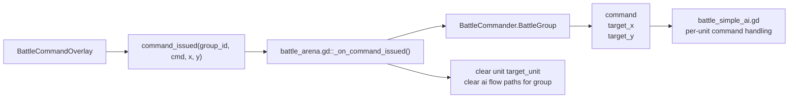

# RTS Command Mode

## Purpose

Command mode is the player's RTS control surface layered on top of the live battle.

The player can:

- toggle command mode with `Tab`
- select units or permanent groups
- issue `ATTACK`, `MOVE`, `HOLD`, `FOLLOW`, `SCATTER`, `DEFENSIVE`
- switch camera to blue commanders
- release follow groups into active attack

## Command Mode Topology

## Selection Model

## Command Application Path

## Related Files

- [battle_arena.gd](/Users/developer-cloudprimero/Desktop/Godot/new-game-project/scripts/battle/battle_arena.gd)
- [battle_command_overlay.gd](/Users/developer-cloudprimero/Desktop/Godot/new-game-project/scripts/battle/battle_command_overlay.gd)
- [battle_hud.gd](/Users/developer-cloudprimero/Desktop/Godot/new-game-project/scripts/battle/battle_hud.gd)
- [battle_commander.gd](/Users/developer-cloudprimero/Desktop/Godot/new-game-project/scripts/battle/battle_commander.gd)

## Inputs

- `Tab`
- `R`
- `F1..F10`
- left click / right click / drag
- `Shift+RightClick`
- `Ctrl+LeftClick`
- command buttons in overlay

## Outputs

- active camera mode and zoom
- selected group or loose unit set
- `BattleGroup.command`
- `BattleGroup.target_x`
- `BattleGroup.target_y`

## Key Functions

- `battle_arena.gd::_toggle_command_mode()`
- `battle_arena.gd::_switch_to_commander()`
- `battle_arena.gd::_switch_to_player()`
- `battle_arena.gd::_release_army()`
- `battle_arena.gd::_on_command_issued()`
- `battle_command_overlay.gd::_input()`
- `battle_command_overlay.gd::_try_select_unit_at()`
- `battle_command_overlay.gd::_select_nearby_same_type()`
- `battle_command_overlay.gd::_finish_box_selection()`
- `battle_command_overlay.gd::_issue_command_to_selection()`

## Important Design Note

The overlay does not create tactical logic itself.

It only:

- manages selection
- mutates group membership in narrow cases
- emits commands

The battle scene writes those commands into `BattleGroup`, and the AI loop interprets them.
