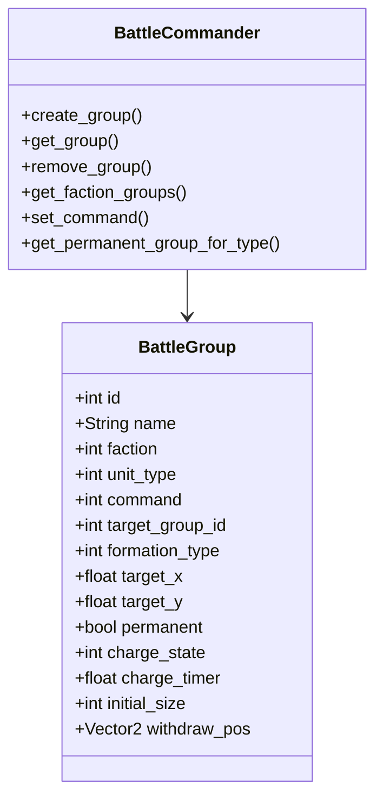
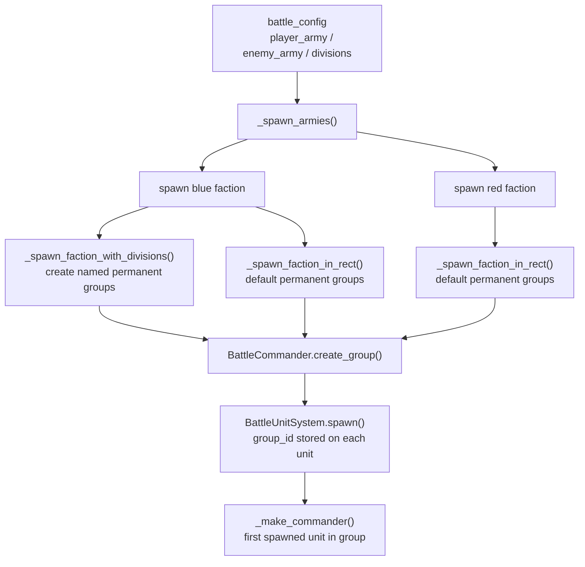
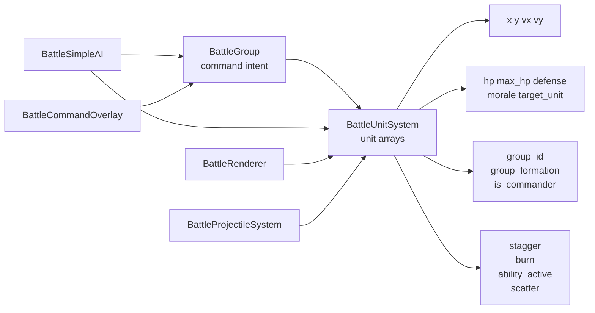

# Groups And SoA Units

## Purpose

The battle system separates:

- group-level intent in `BattleCommander`
- per-unit runtime state in `BattleUnitSystem`

This is the core abstraction that both player command mode and enemy AI share.

## Group Model

## Spawn And Group Ownership

## Shared Data Model

## Related Files

- [battle_commander.gd](/Users/developer-cloudprimero/Desktop/Godot/new-game-project/scripts/battle/battle_commander.gd)
- [battle_unit_system.gd](/Users/developer-cloudprimero/Desktop/Godot/new-game-project/scripts/battle/battle_unit_system.gd)
- [battle_arena.gd](/Users/developer-cloudprimero/Desktop/Godot/new-game-project/scripts/battle/battle_arena.gd)

## Inputs

- army composition arrays
- optional player `army_divisions`
- unit type
- faction
- stat scaling
- veteran rank

## Outputs

- live SoA unit state
- group centers
- group alive counts
- formation-driven stat bonuses

## Key Functions

- `battle_arena.gd::_spawn_armies()`
- `battle_arena.gd::_spawn_faction_with_divisions()`
- `battle_arena.gd::_spawn_faction_in_rect()`
- `battle_arena.gd::_make_commander()`
- `battle_unit_system.gd::spawn()`
- `battle_unit_system.gd::damage()`
- `battle_unit_system.gd::build_spatial_hash()`
- `battle_unit_system.gd::get_nearby()`
- `battle_unit_system.gd::update_formation_bonuses()`
- `battle_unit_system.gd::get_group_center()`
- `battle_unit_system.gd::get_group_alive_count()`

## Important Design Note

This system uses permanent type/division groups as the stable control surface.

Loose selection in command mode does not fundamentally replace groups.
It translates the player's selection back into commands on existing groups.
