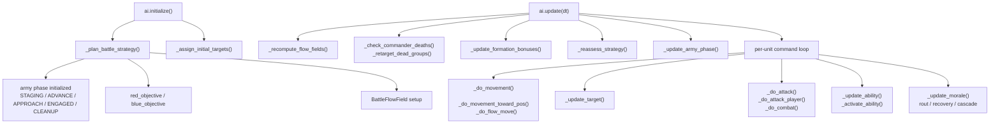
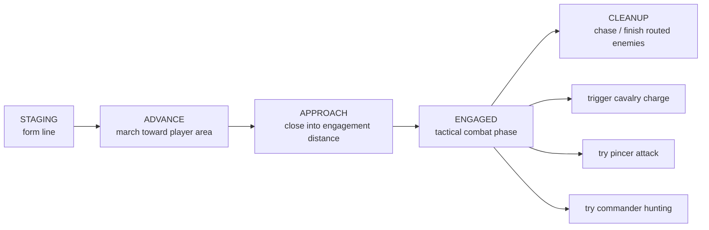
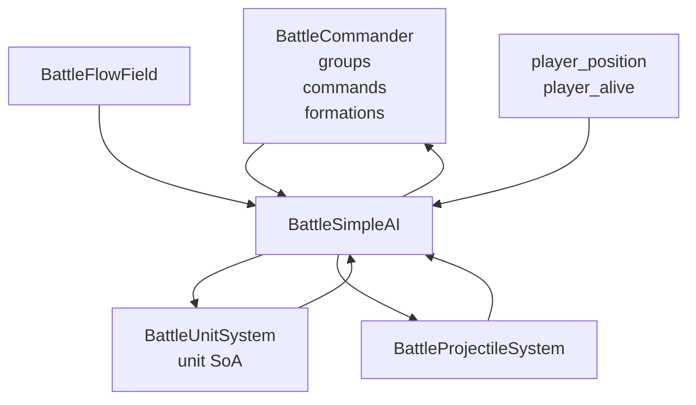

# Enemy Battle AI

## Purpose

`battle_simple_ai.gd` is not simple anymore. It owns:

- target assignment
- command interpretation
- movement
- attack execution
- morale
- formation evaluation
- army-phase coordination
- advanced tactics such as pincer and commander hunting

It drives both sides' units, but the strategic coordination emphasis is on RED enemy forces.

## AI Architecture

## Enemy Army-Phase Control

## AI Data Dependencies

## Inputs

- `BattleGroup.command`
- `BattleGroup.formation_type`
- `BattleGroup.target_x / target_y`
- unit SoA state
- blocked terrain tiles
- red and blue objectives
- player position / alive status

## Outputs

- per-unit movement vectors
- per-unit target selection
- projectile spawns
- morale changes
- formation changes
- group-level tactical command changes

## Related Files

- [battle_simple_ai.gd](/Users/developer-cloudprimero/Desktop/Godot/new-game-project/scripts/battle/battle_simple_ai.gd)
- [battle_flow_field.gd](/Users/developer-cloudprimero/Desktop/Godot/new-game-project/scripts/battle/battle_flow_field.gd)
- [battle_commander.gd](/Users/developer-cloudprimero/Desktop/Godot/new-game-project/scripts/battle/battle_commander.gd)
- [battle_unit_system.gd](/Users/developer-cloudprimero/Desktop/Godot/new-game-project/scripts/battle/battle_unit_system.gd)
- [battle_projectile_system.gd](/Users/developer-cloudprimero/Desktop/Godot/new-game-project/scripts/battle/battle_projectile_system.gd)

## Key Function Clusters

### Initialization

- `initialize()`
- `setup_flow_fields()`
- `compute_initial_flow_fields()`
- `_plan_battle_strategy()`
- `_assign_initial_targets()`

### Strategic Reassessment

- `_reassess_strategy()`
- `_adapt_formations_to_counter()`
- `_try_pincer_attack()`
- `_try_commander_hunting()`

### Army Coordination

- `_update_army_phase()`
- `_do_staging_phase()`
- `_do_advance_phase()`
- `_do_approach_phase()`
- `_do_engaged_phase()`
- `_compute_battle_line_positions()`
- `_trigger_cavalry_charge()`

### Unit Runtime

- `_update_target()`
- `_get_unit_destination()`
- `_do_movement()`
- `_do_movement_toward_pos()`
- `_do_flow_move()`
- `_do_attack()`
- `_do_attack_player()`
- `_do_combat()`

### Morale / Leadership

- `_check_commander_deaths()`
- `_update_morale()`
- `_apply_morale_cascade()`
- `apply_charge_morale_damage()`

## Important Design Note

This file mixes four layers that ideally should be separate:

- strategic planning
- group doctrine
- per-unit locomotion
- combat and projectile execution

That is why it is so hard to extend safely.
