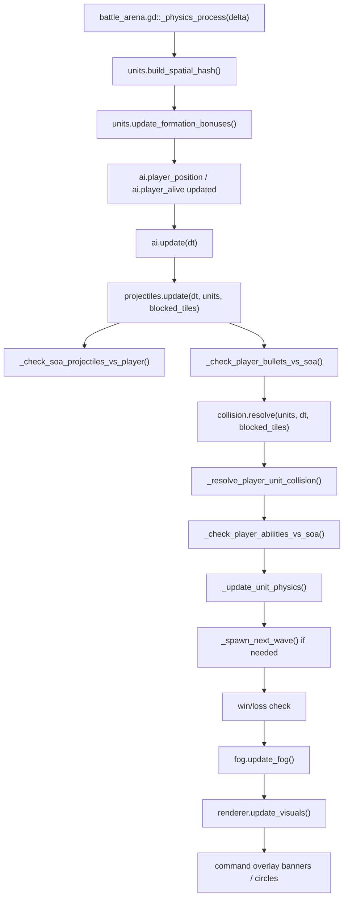
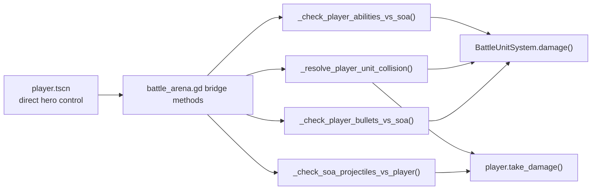

# Frame Loop And Runtime Bridges

## Purpose

The battle scene frame loop is the integration point where:

- SoA simulation advances
- AI updates every unit
- projectiles resolve
- collision resolves
- player hero interacts with the SoA battle
- renderer and fog consume the latest state

## Frame Loop

## Player Bridge

## Related Files

- [battle_arena.gd](/Users/developer-cloudprimero/Desktop/Godot/new-game-project/scripts/battle/battle_arena.gd)
- [battle_projectile_system.gd](/Users/developer-cloudprimero/Desktop/Godot/new-game-project/scripts/battle/battle_projectile_system.gd)
- [battle_collision.gd](/Users/developer-cloudprimero/Desktop/Godot/new-game-project/scripts/battle/battle_collision.gd)
- [battle_renderer.gd](/Users/developer-cloudprimero/Desktop/Godot/new-game-project/scripts/battle/battle_renderer.gd)
- [battle_fog_of_war.gd](/Users/developer-cloudprimero/Desktop/Godot/new-game-project/scripts/battle/battle_fog_of_war.gd)
- [player.gd](/Users/developer-cloudprimero/Desktop/Godot/new-game-project/scripts/player.gd)

## Inputs

- frame delta
- blocked terrain tile map
- current player position
- current camera mode
- projectile arrays
- unit arrays

## Outputs

- updated SoA positions
- updated SoA health and morale
- player damage or knockback
- visual state for renderer and fog
- battle result transitions

## Key Functions

- `battle_arena.gd::_physics_process()`
- `battle_arena.gd::_update_unit_physics()`
- `battle_arena.gd::_resolve_player_unit_collision()`
- `battle_arena.gd::_check_player_bullets_vs_soa()`
- `battle_arena.gd::_check_soa_projectiles_vs_player()`
- `battle_arena.gd::_check_player_abilities_vs_soa()`
- `battle_projectile_system.gd::update()`
- `battle_renderer.gd::update_visuals()`
- `battle_fog_of_war.gd::update_fog()`
