# RTS Battle Refactor Targets

## Current Pressure Points

The commanding mode and enemy AI are workable, but the boundaries are still too wide.

The main pressure points are:

- [battle_arena.gd](/Users/developer-cloudprimero/Desktop/Godot/new-game-project/scripts/battle/battle_arena.gd)
- [battle_simple_ai.gd](/Users/developer-cloudprimero/Desktop/Godot/new-game-project/scripts/battle/battle_simple_ai.gd)
- [battle_command_overlay.gd](/Users/developer-cloudprimero/Desktop/Godot/new-game-project/scripts/battle/battle_command_overlay.gd)

## Refactor Map

```mermaid
flowchart TD
    BA["battle_arena.gd
    current monolith"] --> SETUP["battle/setup/battle_bootstrap.gd"]
    BA --> TERRAIN["battle/setup/battle_terrain_loader.gd"]
    BA --> SPAWN["battle/setup/battle_spawn_system.gd"]
    BA --> LOOP["battle/runtime/battle_runtime_loop.gd"]
    BA --> BRIDGE["battle/runtime/player_soa_bridge.gd"]
    BA --> RESULT["battle/results/battle_resolution.gd"]
    BA --> CAMERA["battle/ui/battle_camera_controller.gd"]

    AI["battle_simple_ai.gd
    current monolith"] --> STRAT["battle/ai/strategy_planner.gd"]
    AI --> PHASE["battle/ai/army_phase_controller.gd"]
    AI --> TACT["battle/ai/tactical_assessor.gd"]
    AI --> MOVE["battle/ai/unit_motion_driver.gd"]
    AI --> COMBAT["battle/ai/unit_combat_driver.gd"]
    AI --> MORALE["battle/ai/morale_system.gd"]
    AI --> ABIL["battle/ai/ability_driver.gd"]

    CMD["battle_command_overlay.gd"] --> SEL["battle/ui/selection_controller.gd"]
    CMD --> PAN["battle/ui/group_panel.gd"]
    CMD --> BANNERS["battle/ui/banner_renderer.gd"]
    CMD --> ORDERS["battle/ui/order_dispatch.gd"]
```

## Minimal Safe Split Order

1. `battle_arena.gd`
   - extract terrain loading
   - extract spawn/group creation
   - extract player bridge methods

2. `battle_command_overlay.gd`
   - extract selection logic
   - extract panel UI
   - extract banner rendering

3. `battle_simple_ai.gd`
   - extract army phase logic
   - extract morale/leadership
   - extract per-unit movement + targeting
   - extract ability firing logic

## Why This Helps

- command mode gets easier to reason about without reading the whole battle scene
- enemy AI changes stop risking unrelated player-bridge bugs
- spawn/group setup becomes reusable for future battle types
- overlays and selection can evolve without touching AI

## Code Reading Shortcuts

If you are reviewing a command-mode bug, read only:

- [02_COMMAND_MODE.md](/Users/developer-cloudprimero/Desktop/Godot/new-game-project/docs/mermaid/battle_rts/02_COMMAND_MODE.md)
- [battle_command_overlay.gd](/Users/developer-cloudprimero/Desktop/Godot/new-game-project/scripts/battle/battle_command_overlay.gd)
- [battle_arena.gd](/Users/developer-cloudprimero/Desktop/Godot/new-game-project/scripts/battle/battle_arena.gd) around `_toggle_command_mode()` and `_on_command_issued()`

If you are reviewing enemy tactical behavior, read only:

- [04_ENEMY_AI.md](/Users/developer-cloudprimero/Desktop/Godot/new-game-project/docs/mermaid/battle_rts/04_ENEMY_AI.md)
- [battle_simple_ai.gd](/Users/developer-cloudprimero/Desktop/Godot/new-game-project/scripts/battle/battle_simple_ai.gd)
- [battle_commander.gd](/Users/developer-cloudprimero/Desktop/Godot/new-game-project/scripts/battle/battle_commander.gd)
- [battle_unit_system.gd](/Users/developer-cloudprimero/Desktop/Godot/new-game-project/scripts/battle/battle_unit_system.gd)
