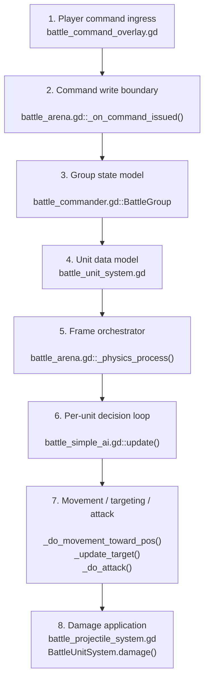

# RTS AI Reading Guide

## Purpose

This is the code-reading entrypoint for the RTS battle stack.

Read this system in this order:

1. command ingress
2. group state
3. unit state
4. per-frame battle loop
5. per-unit AI loop
6. projectile and player bridge

## Reading Order

## Exact Files To Read

- [battle_command_overlay.gd](/Users/developer-cloudprimero/Desktop/Godot/new-game-project/scripts/battle/battle_command_overlay.gd)
- [battle_arena.gd](/Users/developer-cloudprimero/Desktop/Godot/new-game-project/scripts/battle/battle_arena.gd)
- [battle_commander.gd](/Users/developer-cloudprimero/Desktop/Godot/new-game-project/scripts/battle/battle_commander.gd)
- [battle_unit_system.gd](/Users/developer-cloudprimero/Desktop/Godot/new-game-project/scripts/battle/battle_unit_system.gd)
- [battle_simple_ai.gd](/Users/developer-cloudprimero/Desktop/Godot/new-game-project/scripts/battle/battle_simple_ai.gd)
- [battle_projectile_system.gd](/Users/developer-cloudprimero/Desktop/Godot/new-game-project/scripts/battle/battle_projectile_system.gd)

## Exact Function Order

### 1. Command ingress

- [battle_command_overlay.gd](/Users/developer-cloudprimero/Desktop/Godot/new-game-project/scripts/battle/battle_command_overlay.gd): `_input()`
- [battle_command_overlay.gd](/Users/developer-cloudprimero/Desktop/Godot/new-game-project/scripts/battle/battle_command_overlay.gd): `_issue_command_to_selection()`

### 2. Command write boundary

- [battle_arena.gd#L1162](/Users/developer-cloudprimero/Desktop/Godot/new-game-project/scripts/battle/battle_arena.gd#L1162): `_on_command_issued()`

### 3. Group model

- [battle_commander.gd#L9](/Users/developer-cloudprimero/Desktop/Godot/new-game-project/scripts/battle/battle_commander.gd#L9): `BattleGroup`
- [battle_commander.gd#L27](/Users/developer-cloudprimero/Desktop/Godot/new-game-project/scripts/battle/battle_commander.gd#L27): `create_group()`

### 4. Unit state

- [battle_unit_system.gd#L1](/Users/developer-cloudprimero/Desktop/Godot/new-game-project/scripts/battle/battle_unit_system.gd#L1): enums and stat tables
- [battle_unit_system.gd#L151](/Users/developer-cloudprimero/Desktop/Godot/new-game-project/scripts/battle/battle_unit_system.gd#L151): SoA arrays
- [battle_unit_system.gd#L273](/Users/developer-cloudprimero/Desktop/Godot/new-game-project/scripts/battle/battle_unit_system.gd#L273): `spawn()`
- [battle_unit_system.gd#L340](/Users/developer-cloudprimero/Desktop/Godot/new-game-project/scripts/battle/battle_unit_system.gd#L340): `damage()`

### 5. Frame loop

- [battle_arena.gd#L1192](/Users/developer-cloudprimero/Desktop/Godot/new-game-project/scripts/battle/battle_arena.gd#L1192): `_physics_process()`

### 6. AI loop

- [battle_simple_ai.gd#L281](/Users/developer-cloudprimero/Desktop/Godot/new-game-project/scripts/battle/battle_simple_ai.gd#L281): `update()`
- [battle_simple_ai.gd#L2179](/Users/developer-cloudprimero/Desktop/Godot/new-game-project/scripts/battle/battle_simple_ai.gd#L2179): `_do_movement_toward_pos()`
- [battle_simple_ai.gd#L2283](/Users/developer-cloudprimero/Desktop/Godot/new-game-project/scripts/battle/battle_simple_ai.gd#L2283): `_do_attack()`
- [battle_simple_ai.gd#L2482](/Users/developer-cloudprimero/Desktop/Godot/new-game-project/scripts/battle/battle_simple_ai.gd#L2482): `_update_morale()`

## High Stakes Reading Pass

If you only read five things, read:

1. [battle_arena.gd#L1192](/Users/developer-cloudprimero/Desktop/Godot/new-game-project/scripts/battle/battle_arena.gd#L1192)
2. [battle_simple_ai.gd#L281](/Users/developer-cloudprimero/Desktop/Godot/new-game-project/scripts/battle/battle_simple_ai.gd#L281)
3. [battle_simple_ai.gd#L2179](/Users/developer-cloudprimero/Desktop/Godot/new-game-project/scripts/battle/battle_simple_ai.gd#L2179)
4. [battle_simple_ai.gd#L2283](/Users/developer-cloudprimero/Desktop/Godot/new-game-project/scripts/battle/battle_simple_ai.gd#L2283)
5. [battle_unit_system.gd#L340](/Users/developer-cloudprimero/Desktop/Godot/new-game-project/scripts/battle/battle_unit_system.gd#L340)

## What To Notice

- The command overlay does not own tactics. It only writes group intent.
- `BattleGroup` is the command contract between UI and AI.
- `BattleUnitSystem` is the truth for live unit state.
- `battle_arena.gd` is the orchestrator and bridge layer.
- `battle_simple_ai.gd` mixes strategic AI, unit behavior, morale, abilities, and formation control.
