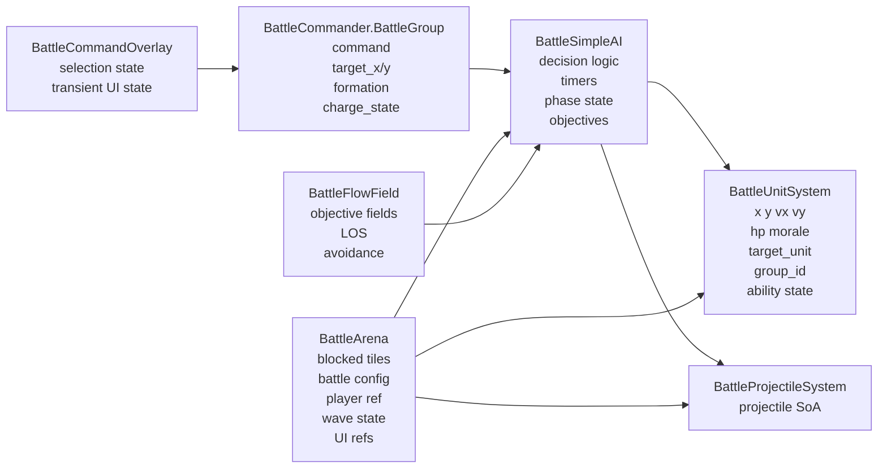
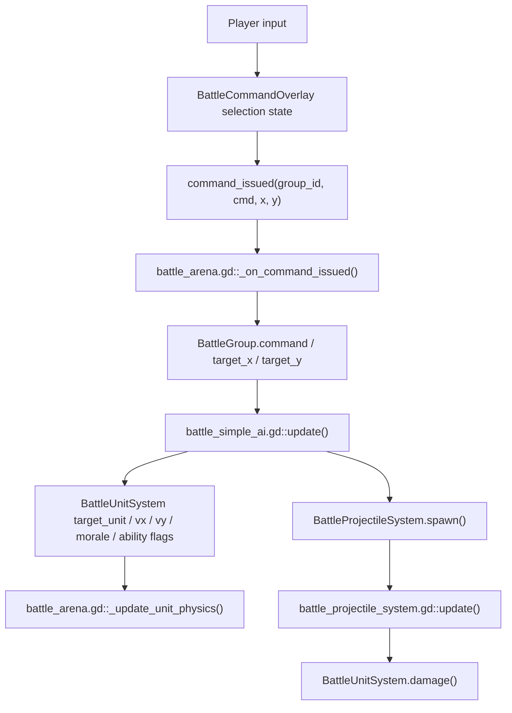
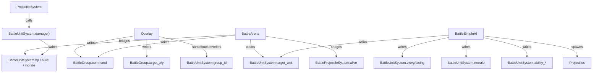

# RTS State And Data Flow

## Purpose

This file answers one question: where does the state live, and who mutates it?

## State Ownership

## Data Flow

## Primary Data Carriers

### Group intent

- [battle_commander.gd#L9](/Users/developer-cloudprimero/Desktop/Godot/new-game-project/scripts/battle/battle_commander.gd#L9)
- fields:
  - `command`
  - `target_group_id`
  - `formation_type`
  - `target_x`
  - `target_y`
  - `charge_state`
  - `initial_size`

### Unit runtime state

- [battle_unit_system.gd#L151](/Users/developer-cloudprimero/Desktop/Godot/new-game-project/scripts/battle/battle_unit_system.gd#L151)
- high-value arrays:
  - `x`, `y`, `vx`, `vy`
  - `group_id`
  - `target_unit`
  - `morale`
  - `ability_cooldown`, `ability_timer`, `ability_active`
  - `is_commander`, `commander_debuff_timer`
  - `formation_bonus_active`, `group_formation`
  - `charge_time`
  - `scatter_time`, `saved_group_id`

### Arena-owned external state

- [battle_arena.gd#L47](/Users/developer-cloudprimero/Desktop/Godot/new-game-project/scripts/battle/battle_arena.gd#L47)
- high-value fields:
  - `units`
  - `projectiles`
  - `commander`
  - `ai`
  - `_blocked_tiles`
  - `_config`
  - `command_mode`
  - `_pending_red_waves`

### AI-owned strategic state

- [battle_simple_ai.gd#L14](/Users/developer-cloudprimero/Desktop/Godot/new-game-project/scripts/battle/battle_simple_ai.gd#L14)
- high-value fields:
  - `_battle_time`
  - `_retarget_timer`
  - `_strategy_timer`
  - `_army_phase`
  - `red_objective`, `blue_objective`
  - `player_position`, `player_alive`
  - `_blue_cavalry_ratio`, `_blue_heavy_ratio`

## Mutation Map

## High Stakes State

These are the fields that connect multiple subsystems and are easiest to break:

- `BattleGroup.command`
- `BattleGroup.target_x / target_y`
- `BattleUnitSystem.group_id`
- `BattleUnitSystem.target_unit`
- `BattleUnitSystem.morale`
- `BattleUnitSystem.ability_active`
- `BattleUnitSystem.group_formation`
- `BattleProjectileSystem.source_formation`

If you change those, read the AI loop and arena frame loop again before committing.
