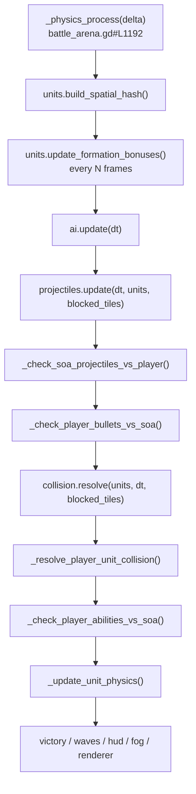
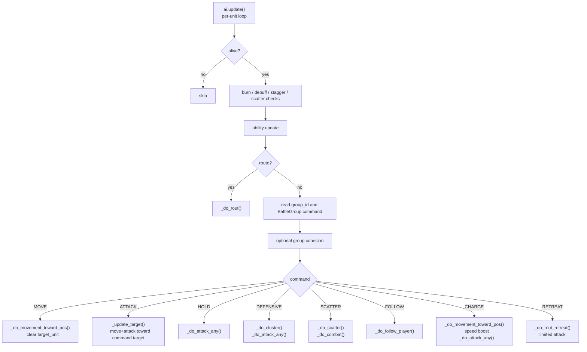
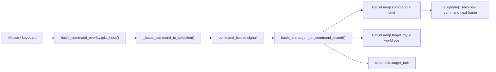
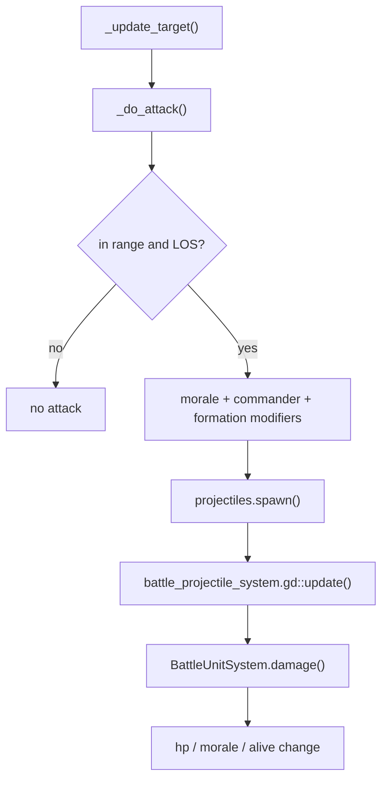
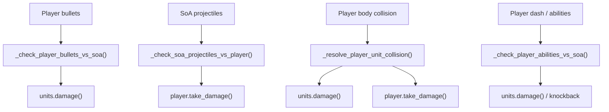

# RTS Control Flow

## Purpose

This file shows how control actually moves through the battle code each frame.

## Top Level Frame Flow

## Per-Unit Decision Flow

## Command Ingress Flow

## Attack Flow

## Player Bridge Flow

## Exact Control Hubs

- [battle_arena.gd#L1192](/Users/developer-cloudprimero/Desktop/Godot/new-game-project/scripts/battle/battle_arena.gd#L1192): frame orchestrator
- [battle_simple_ai.gd#L281](/Users/developer-cloudprimero/Desktop/Godot/new-game-project/scripts/battle/battle_simple_ai.gd#L281): AI root
- [battle_simple_ai.gd#L428](/Users/developer-cloudprimero/Desktop/Godot/new-game-project/scripts/battle/battle_simple_ai.gd#L428): command dispatch
- [battle_simple_ai.gd#L2179](/Users/developer-cloudprimero/Desktop/Godot/new-game-project/scripts/battle/battle_simple_ai.gd#L2179): movement hub
- [battle_simple_ai.gd#L2283](/Users/developer-cloudprimero/Desktop/Godot/new-game-project/scripts/battle/battle_simple_ai.gd#L2283): attack hub

## Reading Advice

When the behavior is surprising, ask these questions in order:

1. what command was written into `BattleGroup`?
2. what did `ai.update()` do with that command?
3. what state did it write into `BattleUnitSystem`?
4. what did the frame loop do after that?
