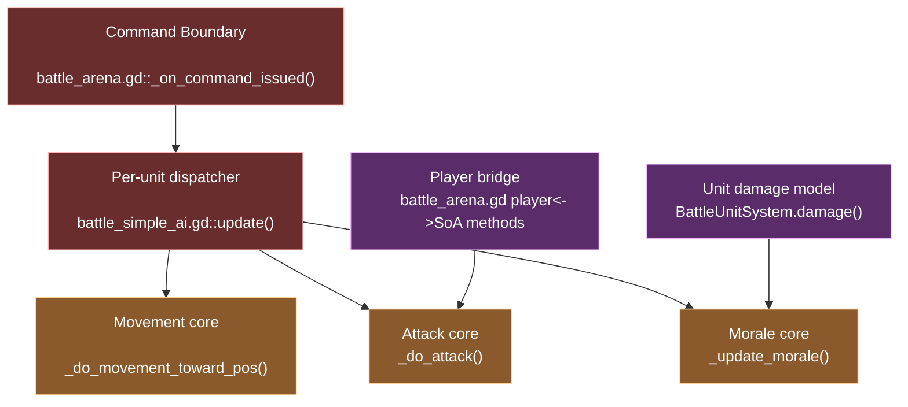

# RTS High Stakes Zones

## Purpose

These are the parts of the RTS battle code that have the highest break risk.

## Risk Map

## Zone 1: Command Boundary

Primary code:

- [battle_arena.gd#L1162](/Users/developer-cloudprimero/Desktop/Godot/new-game-project/scripts/battle/battle_arena.gd#L1162)
- [battle_command_overlay.gd#L419](/Users/developer-cloudprimero/Desktop/Godot/new-game-project/scripts/battle/battle_command_overlay.gd#L419)

Why it is high stakes:

- this is where UI intent becomes simulation state
- it clears `units.target_unit`
- every unit in a group depends on this reset working correctly

What breaks if you get it wrong:

- units ignore new orders
- units keep attacking old targets after a move order
- player commands look accepted but do nothing

## Zone 2: Per-Unit Command Dispatcher

Primary code:

- [battle_simple_ai.gd#L281](/Users/developer-cloudprimero/Desktop/Godot/new-game-project/scripts/battle/battle_simple_ai.gd#L281)
- [battle_simple_ai.gd#L428](/Users/developer-cloudprimero/Desktop/Godot/new-game-project/scripts/battle/battle_simple_ai.gd#L428)

Why it is high stakes:

- every command path converges here
- morale, stagger, scatter, routing, command handling, and ability updates all share one loop

What breaks if you get it wrong:

- one command mode regresses another
- route logic masks attack logic
- cohesion fights MOVE
- follow/retreat/charge become inconsistent

## Zone 3: Movement Core

Primary code:

- [battle_simple_ai.gd#L2179](/Users/developer-cloudprimero/Desktop/Godot/new-game-project/scripts/battle/battle_simple_ai.gd#L2179)
- [battle_flow_field.gd](/Users/developer-cloudprimero/Desktop/Godot/new-game-project/scripts/battle/battle_flow_field.gd)

Why it is high stakes:

- blends direct target movement, flow fields, local avoidance, formation speed, morale speed, and ranged kiting

What breaks if you get it wrong:

- player-issued move orders get overridden by objective flow
- ranged units collapse into melee
- units jam on walls
- cavalry charge pacing breaks

## Zone 4: Attack Core

Primary code:

- [battle_simple_ai.gd#L2283](/Users/developer-cloudprimero/Desktop/Godot/new-game-project/scripts/battle/battle_simple_ai.gd#L2283)
- [battle_projectile_system.gd](/Users/developer-cloudprimero/Desktop/Godot/new-game-project/scripts/battle/battle_projectile_system.gd)
- [battle_unit_system.gd#L340](/Users/developer-cloudprimero/Desktop/Godot/new-game-project/scripts/battle/battle_unit_system.gd#L340)

Why it is high stakes:

- damage is spread across AI, projectile system, and unit system
- morale, commander aura, line formation, charge momentum, and LOS all modify attack behavior

What breaks if you get it wrong:

- DPS shifts unexpectedly
- ranged fire through walls
- cavalry loses its identity
- formation bonuses stop mattering

## Zone 5: Morale And Leadership

Primary code:

- [battle_simple_ai.gd#L547](/Users/developer-cloudprimero/Desktop/Godot/new-game-project/scripts/battle/battle_simple_ai.gd#L547)
- [battle_simple_ai.gd#L2482](/Users/developer-cloudprimero/Desktop/Godot/new-game-project/scripts/battle/battle_simple_ai.gd#L2482)
- [battle_unit_system.gd#L421](/Users/developer-cloudprimero/Desktop/Godot/new-game-project/scripts/battle/battle_unit_system.gd#L421)

Why it is high stakes:

- morale gates speed, attacks, hesitation, routing, cascades, and recovery
- commander death debuff connects leadership to raw combat math

What breaks if you get it wrong:

- battles never rout
- units route too early
- leadership bonuses feel invisible
- late battle cleanup becomes sloggy or trivial

## Zone 6: Player Bridge

Primary code:

- [battle_arena.gd#L1751](/Users/developer-cloudprimero/Desktop/Godot/new-game-project/scripts/battle/battle_arena.gd#L1751)
- [battle_arena.gd#L1816](/Users/developer-cloudprimero/Desktop/Godot/new-game-project/scripts/battle/battle_arena.gd#L1816)
- [battle_arena.gd#L1862](/Users/developer-cloudprimero/Desktop/Godot/new-game-project/scripts/battle/battle_arena.gd#L1862)
- [battle_arena.gd#L1891](/Users/developer-cloudprimero/Desktop/Godot/new-game-project/scripts/battle/battle_arena.gd#L1891)

Why it is high stakes:

- this is where classic player combat crosses into SoA battle simulation
- if this is wrong, the player feels detached from the battle or overpowered inside it

What breaks if you get it wrong:

- player bullets miss visible enemies
- SoA projectiles do not damage the player
- dash/AoE interactions desync from unit state

## Safest Reading Strategy

If you want to understand the battle system without changing it yet:

1. read the command boundary
2. read the AI dispatcher
3. read movement core
4. read attack core
5. only then read morale and player bridge
