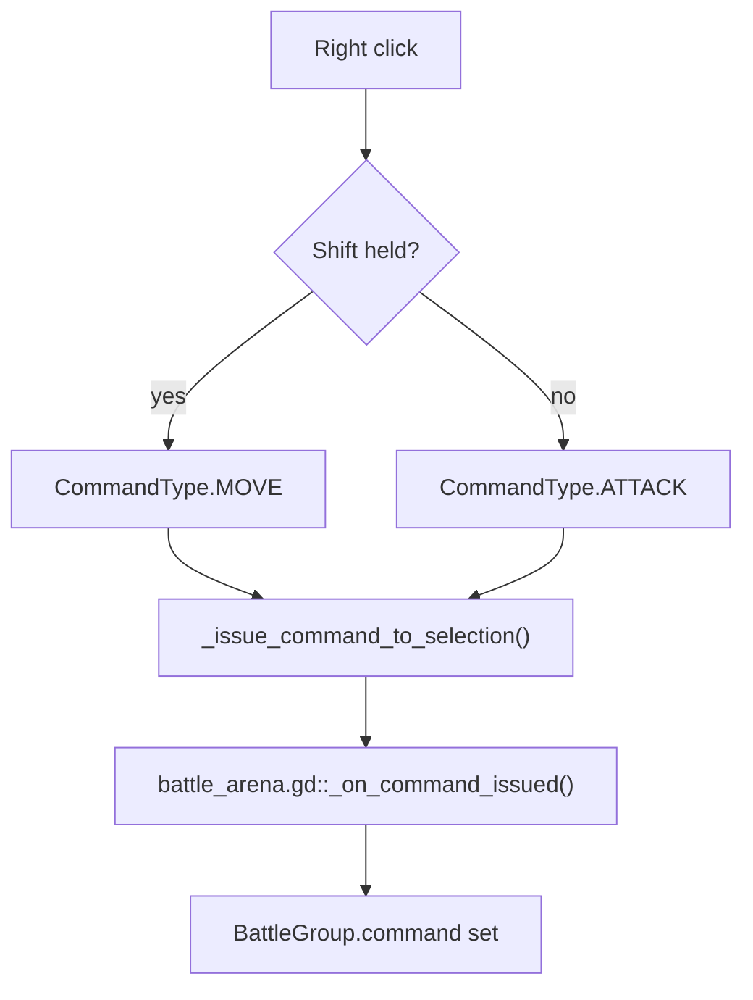
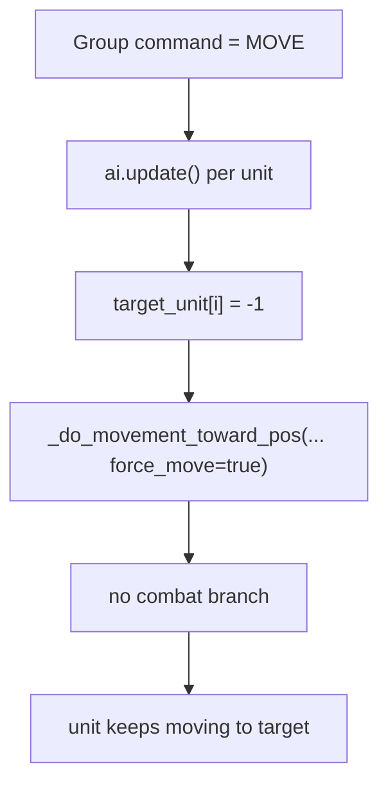
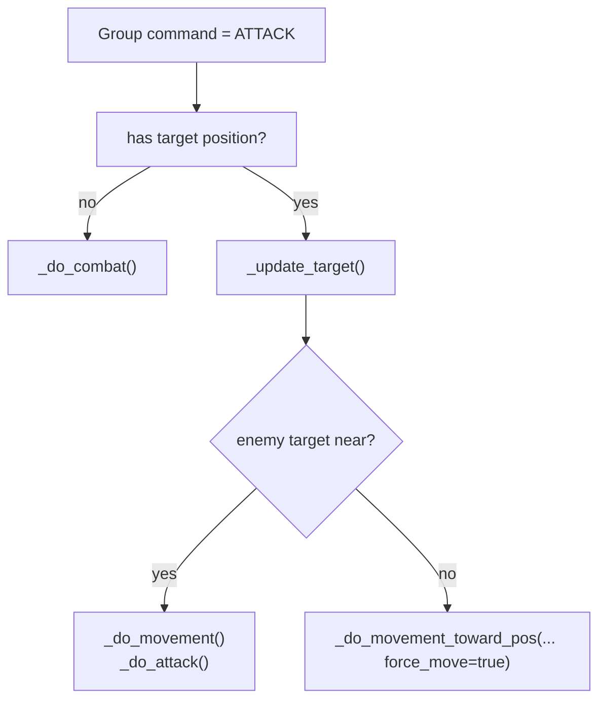
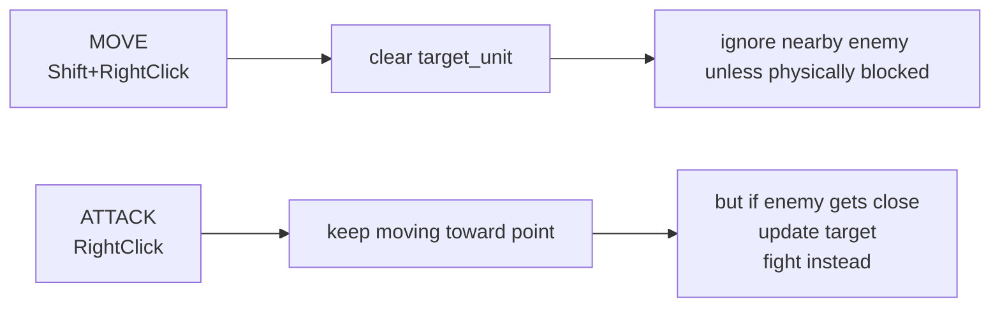
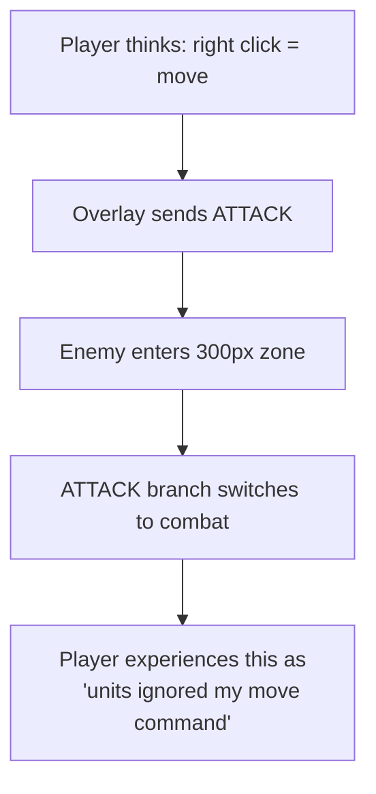
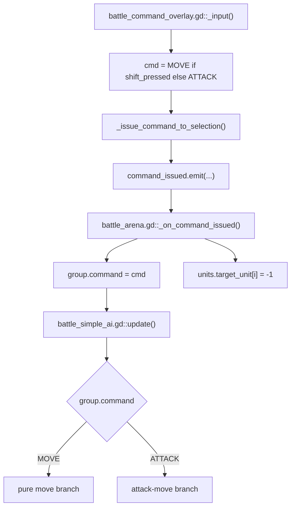

# RTS Command Compliance

## Purpose

This file explains why units appear to ignore move commands when enemies get close.

The short version:

- plain right-click is `ATTACK`, not `MOVE`
- only `Shift+RightClick` is pure `MOVE`
- `ATTACK` is attack-move and intentionally breaks into combat near enemies

## Input To Command Mapping

Primary code:

- [battle_command_overlay.gd#L522](/Users/developer-cloudprimero/Desktop/Godot/new-game-project/scripts/battle/battle_command_overlay.gd#L522)

## What `MOVE` Actually Does

Primary code:

- [battle_simple_ai.gd#L428](/Users/developer-cloudprimero/Desktop/Godot/new-game-project/scripts/battle/battle_simple_ai.gd#L428)

Key behavior:

- target is cleared every frame
- cohesion is skipped during `MOVE`
- the unit is supposed to disengage and keep moving

## What `ATTACK` Actually Does

Primary code:

- [battle_simple_ai.gd#L456](/Users/developer-cloudprimero/Desktop/Godot/new-game-project/scripts/battle/battle_simple_ai.gd#L456)

This is the key branch:

- if enemy gets within roughly `300px`, attack-move switches to combat behavior
- that is why units appear to stop obeying the order

## Command Behavior Comparison

## Why The Current UX Is Confusing

## Mixed Selection Gotcha

If you select a loose set of units from different groups, the overlay does not command those units individually.

It commands every existing group represented in the selection.

Primary code:

- [battle_command_overlay.gd#L657](/Users/developer-cloudprimero/Desktop/Godot/new-game-project/scripts/battle/battle_command_overlay.gd#L657)

That means:

- selecting 3 units from group A and 2 from group B sends the command to group A and group B
- it does not create a temporary task force
- this can also make command response feel broader than expected

## Exact Code Path

## Reading Anchors

- [battle_command_overlay.gd#L522](/Users/developer-cloudprimero/Desktop/Godot/new-game-project/scripts/battle/battle_command_overlay.gd#L522)
- [battle_command_overlay.gd#L657](/Users/developer-cloudprimero/Desktop/Godot/new-game-project/scripts/battle/battle_command_overlay.gd#L657)
- [battle_arena.gd#L1162](/Users/developer-cloudprimero/Desktop/Godot/new-game-project/scripts/battle/battle_arena.gd#L1162)
- [battle_simple_ai.gd#L428](/Users/developer-cloudprimero/Desktop/Godot/new-game-project/scripts/battle/battle_simple_ai.gd#L428)
- [battle_simple_ai.gd#L2179](/Users/developer-cloudprimero/Desktop/Godot/new-game-project/scripts/battle/battle_simple_ai.gd#L2179)

## Likely User-Facing Fixes

If you want this to feel less confusing later, the best options are:

1. Make plain right-click pure `MOVE`, and use another gesture for attack-move.
2. Keep the current controls, but show a stronger on-screen hint: `RightClick = Attack-Move`, `Shift+RightClick = Move`.
3. Give `ATTACK` and `MOVE` distinct cursor decals or destination markers.
4. Allow loose selections to become temporary task-force groups instead of broadcasting to all source groups.
