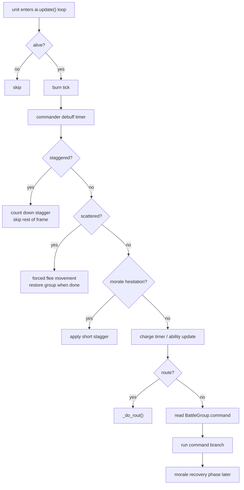
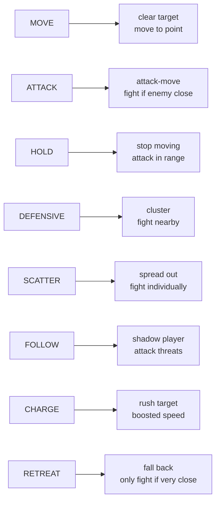
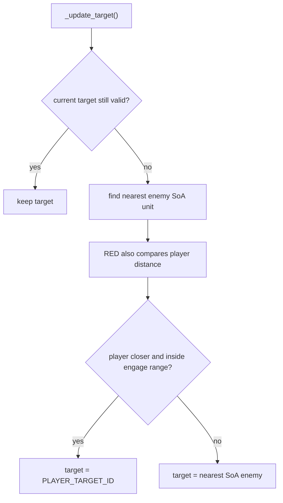
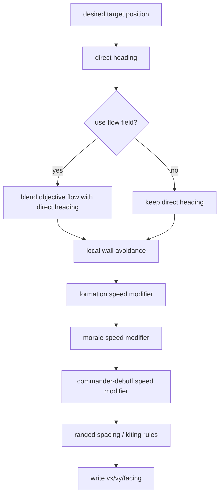
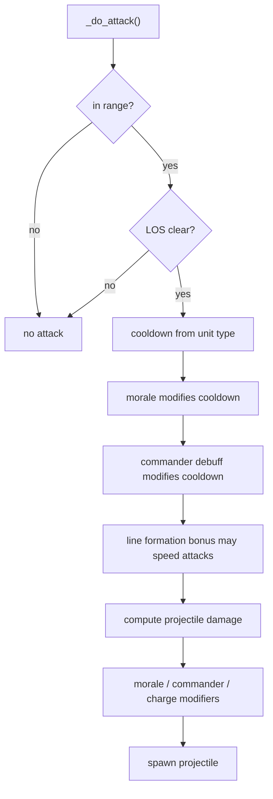
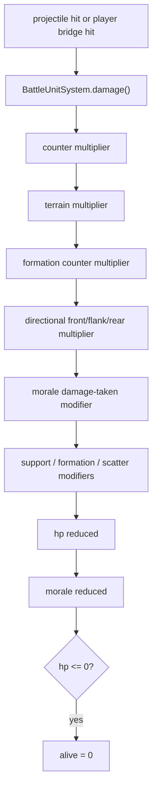

# RTS Unit Runtime Behavior

## Purpose

This file explains what one battle unit actually does during the AI update loop.

## Per-Unit Tick

Primary code:

- [battle_simple_ai.gd#L281](/Users/developer-cloudprimero/Desktop/Godot/new-game-project/scripts/battle/battle_simple_ai.gd#L281)

## Command Branches

Primary code:

- [battle_simple_ai.gd#L428](/Users/developer-cloudprimero/Desktop/Godot/new-game-project/scripts/battle/battle_simple_ai.gd#L428)

## Targeting Logic

Primary code:

- [battle_simple_ai.gd#L2044](/Users/developer-cloudprimero/Desktop/Godot/new-game-project/scripts/battle/battle_simple_ai.gd#L2044)

## Movement Composition

Primary code:

- [battle_simple_ai.gd#L2179](/Users/developer-cloudprimero/Desktop/Godot/new-game-project/scripts/battle/battle_simple_ai.gd#L2179)

## Attack Composition

Primary code:

- [battle_simple_ai.gd#L2283](/Users/developer-cloudprimero/Desktop/Godot/new-game-project/scripts/battle/battle_simple_ai.gd#L2283)

## Damage And Morale Flow

Primary code:

- [battle_unit_system.gd#L340](/Users/developer-cloudprimero/Desktop/Godot/new-game-project/scripts/battle/battle_unit_system.gd#L340)

## What Your Units Were Doing In The Logged Battle

Based on your log:

- BLUE heavy infantry were mostly a slow durable front line.
- BLUE horse archers were mobile ranged units likely getting targeted by RED archers and infantry pressure.
- RED had no cavalry, so its behavior was mostly infantry line pressure plus ranged support.
- RED phase control looked partially bypassed because it started in `ENGAGED` immediately.
- Your own command logs show several manual `HOLD`, `ATTACK`, and `SCATTER` commands being written into BLUE groups.

## Reading Anchors

- [battle_simple_ai.gd#L281](/Users/developer-cloudprimero/Desktop/Godot/new-game-project/scripts/battle/battle_simple_ai.gd#L281)
- [battle_simple_ai.gd#L428](/Users/developer-cloudprimero/Desktop/Godot/new-game-project/scripts/battle/battle_simple_ai.gd#L428)
- [battle_simple_ai.gd#L2044](/Users/developer-cloudprimero/Desktop/Godot/new-game-project/scripts/battle/battle_simple_ai.gd#L2044)
- [battle_simple_ai.gd#L2179](/Users/developer-cloudprimero/Desktop/Godot/new-game-project/scripts/battle/battle_simple_ai.gd#L2179)
- [battle_simple_ai.gd#L2283](/Users/developer-cloudprimero/Desktop/Godot/new-game-project/scripts/battle/battle_simple_ai.gd#L2283)
- [battle_unit_system.gd#L340](/Users/developer-cloudprimero/Desktop/Godot/new-game-project/scripts/battle/battle_unit_system.gd#L340)
