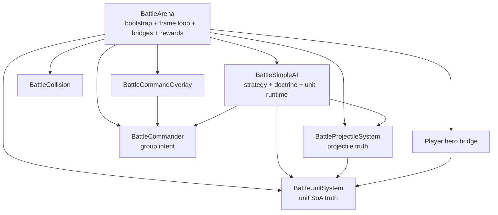

# RTS AI Code Review

## Findings

### High

- [battle_simple_ai.gd](/Users/developer-cloudprimero/Desktop/Godot/new-game-project/scripts/battle/battle_simple_ai.gd) is not one subsystem. It combines strategic planning, phase control, per-group doctrine, per-unit movement, targeting, abilities, morale, and some combat behavior. That makes the tactical layer hard to debug and easy to regress.
- [battle_arena.gd](/Users/developer-cloudprimero/Desktop/Godot/new-game-project/scripts/battle/battle_arena.gd) is both scene bootstrapper and runtime integration hub. It also owns the player bridge, rewards, persistence consequences, wave logic, command-mode camera logic, and terrain extraction.
- Command semantics are easy for the player to misread. Plain right-click is `ATTACK` attack-move, not pure move. The code is consistent, but the UX makes it feel like units are disobeying orders when they are actually switching into combat intentionally.
- The battle phase machine appears to have an initialization or transition problem. In the provided log, RED starts at `ENGAGED` immediately, which bypasses the intended `STAGING -> ADVANCE -> APPROACH -> ENGAGED` structure in [battle_simple_ai.gd#L1628](/Users/developer-cloudprimero/Desktop/Godot/new-game-project/scripts/battle/battle_simple_ai.gd#L1628).

### Medium

- Targeting and movement are spread across multiple layers:
  - group intent in [battle_commander.gd](/Users/developer-cloudprimero/Desktop/Godot/new-game-project/scripts/battle/battle_commander.gd)
  - unit state in [battle_unit_system.gd](/Users/developer-cloudprimero/Desktop/Godot/new-game-project/scripts/battle/battle_unit_system.gd)
  - movement logic in [battle_simple_ai.gd](/Users/developer-cloudprimero/Desktop/Godot/new-game-project/scripts/battle/battle_simple_ai.gd)
  - wall and overlap resolution in [battle_collision.gd](/Users/developer-cloudprimero/Desktop/Godot/new-game-project/scripts/battle/battle_collision.gd) and [battle_arena.gd#L1359](/Users/developer-cloudprimero/Desktop/Godot/new-game-project/scripts/battle/battle_arena.gd#L1359)
- The player hero is not a first-class participant in the SoA simulation. [battle_arena.gd](/Users/developer-cloudprimero/Desktop/Godot/new-game-project/scripts/battle/battle_arena.gd) manually bridges bullets, collisions, dash damage, and incoming projectiles both ways.
- Loose selection broadcasts commands to all represented groups instead of creating temporary battlegroups. This preserves permanent groups, but it can make command response broader than expected.

### Low

- Performance is good enough right now. Your logs show AI generally around `3-5ms`, which means readability and correctness are the current bottlenecks, not raw speed.
- The subsystem already has good conceptual separations on paper: commander model, unit SoA, projectile SoA, renderer, fog, flow field. The problem is orchestration and control coupling, not absence of domains.

## Architecture Assessment

Judgment:

- the system is runtime-monolithic but conceptually recoverable
- the best refactor path is extraction by responsibility, not rewriting battle logic from scratch

## Why The RTS Layer Feels Hard To Read

1. one file decides too many things at once
- [battle_simple_ai.gd](/Users/developer-cloudprimero/Desktop/Godot/new-game-project/scripts/battle/battle_simple_ai.gd)

2. one file integrates too many systems at once
- [battle_arena.gd](/Users/developer-cloudprimero/Desktop/Godot/new-game-project/scripts/battle/battle_arena.gd)

3. command intent and unit behavior are separated across four files
- [battle_command_overlay.gd](/Users/developer-cloudprimero/Desktop/Godot/new-game-project/scripts/battle/battle_command_overlay.gd)
- [battle_arena.gd](/Users/developer-cloudprimero/Desktop/Godot/new-game-project/scripts/battle/battle_arena.gd)
- [battle_commander.gd](/Users/developer-cloudprimero/Desktop/Godot/new-game-project/scripts/battle/battle_commander.gd)
- [battle_simple_ai.gd](/Users/developer-cloudprimero/Desktop/Godot/new-game-project/scripts/battle/battle_simple_ai.gd)

## Major Risks

### Command Risk

- source of confusion: `RightClick = ATTACK`, `Shift+RightClick = MOVE`
- doc: [12_COMMAND_COMPLIANCE.md](/Users/developer-cloudprimero/Desktop/Godot/new-game-project/docs/mermaid/battle_rts/12_COMMAND_COMPLIANCE.md)

### Phase Risk

- likely bug: starting in `ENGAGED` too early
- source: [battle_simple_ai.gd#L156](/Users/developer-cloudprimero/Desktop/Godot/new-game-project/scripts/battle/battle_simple_ai.gd#L156), [battle_simple_ai.gd#L1628](/Users/developer-cloudprimero/Desktop/Godot/new-game-project/scripts/battle/battle_simple_ai.gd#L1628)

### Player Bridge Risk

- player interactions live outside the unit SoA proper
- source: [battle_arena.gd#L1751](/Users/developer-cloudprimero/Desktop/Godot/new-game-project/scripts/battle/battle_arena.gd#L1751)

### Refactor Risk

- `BattleGroup.command`, `BattleGroup.target_x/y`, `BattleUnitSystem.target_unit`, and `BattleUnitSystem.group_id` are the most cross-cutting fields in the system

## What Should Be Extracted First

1. `battle_simple_ai.gd`
- split into:
  - army phase controller
  - strategic reassessment
  - command executor
  - movement driver
  - attack driver
  - morale system
  - ability system

2. `battle_arena.gd`
- split into:
  - battle bootstrap/setup
  - battle runtime loop
  - battle outcome service
  - player bridge
  - command mode controller

3. `battle_command_overlay.gd`
- split into:
  - selection model
  - command UI
  - banner/circle presentation

## Review Summary

The RTS battle code is functional and fairly rich, but it is too centralized. The fastest path back to readability is not “read everything.” It is:

1. read command ingress
2. read frame loop
3. read unit runtime
4. read movement core
5. read attack core
6. read phase logic

That is why the rest of this doc pack is organized around those seams.
