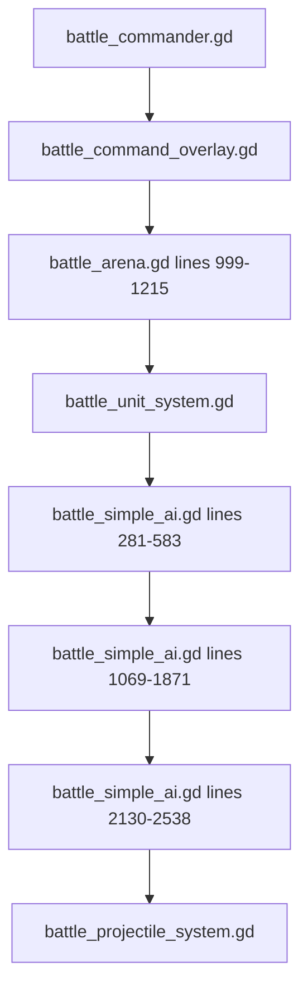

# Major File Walkthrough

## Purpose

This is the line-by-line reading guide by section for the major RTS battle files.

It does not paraphrase every single line literally. It tells you what each line block is responsible for, so you can open the source and read it in controlled chunks.

## 1. battle_arena.gd

File:

- [battle_arena.gd](/Users/developer-cloudprimero/Desktop/Godot/new-game-project/scripts/battle/battle_arena.gd)

### Lines 1-141

- scene-level constants
- references to runtime systems
- references to UI, player, terrain, wave state, camera, performance counters
- this block defines almost the entire battle scene state surface

### Lines 142-236

- `_ready()`
- constructs core systems
- loads battle config from `GameManager`
- prepares terrain
- spawns player and camera
- creates HUD and command overlay
- wires player bullet scaling and scene boot timing

### Lines 237-378

- region setup and player spawn
- terrain layer preparation
- chunk discovery and deferred loading setup

### Lines 379-577

- battle finalization after chunk load
- collision extraction and wall creation
- terrain type setup
- army spawn
- AI init and flow-field init

### Lines 599-998

- army spawn pipeline
- wave splitting
- division-aware spawning
- veteran and upgrade injection
- commander assignment

### Lines 999-1191

- input and command-mode control
- command overlay toggle
- commander camera switching
- release/focus handlers
- command write boundary

### Lines 1192-1443

- `_physics_process()`
- the real frame loop
- spatial hash
- formation update
- AI update
- projectile update
- collision
- player bridge
- unit physics
- wave checks
- HUD/fog/renderer updates

### Lines 1444-1734

- battle end handling
- rewards
- veterans
- hired fighter losses
- return/retreat flow

### Lines 1735-1955

- battle-specific HUD hiding
- player collision damage bridge
- bullet bridge
- projectile bridge
- player ability bridge

## 2. battle_simple_ai.gd

File:

- [battle_simple_ai.gd](/Users/developer-cloudprimero/Desktop/Godot/new-game-project/scripts/battle/battle_simple_ai.gd)

### Lines 1-91

- AI state, difficulty tier, objective state, phase state, flow-field state, player-target state

### Lines 92-280

- strategy planning at battle start
- initial target assignment
- early army composition analysis

### Lines 281-583

- top-level `update(dt)`
- timers
- debug prints
- flow recompute
- commander death processing
- retargeting
- per-unit loop
- morale recovery

### Lines 585-770

- ability system
- activation rules per unit type
- ability stat changes
- volley and fireball firing helpers

### Lines 771-979

- standard combat shell
- attack-any helper
- group cohesion
- formation position calculation
- clustering/scatter/follow helpers
- local formation bonus checks begin

### Lines 992-1068

- commander death handling
- dead group retargeting
- formation counter selection helpers

### Lines 1069-1188

- `_reassess_strategy()`
- this is the strategic reassessment hub
- focus fire
- pincer trigger
- commander hunting
- formation adaptation
- per-group doctrine dispatch

### Lines 1189-1535

- per-group assessment methods:
  - infantry
  - heavy infantry
  - cavalry
  - heavy cavalry
  - spear
  - horse archer
  - ranged

### Lines 1538-1620

- smart tactics:
  - pincer
  - commander hunting

### Lines 1621-1871

- army phase machine
- staging, advance, approach, engaged
- battle-line positioning
- cavalry charge trigger

### Lines 1872-2043

- helper functions for nearest enemy group, exposed ranged, flank targets, screening, local strength

### Lines 2044-2125

- target acquisition
- objective fallback
- flow-field recomputation and selection

### Lines 2130-2436

- movement and attack core
- movement-to-pos
- flow blend
- avoidance
- morale speed modifiers
- ranged spacing
- attack and projectile generation

### Lines 2440-2538

- route and retreat
- group morale cascade
- charge morale damage
- LOS helpers

## 3. battle_unit_system.gd

File:

- [battle_unit_system.gd](/Users/developer-cloudprimero/Desktop/Godot/new-game-project/scripts/battle/battle_unit_system.gd)

### Lines 1-150

- enums
- raw stat tables
- terrain tables
- damage matrix
- formation modifiers

### Lines 151-272

- SoA array declarations
- allocator/init
- battle terrain state

### Lines 273-339

- `spawn()`
- turns unit type plus faction plus upgrade multipliers into live unit state

### Lines 340-436

- `damage()`
- the actual damage model
- counter, terrain, formation, direction, morale, support, scatter, commander, death

### Lines 437-550

- spatial hash
- nearby lookup
- nearest enemy
- formation bonus propagation
- group center/count helpers

## 4. battle_command_overlay.gd

File:

- [battle_command_overlay.gd](/Users/developer-cloudprimero/Desktop/Godot/new-game-project/scripts/battle/battle_command_overlay.gd)

### Lines 1-118

- overlay state
- signals
- selection state
- UI references

### Lines 119-245

- UI construction
- command buttons
- formation buttons
- hints and zoom buttons

### Lines 246-418

- group list refresh
- selection and disband behavior
- select-all and instant commands
- formation write path
- banner updates

### Lines 419-586

- input model
- right-click command mapping
- ctrl-add to group
- click selection
- drag box selection

### Lines 587-746

- unit picking
- group-vs-loose selection logic
- issue-command-to-selection
- selection drawing
- getters and update helpers

## 5. Small Core Files

### battle_commander.gd

- [battle_commander.gd](/Users/developer-cloudprimero/Desktop/Godot/new-game-project/scripts/battle/battle_commander.gd)
- group intent data model only

### battle_projectile_system.gd

- [battle_projectile_system.gd](/Users/developer-cloudprimero/Desktop/Godot/new-game-project/scripts/battle/battle_projectile_system.gd)
- projectile SoA plus hit resolution against unit SoA

### battle_collision.gd

- [battle_collision.gd](/Users/developer-cloudprimero/Desktop/Godot/new-game-project/scripts/battle/battle_collision.gd)
- unit-unit collision and separation

### battle_renderer.gd

- [battle_renderer.gd](/Users/developer-cloudprimero/Desktop/Godot/new-game-project/scripts/battle/battle_renderer.gd)
- visual-only presentation layer

### battle_flow_field.gd

- [battle_flow_field.gd](/Users/developer-cloudprimero/Desktop/Godot/new-game-project/scripts/battle/battle_flow_field.gd)
- objective fields, LOS, avoidance

### battle_hud.gd

- [battle_hud.gd](/Users/developer-cloudprimero/Desktop/Godot/new-game-project/scripts/battle/battle_hud.gd)
- player-facing battle status controls

### battle_fog_of_war.gd

- [battle_fog_of_war.gd](/Users/developer-cloudprimero/Desktop/Godot/new-game-project/scripts/battle/battle_fog_of_war.gd)
- visibility model over battlefield tiles

## Recommended Reading Session

