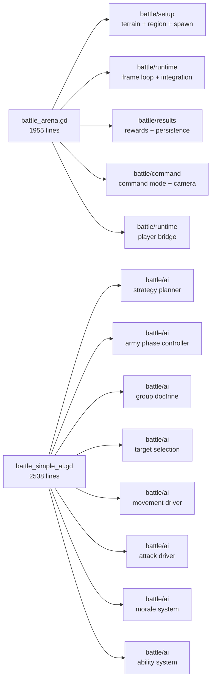

# System Rebuild Map

## Purpose

This diagram shows how to rebuild the RTS/AI subsystem into readable parts without rewriting the gameplay all at once.

## Current To Target

## First Extraction Order

1. move review-only docs and maps first
2. extract command semantics from `battle_simple_ai.gd`
3. extract movement driver from `battle_simple_ai.gd`
4. extract player bridge from `battle_arena.gd`
5. extract battle results/persistence from `battle_arena.gd`
6. extract army phase controller from `battle_simple_ai.gd`

## Why This Order

- command semantics and movement are the most confusing live behaviors
- player bridge is the strangest integration boundary
- rewards and persistence should not live in the frame orchestrator
- phase controller is easier to isolate once movement and command interpretation are explicit

## What Not To Split First

- `battle_unit_system.gd`
- `battle_projectile_system.gd`

Those files are dense, but they still have clearer responsibility boundaries than the two big orchestration files.
