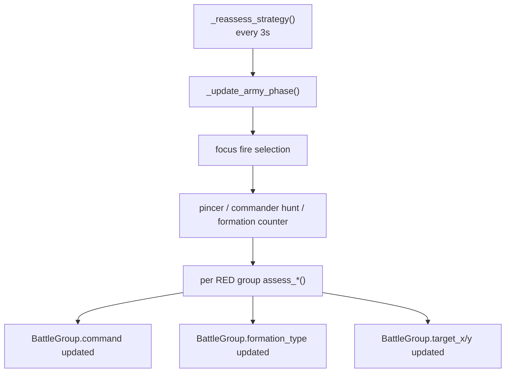
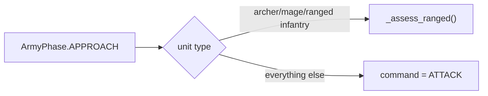
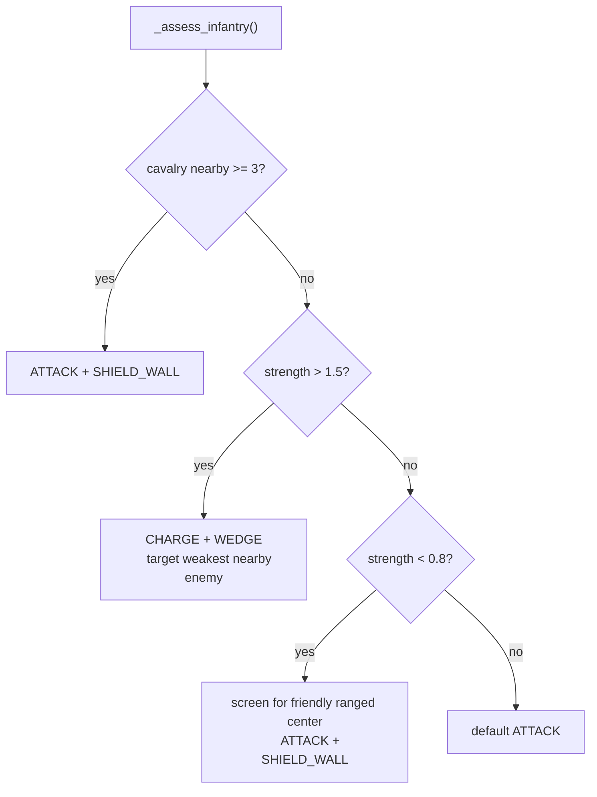
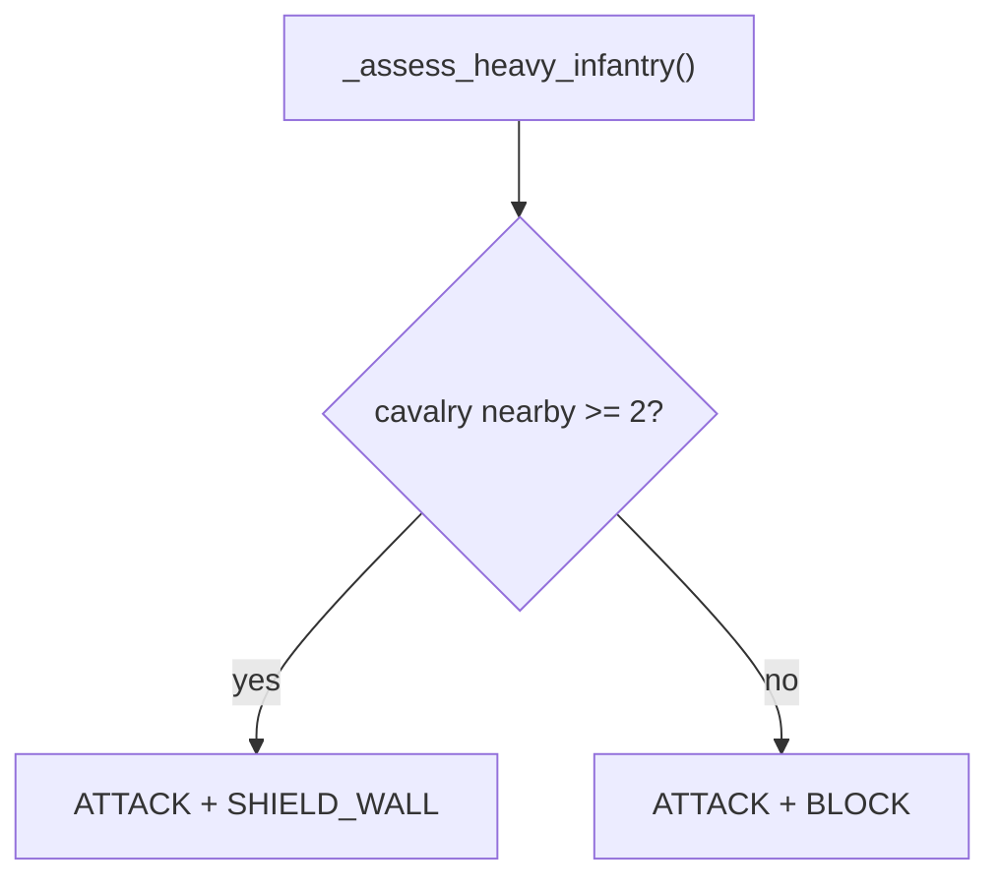
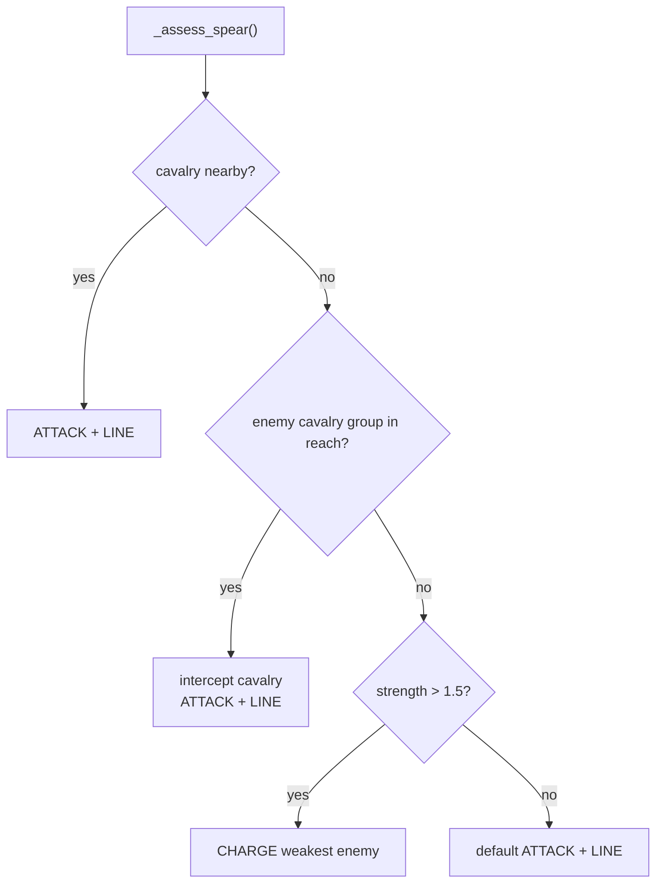
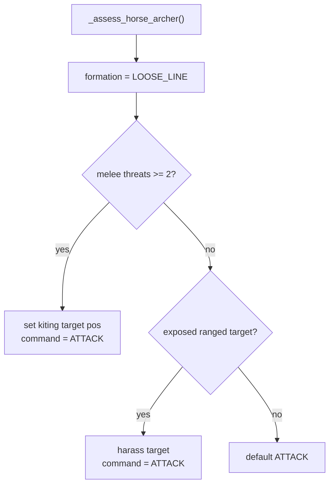
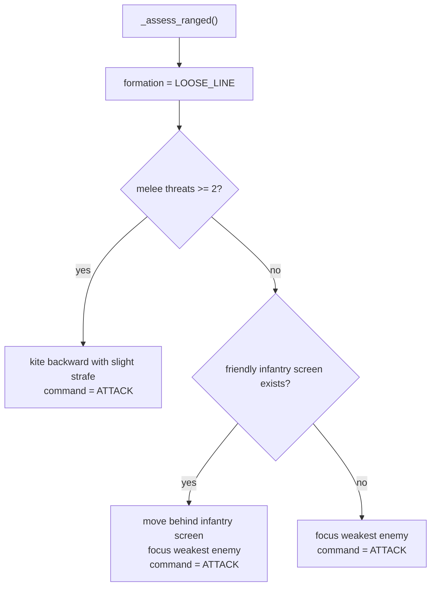
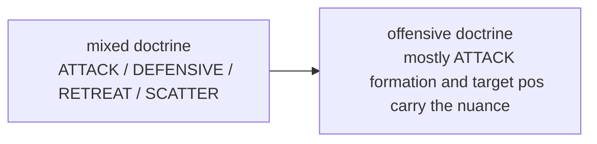

# RED Doctrine Flow

## Purpose

This file explains the edited RED tactical doctrine in `battle_simple_ai.gd`.

This is the layer Claude was changing:

- group-level tactical assessment
- not per-unit movement math
- not projectile hit resolution

Primary source:

- [battle_simple_ai.gd#L1069](/Users/developer-cloudprimero/Desktop/Godot/new-game-project/scripts/battle/battle_simple_ai.gd#L1069)

## Strategic Reassessment Flow

## APPROACH Phase Doctrine

Source:

- [battle_simple_ai.gd#L1135](/Users/developer-cloudprimero/Desktop/Godot/new-game-project/scripts/battle/battle_simple_ai.gd#L1135)

What changed:

- earlier logic held cavalry back in `HOLD`
- current logic pushes almost everyone into `ATTACK`
- ranged still gets special positioning

Effect:

- the RED army enters contact more aggressively
- cavalry is less staged and more continuously involved

## Infantry Doctrine

Source:

- [battle_simple_ai.gd#L1220](/Users/developer-cloudprimero/Desktop/Godot/new-game-project/scripts/battle/battle_simple_ai.gd#L1220)

Key point:

- infantry no longer flips into `DEFENSIVE` or `RETREAT` here
- it always stays in an offensive command posture
- when outnumbered, it still tries to interpose between enemy and friendly ranged groups

Relevant helper:

- [battle_simple_ai.gd#L1871](/Users/developer-cloudprimero/Desktop/Godot/new-game-project/scripts/battle/battle_simple_ai.gd#L1871)

## Heavy Infantry Doctrine

Source:

- [battle_simple_ai.gd#L1261](/Users/developer-cloudprimero/Desktop/Godot/new-game-project/scripts/battle/battle_simple_ai.gd#L1261)

Key point:

- heavy infantry has been simplified into an always-attack doctrine
- formation changes remain, command changes mostly do not

## Spear Doctrine

Source:

- [battle_simple_ai.gd#L1403](/Users/developer-cloudprimero/Desktop/Godot/new-game-project/scripts/battle/battle_simple_ai.gd#L1403)

Key point:

- spear doctrine now assumes anti-cavalry works through active combat, not passive standing

## Horse Archer Doctrine

Source:

- [battle_simple_ai.gd#L1439](/Users/developer-cloudprimero/Desktop/Godot/new-game-project/scripts/battle/battle_simple_ai.gd#L1439)

Key point:

- horse archers no longer use `MOVE` for kiting in this doctrine layer
- they reposition under `ATTACK`, relying on attack-move behavior to keep shooting

## Ranged Doctrine

Source:

- [battle_simple_ai.gd#L1471](/Users/developer-cloudprimero/Desktop/Godot/new-game-project/scripts/battle/battle_simple_ai.gd#L1471)

Key point:

- ranged no longer uses `RETREAT`, `SCATTER`, or `MOVE` in this assessment block
- it always stays under `ATTACK`
- that means ranged units keep the ability to fire while repositioning

## What This Means Architecturally

This is a major design shift:

- old design: command type encoded tactical stance
- new design: command is usually `ATTACK`, while formation and destination encode stance

## Risk

This simplification makes behavior easier to reason about, but it compresses tactical diversity:

- fewer explicit defensive modes
- less clear distinction between “fight here” and “reposition while fighting”
- more pressure on the per-unit `ATTACK` branch to behave correctly

The key execution layer for that is:

- [battle_simple_ai.gd#L456](/Users/developer-cloudprimero/Desktop/Godot/new-game-project/scripts/battle/battle_simple_ai.gd#L456)
