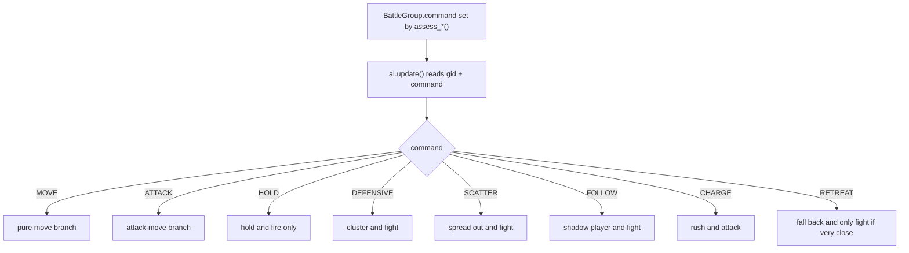
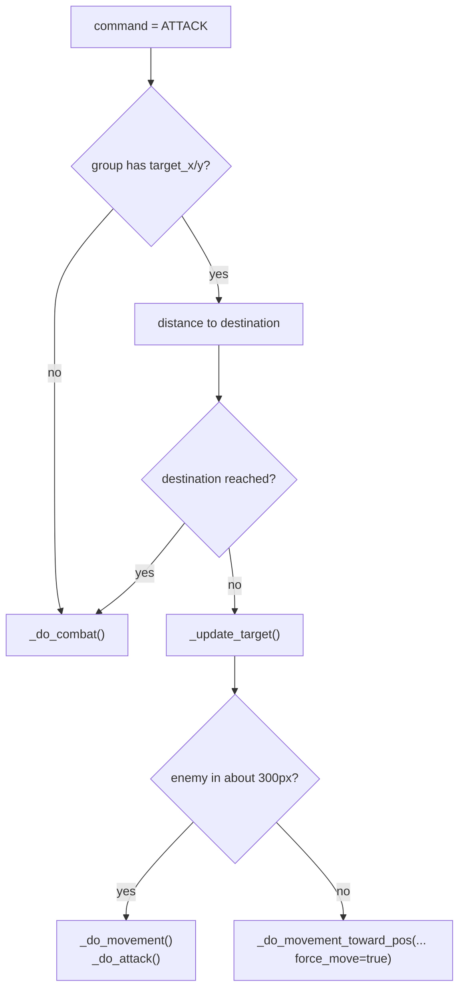
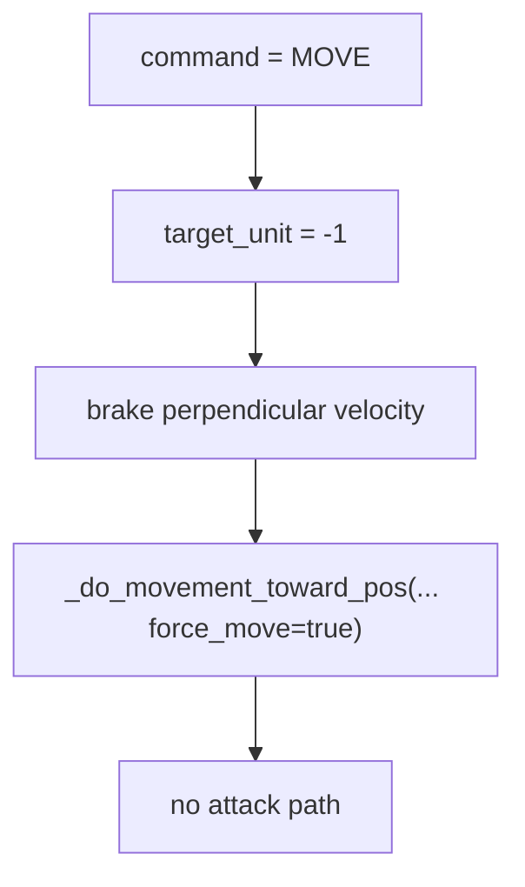
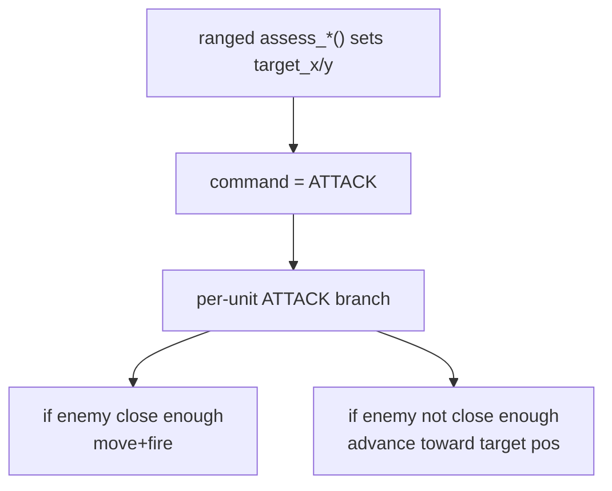
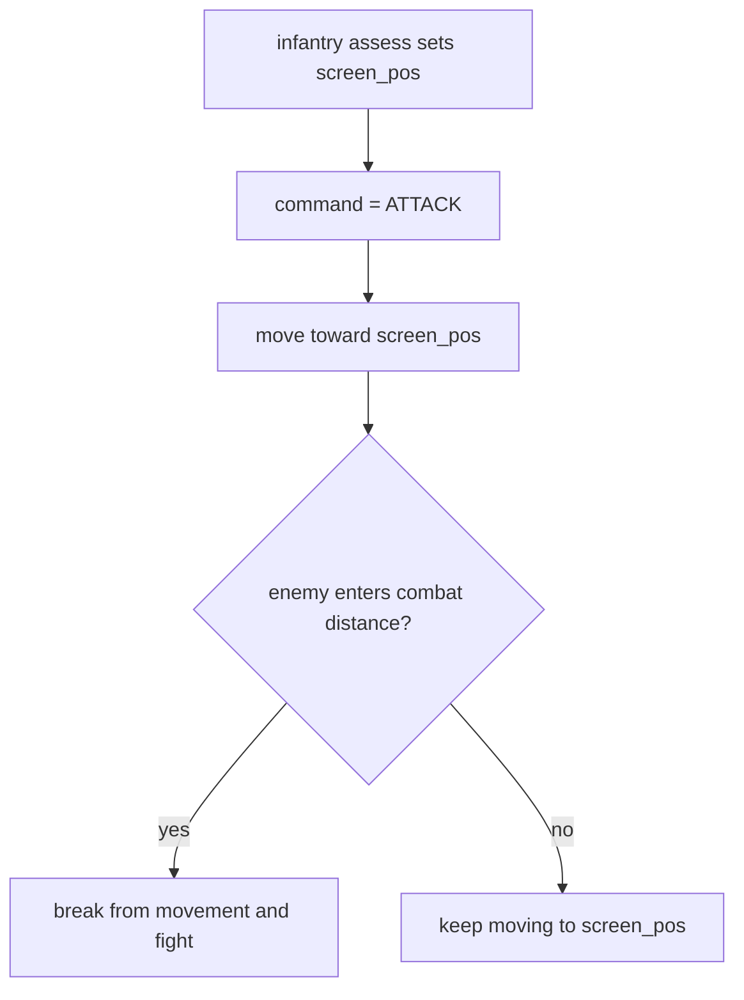
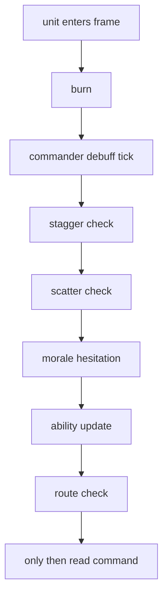

# Per-Unit Command Execution

## Purpose

This file explains what happens after the doctrine layer writes `BattleGroup.command`.

This is the bridge between:

- group-level tactics
- individual unit behavior

Primary source:

- [battle_simple_ai.gd#L428](/Users/developer-cloudprimero/Desktop/Godot/new-game-project/scripts/battle/battle_simple_ai.gd#L428)

## Group Command To Unit Behavior

## Why The New Doctrine Matters

The recent doctrine edits bias RED groups toward `ATTACK`.

That means the `ATTACK` branch now carries much more of the tactical burden.

## ATTACK Branch

Source:

- [battle_simple_ai.gd#L456](/Users/developer-cloudprimero/Desktop/Godot/new-game-project/scripts/battle/battle_simple_ai.gd#L456)

Meaning:

- `ATTACK` is not “stand still and attack”
- `ATTACK` is “move toward the tactical destination, but engage enemies when they become tactically relevant”

## MOVE Branch

Source:

- [battle_simple_ai.gd#L429](/Users/developer-cloudprimero/Desktop/Godot/new-game-project/scripts/battle/battle_simple_ai.gd#L429)

Meaning:

- this is the actual “ignore combat and move” path
- if doctrine stops using `MOVE`, units will rarely hard-disengage

## Ranged Reposition Under ATTACK

The recent edits made ranged and horse archers reposition using `ATTACK`, not `MOVE`.

That means:

This is why the recent Claude changes matter:

- the doctrine says “kite and keep shooting”
- the unit execution layer makes that possible only because `ATTACK` contains both movement and attack

## Infantry Screening Under ATTACK

For edited infantry doctrine:

This is a subtle but important behavior:

- infantry no longer uses explicit defensive command types to screen
- it screens by destination geometry while staying in attack-move mode

## Per-Unit Status Gates Before Commands

Source:

- [battle_simple_ai.gd#L334](/Users/developer-cloudprimero/Desktop/Godot/new-game-project/scripts/battle/battle_simple_ai.gd#L334)

So even if doctrine says `ATTACK`, the unit may still:

- skip action due to stagger
- flee due to scatter
- hesitate due to morale
- rout due to low hp and local inferiority

## Practical Reading Advice

If you want to understand one surprising unit action, inspect in this order:

1. what `assess_*()` wrote into the group
2. what `command` branch the unit entered
3. whether status gates blocked normal execution
4. what `_update_target()` selected
5. what `_do_movement_toward_pos()` and `_do_attack()` did

## Key References

- [battle_simple_ai.gd#L1135](/Users/developer-cloudprimero/Desktop/Godot/new-game-project/scripts/battle/battle_simple_ai.gd#L1135)
- [battle_simple_ai.gd#L1220](/Users/developer-cloudprimero/Desktop/Godot/new-game-project/scripts/battle/battle_simple_ai.gd#L1220)
- [battle_simple_ai.gd#L1261](/Users/developer-cloudprimero/Desktop/Godot/new-game-project/scripts/battle/battle_simple_ai.gd#L1261)
- [battle_simple_ai.gd#L1403](/Users/developer-cloudprimero/Desktop/Godot/new-game-project/scripts/battle/battle_simple_ai.gd#L1403)
- [battle_simple_ai.gd#L1439](/Users/developer-cloudprimero/Desktop/Godot/new-game-project/scripts/battle/battle_simple_ai.gd#L1439)
- [battle_simple_ai.gd#L1471](/Users/developer-cloudprimero/Desktop/Godot/new-game-project/scripts/battle/battle_simple_ai.gd#L1471)
- [battle_simple_ai.gd#L428](/Users/developer-cloudprimero/Desktop/Godot/new-game-project/scripts/battle/battle_simple_ai.gd#L428)
