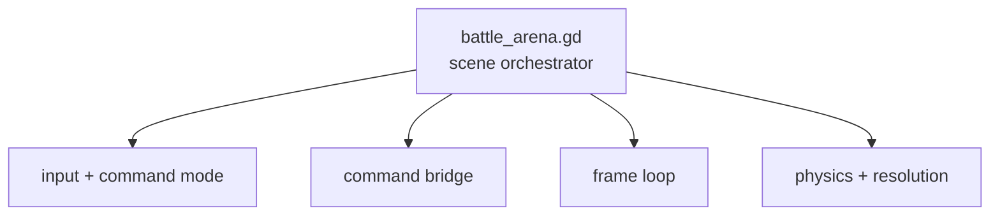
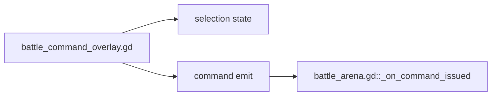
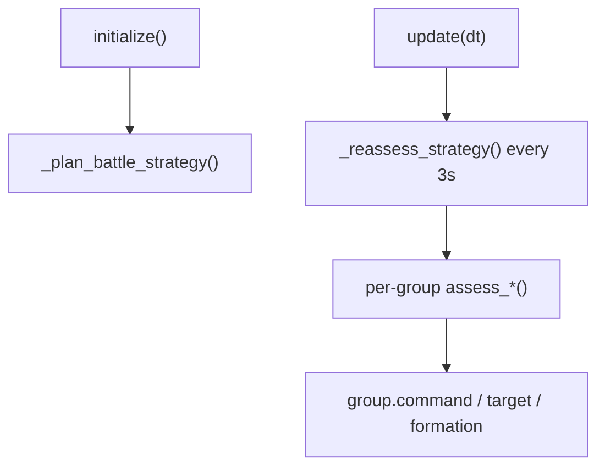
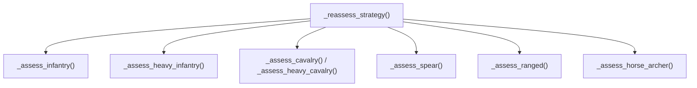
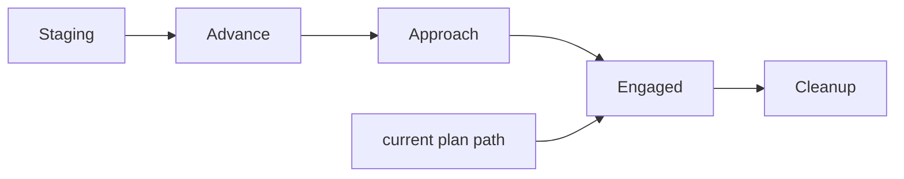
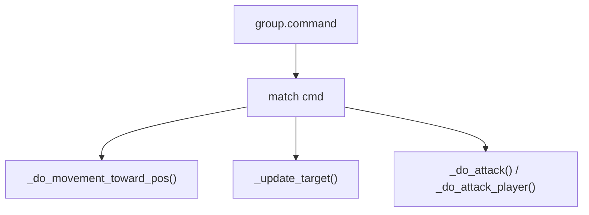
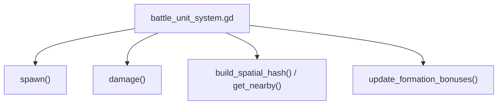

# RTS Code Slice Index

This file is the fastest way to get from "which subsystem am I thinking about?" to the exact slice of code that owns it.

## Battle Arena

Relevant slices:

- [battle_arena.gd#L130-L216](/Users/developer-cloudprimero/Desktop/Godot/new-game-project/scripts/battle/battle_arena.gd#L130) creates `BattleUnitSystem`, `BattleProjectileSystem`, `BattleCommander`, `BattleCollision`, `BattleSimpleAI`, the player, HUD, and command overlay.
- [battle_arena.gd#L999-L1050](/Users/developer-cloudprimero/Desktop/Godot/new-game-project/scripts/battle/battle_arena.gd#L999) handles battle-scene input: `Tab`, `R`, commander switching, and zoom.
- [battle_arena.gd#L1052-L1077](/Users/developer-cloudprimero/Desktop/Godot/new-game-project/scripts/battle/battle_arena.gd#L1052) toggles command mode and re-parents the camera.
- [battle_arena.gd#L1162-L1190](/Users/developer-cloudprimero/Desktop/Godot/new-game-project/scripts/battle/battle_arena.gd#L1162) is the command bridge from UI intent into `BattleCommander` group state.
- [battle_arena.gd#L1192-L1357](/Users/developer-cloudprimero/Desktop/Godot/new-game-project/scripts/battle/battle_arena.gd#L1192) is the battle frame loop and system ordering.
- [battle_arena.gd#L1359-L1468](/Users/developer-cloudprimero/Desktop/Godot/new-game-project/scripts/battle/battle_arena.gd#L1359) applies raw velocity/friction/boundary/wall physics after AI and collision.

## Command Overlay

Relevant slices:

- [battle_command_overlay.gd#L46-L245](/Users/developer-cloudprimero/Desktop/Godot/new-game-project/scripts/battle/battle_command_overlay.gd#L46) builds the command UI and explains the control contract.
- [battle_command_overlay.gd#L504-L586](/Users/developer-cloudprimero/Desktop/Godot/new-game-project/scripts/battle/battle_command_overlay.gd#L504) is the actual input policy.
- [battle_command_overlay.gd#L522-L529](/Users/developer-cloudprimero/Desktop/Godot/new-game-project/scripts/battle/battle_command_overlay.gd#L522) maps `RightClick -> ATTACK` and `Shift+RightClick -> MOVE`.
- [battle_command_overlay.gd#L602-L718](/Users/developer-cloudprimero/Desktop/Godot/new-game-project/scripts/battle/battle_command_overlay.gd#L602) converts click/box selection into selected groups or loose unit selections.
- [battle_command_overlay.gd#L657-L687](/Users/developer-cloudprimero/Desktop/Godot/new-game-project/scripts/battle/battle_command_overlay.gd#L657) emits commands to one or more existing groups.

## Strategic AI

Relevant slices:

- [battle_simple_ai.gd#L71-L80](/Users/developer-cloudprimero/Desktop/Godot/new-game-project/scripts/battle/battle_simple_ai.gd#L71) initializes the AI and immediately plans strategy.
- [battle_simple_ai.gd#L95-L183](/Users/developer-cloudprimero/Desktop/Godot/new-game-project/scripts/battle/battle_simple_ai.gd#L95) profiles the BLUE army and currently forces RED straight into `ENGAGED`.
- [battle_simple_ai.gd#L281-L549](/Users/developer-cloudprimero/Desktop/Godot/new-game-project/scripts/battle/battle_simple_ai.gd#L281) is the per-frame AI runtime for every unit.
- [battle_simple_ai.gd#L1069-L1186](/Users/developer-cloudprimero/Desktop/Godot/new-game-project/scripts/battle/battle_simple_ai.gd#L1069) is the 3-second reassessment loop.
- [battle_simple_ai.gd#L1187-L1218](/Users/developer-cloudprimero/Desktop/Godot/new-game-project/scripts/battle/battle_simple_ai.gd#L1187) adapts melee formations to counter nearby BLUE formations.

## Doctrine Functions

Relevant slices:

- [battle_simple_ai.gd#L1220-L1260](/Users/developer-cloudprimero/Desktop/Godot/new-game-project/scripts/battle/battle_simple_ai.gd#L1220) infantry doctrine.
- [battle_simple_ai.gd#L1261-L1275](/Users/developer-cloudprimero/Desktop/Godot/new-game-project/scripts/battle/battle_simple_ai.gd#L1261) heavy infantry doctrine.
- [battle_simple_ai.gd#L1277-L1401](/Users/developer-cloudprimero/Desktop/Godot/new-game-project/scripts/battle/battle_simple_ai.gd#L1277) cavalry and heavy cavalry charge lifecycle.
- [battle_simple_ai.gd#L1403-L1437](/Users/developer-cloudprimero/Desktop/Godot/new-game-project/scripts/battle/battle_simple_ai.gd#L1403) spear doctrine.
- [battle_simple_ai.gd#L1439-L1469](/Users/developer-cloudprimero/Desktop/Godot/new-game-project/scripts/battle/battle_simple_ai.gd#L1439) horse archer doctrine.
- [battle_simple_ai.gd#L1471-L1518](/Users/developer-cloudprimero/Desktop/Godot/new-game-project/scripts/battle/battle_simple_ai.gd#L1471) ranged doctrine.

## Phase Machine

Relevant slices:

- [battle_simple_ai.gd#L1627-L1645](/Users/developer-cloudprimero/Desktop/Godot/new-game-project/scripts/battle/battle_simple_ai.gd#L1627) dispatches the phase machine.
- [battle_simple_ai.gd#L1647-L1689](/Users/developer-cloudprimero/Desktop/Godot/new-game-project/scripts/battle/battle_simple_ai.gd#L1647) contains `STAGING` and `ADVANCE`.
- [battle_simple_ai.gd#L1690-L1705](/Users/developer-cloudprimero/Desktop/Godot/new-game-project/scripts/battle/battle_simple_ai.gd#L1690) contains `APPROACH` and `ENGAGED`.
- [battle_simple_ai.gd#L1707-L1777](/Users/developer-cloudprimero/Desktop/Godot/new-game-project/scripts/battle/battle_simple_ai.gd#L1707) computes battle-line target positions.
- [battle_simple_ai.gd#L1793-L1855](/Users/developer-cloudprimero/Desktop/Godot/new-game-project/scripts/battle/battle_simple_ai.gd#L1793) triggers the one-shot cavalry charge.

## Per-Unit Combat Runtime

Relevant slices:

- [battle_simple_ai.gd#L381-L510](/Users/developer-cloudprimero/Desktop/Godot/new-game-project/scripts/battle/battle_simple_ai.gd#L381) branches unit behavior by command.
- [battle_simple_ai.gd#L2044-L2080](/Users/developer-cloudprimero/Desktop/Godot/new-game-project/scripts/battle/battle_simple_ai.gd#L2044) updates combat targets and lets RED prefer the player if close.
- [battle_simple_ai.gd#L2130-L2239](/Users/developer-cloudprimero/Desktop/Godot/new-game-project/scripts/battle/battle_simple_ai.gd#L2130) handles movement, flow-field blending, morale speed changes, and ranged spacing.
- [battle_simple_ai.gd#L2241-L2323](/Users/developer-cloudprimero/Desktop/Godot/new-game-project/scripts/battle/battle_simple_ai.gd#L2241) handles attack permission, cooldowns, and projectile spawn.
- [battle_simple_ai.gd#L2324-L2358](/Users/developer-cloudprimero/Desktop/Godot/new-game-project/scripts/battle/battle_simple_ai.gd#L2324) is the dedicated attack path when the target is the player.

## SoA Data Ownership

Relevant slices:

- [battle_unit_system.gd#L1-L248](/Users/developer-cloudprimero/Desktop/Godot/new-game-project/scripts/battle/battle_unit_system.gd#L1) defines enums, stat tables, terrain modifiers, and SoA arrays.
- [battle_unit_system.gd#L273-L338](/Users/developer-cloudprimero/Desktop/Godot/new-game-project/scripts/battle/battle_unit_system.gd#L273) spawns units and writes all initial SoA fields.
- [battle_unit_system.gd#L340-L435](/Users/developer-cloudprimero/Desktop/Godot/new-game-project/scripts/battle/battle_unit_system.gd#L340) computes damage, morale loss, flanking multipliers, and death.
- [battle_unit_system.gd#L437-L480](/Users/developer-cloudprimero/Desktop/Godot/new-game-project/scripts/battle/battle_unit_system.gd#L437) is the spatial query backbone.
- [battle_unit_system.gd#L482-L520](/Users/developer-cloudprimero/Desktop/Godot/new-game-project/scripts/battle/battle_unit_system.gd#L482) updates formation bonuses and neighbor counts.

## High-Stakes Reading Order

1. [battle_command_overlay.gd#L522](/Users/developer-cloudprimero/Desktop/Godot/new-game-project/scripts/battle/battle_command_overlay.gd#L522) to understand what command the player actually issued.
2. [battle_arena.gd#L1162](/Users/developer-cloudprimero/Desktop/Godot/new-game-project/scripts/battle/battle_arena.gd#L1162) to see how that command mutates group state.
3. [battle_simple_ai.gd#L381](/Users/developer-cloudprimero/Desktop/Godot/new-game-project/scripts/battle/battle_simple_ai.gd#L381) to see how that group state becomes per-unit behavior.
4. [battle_simple_ai.gd#L2137](/Users/developer-cloudprimero/Desktop/Godot/new-game-project/scripts/battle/battle_simple_ai.gd#L2137) to see how movement is actually applied.
5. [battle_simple_ai.gd#L2241](/Users/developer-cloudprimero/Desktop/Godot/new-game-project/scripts/battle/battle_simple_ai.gd#L2241) to see when attacks happen.
