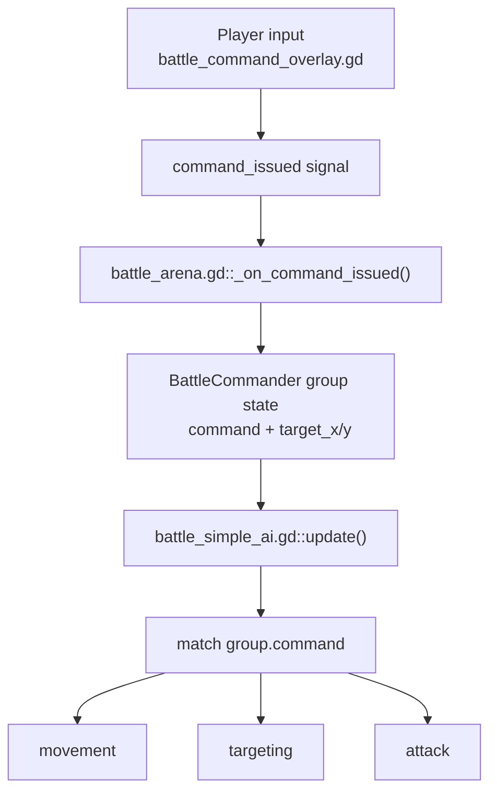
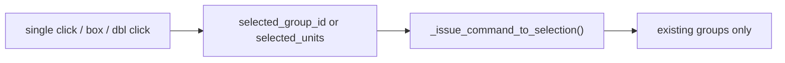
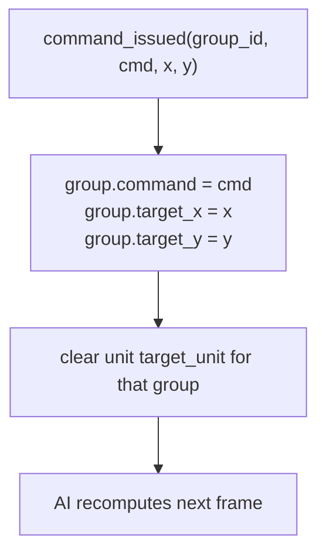
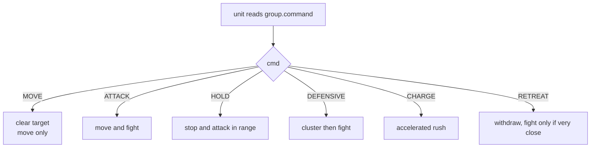
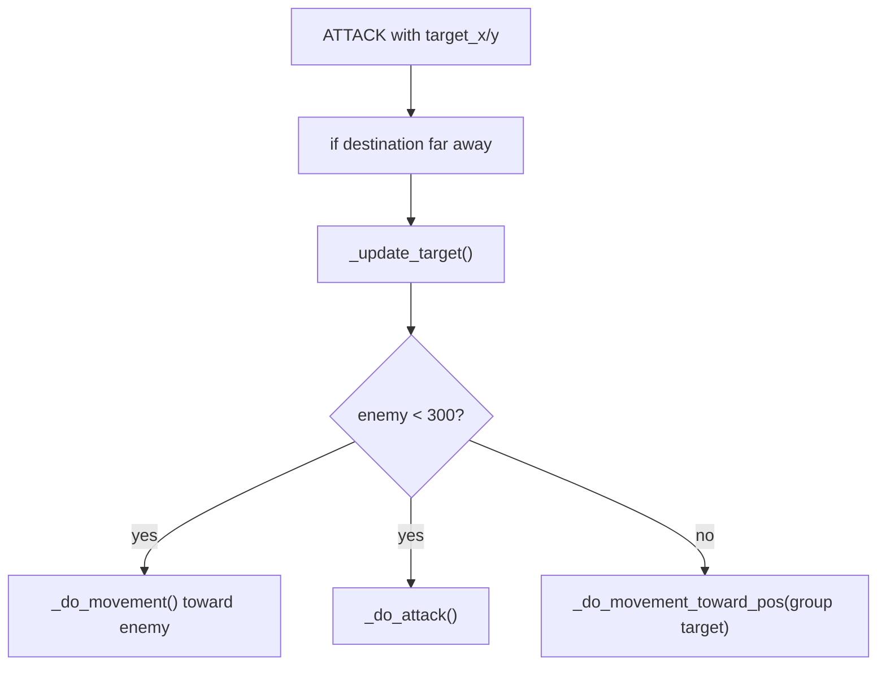
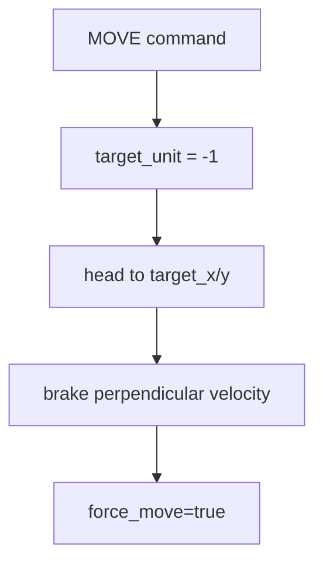

# Command To Unit Trace

This file follows one command all the way from your input to unit behavior.

## End-To-End Map

## 1. Input Policy

The source of a lot of confusion is the actual input contract:

- [battle_command_overlay.gd#L498-L499](/Users/developer-cloudprimero/Desktop/Godot/new-game-project/scripts/battle/battle_command_overlay.gd#L498) documents `Right-click = ATK MOVE`, `Shift+Right-click = pure MOVE`.
- [battle_command_overlay.gd#L522-L527](/Users/developer-cloudprimero/Desktop/Godot/new-game-project/scripts/battle/battle_command_overlay.gd#L522) enforces it in code:
  - `shift_pressed` means `MOVE`
  - otherwise the command is `ATTACK`

That means the default ground order is not a passive move. It is attack-move.

## 2. Selection To Group Mapping

Relevant code:

- [battle_command_overlay.gd#L602-L617](/Users/developer-cloudprimero/Desktop/Godot/new-game-project/scripts/battle/battle_command_overlay.gd#L602) single-click selects a whole existing group when possible.
- [battle_command_overlay.gd#L619-L656](/Users/developer-cloudprimero/Desktop/Godot/new-game-project/scripts/battle/battle_command_overlay.gd#L619) double-click can become a loose unit selection.
- [battle_command_overlay.gd#L688-L718](/Users/developer-cloudprimero/Desktop/Godot/new-game-project/scripts/battle/battle_command_overlay.gd#L688) box-select also collapses to a group if all units share one.
- [battle_command_overlay.gd#L657-L669](/Users/developer-cloudprimero/Desktop/Godot/new-game-project/scripts/battle/battle_command_overlay.gd#L657) emits commands per selected group.

Important implication:

- the overlay does not rewrite permanent grouping when you give a ground order
- it emits one command per existing group
- per-unit behavior still depends on the unit's original `group_id`

## 3. Arena Command Bridge

Relevant code:

- [battle_arena.gd#L1162-L1171](/Users/developer-cloudprimero/Desktop/Godot/new-game-project/scripts/battle/battle_arena.gd#L1162) writes the new command and target position into the commander group.
- [battle_arena.gd#L1186-L1190](/Users/developer-cloudprimero/Desktop/Godot/new-game-project/scripts/battle/battle_arena.gd#L1186) clears `target_unit` for every unit in that group so the next AI tick retargets.

This is the main state mutation point for player-issued orders.

## 4. Frame Loop Ownership

Every physics tick, battle execution happens in this order:

1. [battle_arena.gd#L1251-L1254](/Users/developer-cloudprimero/Desktop/Godot/new-game-project/scripts/battle/battle_arena.gd#L1251) rebuild spatial hash.
2. [battle_arena.gd#L1256-L1262](/Users/developer-cloudprimero/Desktop/Godot/new-game-project/scripts/battle/battle_arena.gd#L1256) refresh formation bonuses periodically.
3. [battle_arena.gd#L1264-L1272](/Users/developer-cloudprimero/Desktop/Godot/new-game-project/scripts/battle/battle_arena.gd#L1264) call `ai.update(dt)`.
4. [battle_arena.gd#L1274-L1291](/Users/developer-cloudprimero/Desktop/Godot/new-game-project/scripts/battle/battle_arena.gd#L1274) update projectiles, collision, and physics.

So the player command is not executed immediately by the overlay. It is consumed in the next `ai.update(dt)` cycle.

## 5. Unit Command Branch

Relevant code:

- [battle_simple_ai.gd#L381-L387](/Users/developer-cloudprimero/Desktop/Godot/new-game-project/scripts/battle/battle_simple_ai.gd#L381) reads `group.command`.
- [battle_simple_ai.gd#L388-L391](/Users/developer-cloudprimero/Desktop/Godot/new-game-project/scripts/battle/battle_simple_ai.gd#L388) applies group cohesion except during `SCATTER`, `RETREAT`, and `MOVE`.
- [battle_simple_ai.gd#L393-L510](/Users/developer-cloudprimero/Desktop/Godot/new-game-project/scripts/battle/battle_simple_ai.gd#L393) is the actual command switch.

## 6. Why `ATTACK` Feels Like Ignored Move Orders

Relevant code:

- [battle_simple_ai.gd#L421-L450](/Users/developer-cloudprimero/Desktop/Godot/new-game-project/scripts/battle/battle_simple_ai.gd#L421) is the attack-move branch.
- [battle_simple_ai.gd#L433-L444](/Users/developer-cloudprimero/Desktop/Godot/new-game-project/scripts/battle/battle_simple_ai.gd#L433) says that if an enemy is valid and within `300`, the unit abandons path-to-point behavior and enters combat behavior.

This is why a plain right-click can look like "my units stopped obeying the move." They did obey the order. The order was `ATTACK`, and the `ATTACK` branch explicitly allows interception.

## 7. What `MOVE` Does Differently

Relevant code:

- [battle_simple_ai.gd#L394-L420](/Users/developer-cloudprimero/Desktop/Godot/new-game-project/scripts/battle/battle_simple_ai.gd#L394) is the pure move branch.
- [battle_simple_ai.gd#L397](/Users/developer-cloudprimero/Desktop/Godot/new-game-project/scripts/battle/battle_simple_ai.gd#L397) clears the current combat target.
- [battle_simple_ai.gd#L404-L412](/Users/developer-cloudprimero/Desktop/Godot/new-game-project/scripts/battle/battle_simple_ai.gd#L404) actively strips perpendicular velocity and forces travel toward the destination.

This is the branch you want when you truly mean disengage-and-relocate.

## 8. Movement Layer Details

Relevant code:

- [battle_simple_ai.gd#L2137-L2176](/Users/developer-cloudprimero/Desktop/Godot/new-game-project/scripts/battle/battle_simple_ai.gd#L2137) chooses a direction, optionally blends flow field guidance, and applies local avoidance.
- [battle_simple_ai.gd#L2151-L2159](/Users/developer-cloudprimero/Desktop/Godot/new-game-project/scripts/battle/battle_simple_ai.gd#L2151) explicitly disables objective flow-field steering for BLUE groups with a player-given target position.
- [battle_simple_ai.gd#L2209-L2228](/Users/developer-cloudprimero/Desktop/Godot/new-game-project/scripts/battle/battle_simple_ai.gd#L2209) is the range-keeping logic that can make ranged units stop, backpedal, or kite even when they are nominally attacking a target point.

Important implication:

- even with a player target position, ranged units are still allowed to preserve preferred range unless `force_move` is true
- so `ATTACK` plus a target point does not mean "walk to exact point no matter what"

## 9. Attack Layer Details

Relevant code:

- [battle_simple_ai.gd#L2241-L2258](/Users/developer-cloudprimero/Desktop/Godot/new-game-project/scripts/battle/battle_simple_ai.gd#L2241) checks target validity, range, and line of sight.
- [battle_simple_ai.gd#L2259-L2280](/Users/developer-cloudprimero/Desktop/Godot/new-game-project/scripts/battle/battle_simple_ai.gd#L2259) modifies attack speed by morale, commander debuff, and formation bonus.
- [battle_simple_ai.gd#L2283-L2322](/Users/developer-cloudprimero/Desktop/Godot/new-game-project/scripts/battle/battle_simple_ai.gd#L2283) computes projectile direction, damage, charge momentum, and spawns the attack payload.

## High-Stakes Notes

- [battle_command_overlay.gd#L522](/Users/developer-cloudprimero/Desktop/Godot/new-game-project/scripts/battle/battle_command_overlay.gd#L522) is the human-facing contract. If this is wrong or mislabeled, the whole RTS layer feels broken.
- [battle_arena.gd#L1162](/Users/developer-cloudprimero/Desktop/Godot/new-game-project/scripts/battle/battle_arena.gd#L1162) is the command mutation choke point.
- [battle_simple_ai.gd#L421](/Users/developer-cloudprimero/Desktop/Godot/new-game-project/scripts/battle/battle_simple_ai.gd#L421) is the main reason units appear to "not listen" during combat.
- [battle_simple_ai.gd#L2209](/Users/developer-cloudprimero/Desktop/Godot/new-game-project/scripts/battle/battle_simple_ai.gd#L2209) is where ranged autonomy overrides naive straight-line travel.
