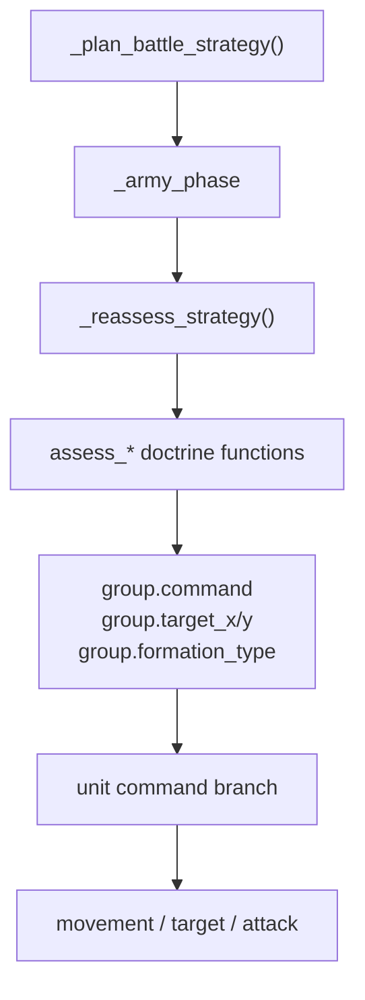
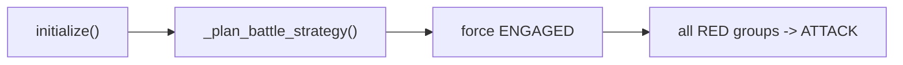
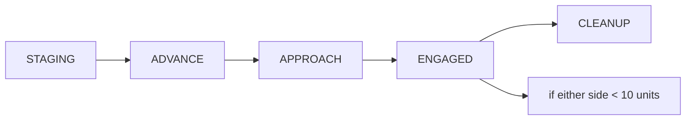
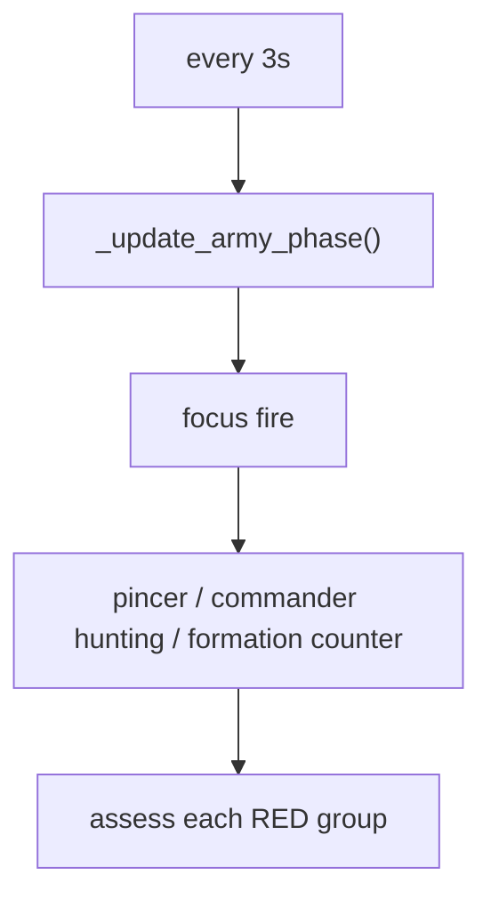
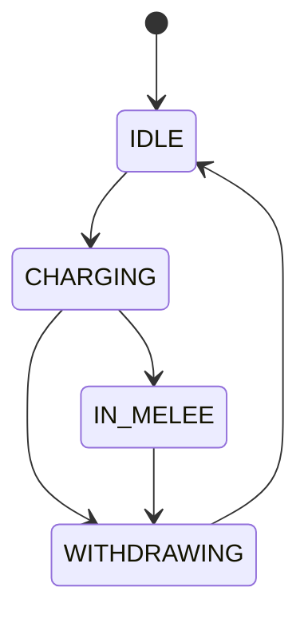
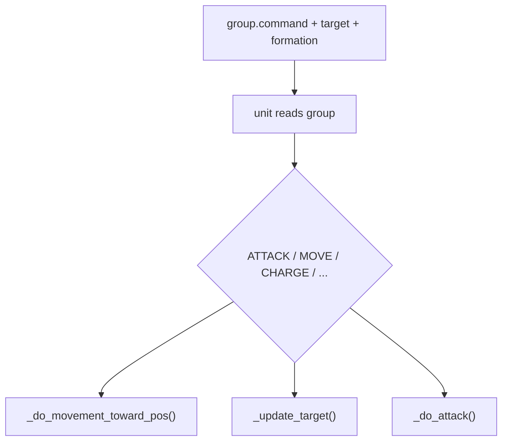

# Phase Doctrine Runtime Trace

This file is the best place to understand what the RED AI is doing strategically, what the doctrine functions actually write, and how those decisions become unit behavior.

## Full Stack

## 1. Current Initialization Behavior

Relevant code:

- [battle_simple_ai.gd#L71-L80](/Users/developer-cloudprimero/Desktop/Godot/new-game-project/scripts/battle/battle_simple_ai.gd#L71) runs `_plan_battle_strategy()` immediately during initialization.
- [battle_simple_ai.gd#L95-L158](/Users/developer-cloudprimero/Desktop/Godot/new-game-project/scripts/battle/battle_simple_ai.gd#L95) profiles BLUE composition and adjusts some starting formations.
- [battle_simple_ai.gd#L159-L168](/Users/developer-cloudprimero/Desktop/Godot/new-game-project/scripts/battle/battle_simple_ai.gd#L159) explicitly skips the formation phases and forces `_army_phase = ArmyPhase.ENGAGED`.
- [battle_simple_ai.gd#L169-L183](/Users/developer-cloudprimero/Desktop/Godot/new-game-project/scripts/battle/battle_simple_ai.gd#L169) sets every RED group to `ATTACK` with `target_x = target_y = 0`.

Practical result:

- the code still contains a full staged phase machine
- but the current startup path mostly bypasses it
- that matches the earlier battle logs where RED began in `ENGAGED`

## 2. What the Phase Machine Still Owns

Relevant code:

- [battle_simple_ai.gd#L1627-L1645](/Users/developer-cloudprimero/Desktop/Godot/new-game-project/scripts/battle/battle_simple_ai.gd#L1627) phase dispatch.
- [battle_simple_ai.gd#L1647-L1667](/Users/developer-cloudprimero/Desktop/Godot/new-game-project/scripts/battle/battle_simple_ai.gd#L1647) staging logic.
- [battle_simple_ai.gd#L1668-L1689](/Users/developer-cloudprimero/Desktop/Godot/new-game-project/scripts/battle/battle_simple_ai.gd#L1668) advance logic.
- [battle_simple_ai.gd#L1690-L1699](/Users/developer-cloudprimero/Desktop/Godot/new-game-project/scripts/battle/battle_simple_ai.gd#L1690) approach transition.
- [battle_simple_ai.gd#L1700-L1705](/Users/developer-cloudprimero/Desktop/Godot/new-game-project/scripts/battle/battle_simple_ai.gd#L1700) engaged-phase cavalry trigger.

Important note:

- even though `STAGING -> ADVANCE -> APPROACH` still exists, the current planner is bypassing that choreography at battle start
- the remaining visible phase transition in live play is usually `ENGAGED -> CLEANUP`

## 3. Reassessment Loop

Relevant code:

- [battle_simple_ai.gd#L293-L297](/Users/developer-cloudprimero/Desktop/Godot/new-game-project/scripts/battle/battle_simple_ai.gd#L293) schedules strategic reassessment every 3 seconds.
- [battle_simple_ai.gd#L1069-L1116](/Users/developer-cloudprimero/Desktop/Godot/new-game-project/scripts/battle/battle_simple_ai.gd#L1069) runs global tactics before per-group doctrine.
- [battle_simple_ai.gd#L1117-L1186](/Users/developer-cloudprimero/Desktop/Godot/new-game-project/scripts/battle/battle_simple_ai.gd#L1117) computes per-group strength, casualties, targeting, and unit-type-specific doctrine.

The reassessment loop is the doctrinal brain. It does not move units directly. It only mutates group state.

## 4. Current RED Doctrine After the Claude Edits

```mermaid
flowchart TD
    Infantry["infantry"] -->|winning| Charge["CHARGE + WEDGE"]
    Infantry -->|outnumbered| Screen["ATTACK + SHIELD_WALL + screen ranged"]
    Infantry -->|cav nearby| Brace["ATTACK + SHIELD_WALL"]
    Infantry -->|default| Push["ATTACK"]

    Heavy["heavy infantry"] -->|cav nearby| HBrace["ATTACK + SHIELD_WALL"]
    Heavy -->|default| HPush["ATTACK + BLOCK"]

    Spear["spear"] -->|cav threat| Intercept["ATTACK + LINE"]
    Spear -->|winning| SCharge["CHARGE + LINE"]
    Spear -->|default| SAttack["ATTACK + LINE"]

    Ranged["archer/mage/ranged inf"] -->|melee close| Kite["ATTACK + kite target_x/y"]
    Ranged -->|screen exists| Safe["ATTACK + safe_pos"]
    Ranged -->|default| Focus["ATTACK + weakest target"]

    Horse["horse archer"] -->|melee close| HKite["ATTACK + kite target_x/y"]
    Horse -->|default| Harass["ATTACK"]
```

Key code:

- [battle_simple_ai.gd#L1220-L1260](/Users/developer-cloudprimero/Desktop/Godot/new-game-project/scripts/battle/battle_simple_ai.gd#L1220) infantry.
- [battle_simple_ai.gd#L1261-L1275](/Users/developer-cloudprimero/Desktop/Godot/new-game-project/scripts/battle/battle_simple_ai.gd#L1261) heavy infantry.
- [battle_simple_ai.gd#L1403-L1437](/Users/developer-cloudprimero/Desktop/Godot/new-game-project/scripts/battle/battle_simple_ai.gd#L1403) spear.
- [battle_simple_ai.gd#L1439-L1518](/Users/developer-cloudprimero/Desktop/Godot/new-game-project/scripts/battle/battle_simple_ai.gd#L1439) horse archer and ranged.

Interpretation:

- doctrine is now much flatter than before
- more units remain on `ATTACK`
- tactical nuance moved into:
  - `formation_type`
  - `target_x / target_y`
  - the `ATTACK` branch behavior itself

## 5. Cavalry Is Still a Real State Machine

Relevant code:

- [battle_simple_ai.gd#L1277-L1378](/Users/developer-cloudprimero/Desktop/Godot/new-game-project/scripts/battle/battle_simple_ai.gd#L1277) cavalry lifecycle.
- [battle_simple_ai.gd#L1793-L1855](/Users/developer-cloudprimero/Desktop/Godot/new-game-project/scripts/battle/battle_simple_ai.gd#L1793) phase-triggered cavalry opener.

Important difference:

- infantry and ranged doctrine are now simpler and more attack-centric
- cavalry still has explicit state transitions and withdraw behavior

## 6. Helper Functions That Doctrine Depends On

Relevant code:

- [battle_simple_ai.gd#L1856-L1869](/Users/developer-cloudprimero/Desktop/Godot/new-game-project/scripts/battle/battle_simple_ai.gd#L1856) friendly infantry center.
- [battle_simple_ai.gd#L1871-L1885](/Users/developer-cloudprimero/Desktop/Godot/new-game-project/scripts/battle/battle_simple_ai.gd#L1871) friendly ranged center.
- [battle_simple_ai.gd#L1887-L1904](/Users/developer-cloudprimero/Desktop/Godot/new-game-project/scripts/battle/battle_simple_ai.gd#L1887) weakest enemy group lookup.
- [battle_simple_ai.gd#L1906-L1917](/Users/developer-cloudprimero/Desktop/Godot/new-game-project/scripts/battle/battle_simple_ai.gd#L1906) nearest enemy group center.
- [battle_simple_ai.gd#L1928-L1953](/Users/developer-cloudprimero/Desktop/Godot/new-game-project/scripts/battle/battle_simple_ai.gd#L1928) local strength ratio and nearby-type counters.
- [battle_simple_ai.gd#L1955-L2012](/Users/developer-cloudprimero/Desktop/Godot/new-game-project/scripts/battle/battle_simple_ai.gd#L1955) flank targets and exposed-ranged discovery.

These are the real tactical query layer. The doctrine functions are mostly just policy built on top of these helpers.

## 7. Runtime Consumption Of Doctrine

Relevant code:

- [battle_simple_ai.gd#L381-L510](/Users/developer-cloudprimero/Desktop/Godot/new-game-project/scripts/battle/battle_simple_ai.gd#L381) consumes group command state.
- [battle_simple_ai.gd#L2044-L2080](/Users/developer-cloudprimero/Desktop/Godot/new-game-project/scripts/battle/battle_simple_ai.gd#L2044) targets nearby enemies or the player.
- [battle_simple_ai.gd#L2137-L2239](/Users/developer-cloudprimero/Desktop/Godot/new-game-project/scripts/battle/battle_simple_ai.gd#L2137) moves units according to command and range-keeping.
- [battle_simple_ai.gd#L2241-L2323](/Users/developer-cloudprimero/Desktop/Godot/new-game-project/scripts/battle/battle_simple_ai.gd#L2241) executes attacks.

This is why doctrine docs alone are not enough. The meaning of `ATTACK` is defined by the runtime branch, not by the doctrine function that assigned it.

## 8. High-Stakes Zones

- [battle_simple_ai.gd#L159-L168](/Users/developer-cloudprimero/Desktop/Godot/new-game-project/scripts/battle/battle_simple_ai.gd#L159) currently overrides the intended phase choreography.
- [battle_simple_ai.gd#L1135-L1142](/Users/developer-cloudprimero/Desktop/Godot/new-game-project/scripts/battle/battle_simple_ai.gd#L1135) rewrites `APPROACH` into mostly universal attack behavior.
- [battle_simple_ai.gd#L1220-L1518](/Users/developer-cloudprimero/Desktop/Godot/new-game-project/scripts/battle/battle_simple_ai.gd#L1220) is where doctrine simplification lives.
- [battle_simple_ai.gd#L421-L450](/Users/developer-cloudprimero/Desktop/Godot/new-game-project/scripts/battle/battle_simple_ai.gd#L421) is where "attack-move" truly becomes combat interception.
- [battle_simple_ai.gd#L2209-L2228](/Users/developer-cloudprimero/Desktop/Godot/new-game-project/scripts/battle/battle_simple_ai.gd#L2209) is where ranged units preserve distance instead of blindly marching.
