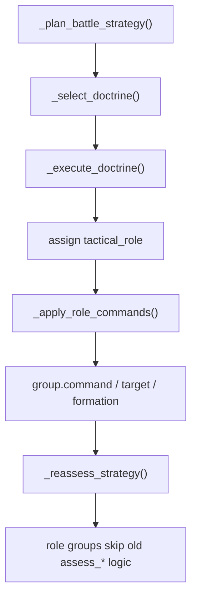
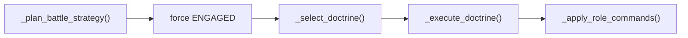
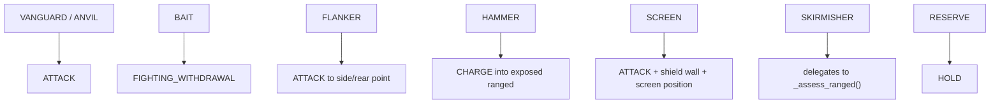

# Doctrine Playbook Layer

This file documents the newer playbook system that now sits above the older `assess_*()` logic.

## Why This Matters

Most of the RTS AI is no longer driven directly by the per-unit-type assess functions.

There is now a newer chain:

The crossover point is here:

- [battle_simple_ai.gd#L1188-L1191](/Users/developer-cloudprimero/Desktop/Godot/new-game-project/scripts/battle/battle_simple_ai.gd#L1188)

That block says:

- if a group has a `tactical_role`
- skip the older per-type assess functions entirely

So the playbook layer is now first-class.

## Initialization Path

Relevant code:

- [battle_simple_ai.gd#L172-L183](/Users/developer-cloudprimero/Desktop/Godot/new-game-project/scripts/battle/battle_simple_ai.gd#L172) forces `ENGAGED`, selects doctrine, executes doctrine, and applies role commands.
- [battle_simple_ai.gd#L177-L180](/Users/developer-cloudprimero/Desktop/Godot/new-game-project/scripts/battle/battle_simple_ai.gd#L177) picks and executes the doctrine.

## Doctrine Selection

Relevant code:

- [battle_simple_ai.gd#L2602-L2666](/Users/developer-cloudprimero/Desktop/Godot/new-game-project/scripts/battle/battle_simple_ai.gd#L2602)

Current doctrine options:

- `FRONTAL_ASSAULT`
- `HAMMER_ANVIL`
- `BAIT_AND_FLANK`
- `KITING_HARASS`
- `DEFENSIVE_LINE`

Important behavior:

- if RED is outnumbered and has enough ranged presence, it can choose `KITING_HARASS`
- if RED is outnumbered without enough flanking tools, it can choose `DEFENSIVE_LINE`

That is the higher-level explanation for why the army can still feel conservative even after aggressive edits in `_assess_infantry()`.

## Role Assignment

```mermaid
flowchart TD
    Frontal["FRONTAL_ASSAULT"] --> Vanguard["all -> VANGUARD"]
    Hammer["HAMMER_ANVIL"] --> Anvil["melee -> ANVIL"]
    Hammer --> HammerRole["cav / horse archer -> HAMMER"]
    Hammer --> Skirm["ranged -> SKIRMISHER"]
    Bait["BAIT_AND_FLANK"] --> BaitRole["light infantry -> BAIT"]
    Bait --> Flanker["horse archer or detachments -> FLANKER"]
    Kiting["KITING_HARASS"] --> Screen["infantry/spear -> SCREEN"]
    Kiting --> KSkirm["ranged -> SKIRMISHER"]
    Kiting --> KHammer["cav -> HAMMER"]
    Defensive["DEFENSIVE_LINE"] --> DAnvil["melee -> ANVIL"]
    Defensive --> DSkirm["ranged -> SKIRMISHER"]
    Defensive --> Reserve["cav -> RESERVE"]
```

Relevant code:

- [battle_simple_ai.gd#L2668-L2692](/Users/developer-cloudprimero/Desktop/Godot/new-game-project/scripts/battle/battle_simple_ai.gd#L2668) default role assignment per doctrine.
- [battle_simple_ai.gd#L2706-L2737](/Users/developer-cloudprimero/Desktop/Godot/new-game-project/scripts/battle/battle_simple_ai.gd#L2706) `BAIT_AND_FLANK`, including group splitting into flank detachments.
- [battle_simple_ai.gd#L2738-L2751](/Users/developer-cloudprimero/Desktop/Godot/new-game-project/scripts/battle/battle_simple_ai.gd#L2738) `KITING_HARASS`.

## Role To Command Mapping

Relevant code:

- [battle_simple_ai.gd#L2753-L2831](/Users/developer-cloudprimero/Desktop/Godot/new-game-project/scripts/battle/battle_simple_ai.gd#L2753)

This is the actual role-command bridge.

## Key Consequence

If a group has a tactical role, these older functions are bypassed:

- [battle_simple_ai.gd#L1278-L1317](/Users/developer-cloudprimero/Desktop/Godot/new-game-project/scripts/battle/battle_simple_ai.gd#L1278) `_assess_infantry()`
- [battle_simple_ai.gd#L1319-L1333](/Users/developer-cloudprimero/Desktop/Godot/new-game-project/scripts/battle/battle_simple_ai.gd#L1319) `_assess_heavy_infantry()`
- [battle_simple_ai.gd#L1461-L1495](/Users/developer-cloudprimero/Desktop/Godot/new-game-project/scripts/battle/battle_simple_ai.gd#L1461) `_assess_spear()`
- [battle_simple_ai.gd#L1497-L1527](/Users/developer-cloudprimero/Desktop/Godot/new-game-project/scripts/battle/battle_simple_ai.gd#L1497) `_assess_horse_archer()`

The main exception is:

- [battle_simple_ai.gd#L2822-L2824](/Users/developer-cloudprimero/Desktop/Godot/new-game-project/scripts/battle/battle_simple_ai.gd#L2822) `SKIRMISHER` explicitly delegates to `_assess_ranged()`

So the recent ranged edits matter more reliably than the recent infantry edits.

## High-Stakes Zones

- [battle_simple_ai.gd#L1188-L1191](/Users/developer-cloudprimero/Desktop/Godot/new-game-project/scripts/battle/battle_simple_ai.gd#L1188) is the override gate where tactical-role groups stop using old assess logic.
- [battle_simple_ai.gd#L2668-L2831](/Users/developer-cloudprimero/Desktop/Godot/new-game-project/scripts/battle/battle_simple_ai.gd#L2668) is now one of the highest-value control regions in the whole file.
- [battle_simple_ai.gd#L2825-L2827](/Users/developer-cloudprimero/Desktop/Godot/new-game-project/scripts/battle/battle_simple_ai.gd#L2825) makes `RESERVE` groups `HOLD`, which can make the army feel passive if too many valuable units get that role.
- [battle_simple_ai.gd#L2766-L2773](/Users/developer-cloudprimero/Desktop/Godot/new-game-project/scripts/battle/battle_simple_ai.gd#L2766) is the entrypoint for `FIGHTING_WITHDRAWAL`, which is the best current hook for the bait-and-archer behavior you want.
