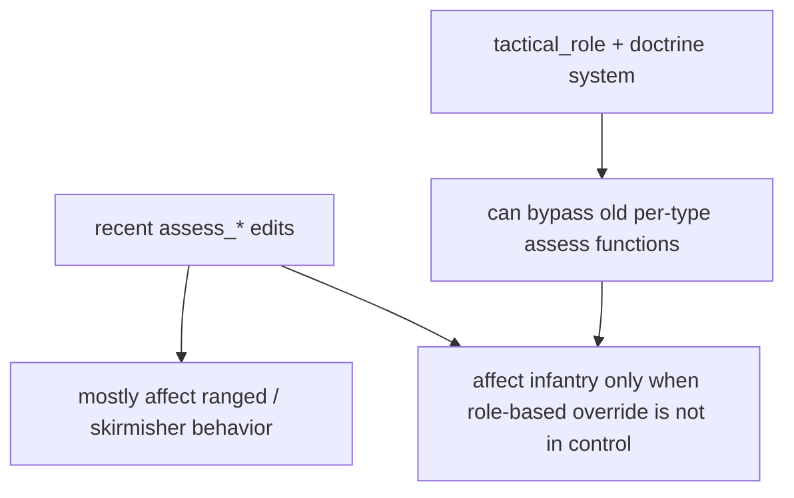

# Claude Edits Impact Map

This file answers a simple question:

What do the recent `battle_simple_ai.gd` edits actually change in live behavior, and what do they not change because of the newer doctrine layer?

## Summary

## What Definitely Changed

### 1. Ranged units now stay in `ATTACK`

Relevant code:

- [battle_simple_ai.gd#L1529-L1576](/Users/developer-cloudprimero/Desktop/Godot/new-game-project/scripts/battle/battle_simple_ai.gd#L1529)

What changed:

- ranged units no longer use `MOVE`, `RETREAT`, or `SCATTER` from `_assess_ranged()`
- when pressured, they keep `ATTACK` and kite by changing `target_x / target_y`
- this matches your observation that movement got better

Why it matters:

- it preserves firing while repositioning
- it makes ranged behavior feel less frozen

### 2. Horse archers now kite while staying on `ATTACK`

Relevant code:

- [battle_simple_ai.gd#L1497-L1527](/Users/developer-cloudprimero/Desktop/Godot/new-game-project/scripts/battle/battle_simple_ai.gd#L1497)

What changed:

- horse archers no longer switch to `MOVE` when backing off
- they reposition but remain in the attack runtime

### 3. Infantry and spears no longer default to purely passive defense in the edited assess blocks

Relevant code:

- [battle_simple_ai.gd#L1278-L1317](/Users/developer-cloudprimero/Desktop/Godot/new-game-project/scripts/battle/battle_simple_ai.gd#L1278)
- [battle_simple_ai.gd#L1461-L1495](/Users/developer-cloudprimero/Desktop/Godot/new-game-project/scripts/battle/battle_simple_ai.gd#L1461)

What changed:

- more `ATTACK`
- less `DEFENSIVE`
- more use of `target_x / target_y` as tactical geometry instead of command switching

## What Did Not Actually Get Solved

### 1. The doctrine layer can bypass most of those infantry changes

Relevant code:

- [battle_simple_ai.gd#L1188-L1191](/Users/developer-cloudprimero/Desktop/Godot/new-game-project/scripts/battle/battle_simple_ai.gd#L1188)
- [battle_simple_ai.gd#L2753-L2831](/Users/developer-cloudprimero/Desktop/Godot/new-game-project/scripts/battle/battle_simple_ai.gd#L2753)

Why this matters:

- if infantry is assigned `ANVIL`, `SCREEN`, `BAIT`, `FLANKER`, or another tactical role
- the older `_assess_infantry()` block is skipped
- so changing `_assess_infantry()` does not guarantee live RED infantry behavior changes

### 2. RED still starts in `ENGAGED`

Relevant code:

- [battle_simple_ai.gd#L172-L180](/Users/developer-cloudprimero/Desktop/Godot/new-game-project/scripts/battle/battle_simple_ai.gd#L172)

Why this matters:

- early-battle choreography is still being skipped
- the playbook can react, but it is not getting a proper staging/approach window to set up the kind of lure-and-flank pattern you want

### 3. `RESERVE` still maps to `HOLD`

Relevant code:

- [battle_simple_ai.gd#L2825-L2827](/Users/developer-cloudprimero/Desktop/Godot/new-game-project/scripts/battle/battle_simple_ai.gd#L2825)

Why this matters:

- if the doctrine selects `DEFENSIVE_LINE`
- cavalry become `RESERVE`
- reserve means `HOLD`
- that can easily make the army look passive, especially when outclassed

### 4. The “bait and archer trap” system exists, but it is not yet the dominant driver

Relevant code:

- [battle_simple_ai.gd#L2706-L2737](/Users/developer-cloudprimero/Desktop/Godot/new-game-project/scripts/battle/battle_simple_ai.gd#L2706) creates `BAIT_AND_FLANK`
- [battle_simple_ai.gd#L2766-L2773](/Users/developer-cloudprimero/Desktop/Godot/new-game-project/scripts/battle/battle_simple_ai.gd#L2766) assigns `FIGHTING_WITHDRAWAL`
- [battle_simple_ai.gd#L2833-L2857](/Users/developer-cloudprimero/Desktop/Godot/new-game-project/scripts/battle/battle_simple_ai.gd#L2833) ticks the fighting-withdrawal cycle

Why this matters:

- the code now has the beginnings of the exact behavior you described
- bait group engages
- bait group backs off
- flankers and skirmishers exploit the shape

But:

- this layer is still buried inside the monolith
- it is not yet clearly dominating target selection and attack timing for the whole RED army

## What The Current Enemy Is Actually Better At Now

- keeping ranged units active while repositioning
- screening archers with melee geometry
- using tactical roles to define higher-level posture
- preserving attack behavior during kite maneuvers

## What The Current Enemy Is Still Bad At

- recognizing "I am outclassed, so I need a coordinated asymmetric plan"
- sustaining a true lure-and-punish loop with infantry bait plus ranged punishment
- using cavalry reserves aggressively enough after the initial plan
- making the doctrine layer and the older assess layer feel like one coherent system

## Best Next Technical Focus

If the goal is:

"enemy should realize it is weaker, pull your heavy infantry forward with bait/light infantry, punish the chase with archers, and flank with mobile units"

then the next high-value code is not another pass on `_assess_infantry()`.

It is:

1. [battle_simple_ai.gd#L2602-L2666](/Users/developer-cloudprimero/Desktop/Godot/new-game-project/scripts/battle/battle_simple_ai.gd#L2602) doctrine selection
2. [battle_simple_ai.gd#L2706-L2737](/Users/developer-cloudprimero/Desktop/Godot/new-game-project/scripts/battle/battle_simple_ai.gd#L2706) bait-and-flank role setup
3. [battle_simple_ai.gd#L2753-L2831](/Users/developer-cloudprimero/Desktop/Godot/new-game-project/scripts/battle/battle_simple_ai.gd#L2753) role-to-command mapping
4. [battle_simple_ai.gd#L2833-L2857](/Users/developer-cloudprimero/Desktop/Godot/new-game-project/scripts/battle/battle_simple_ai.gd#L2833) fighting-withdrawal timing

That is the layer that should own the smarter “weaker army” plan.
