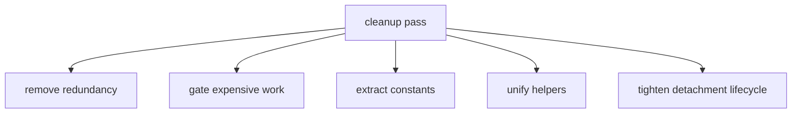
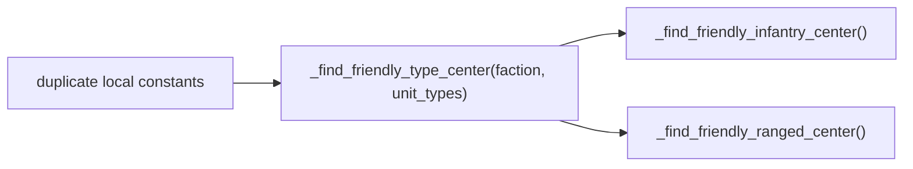
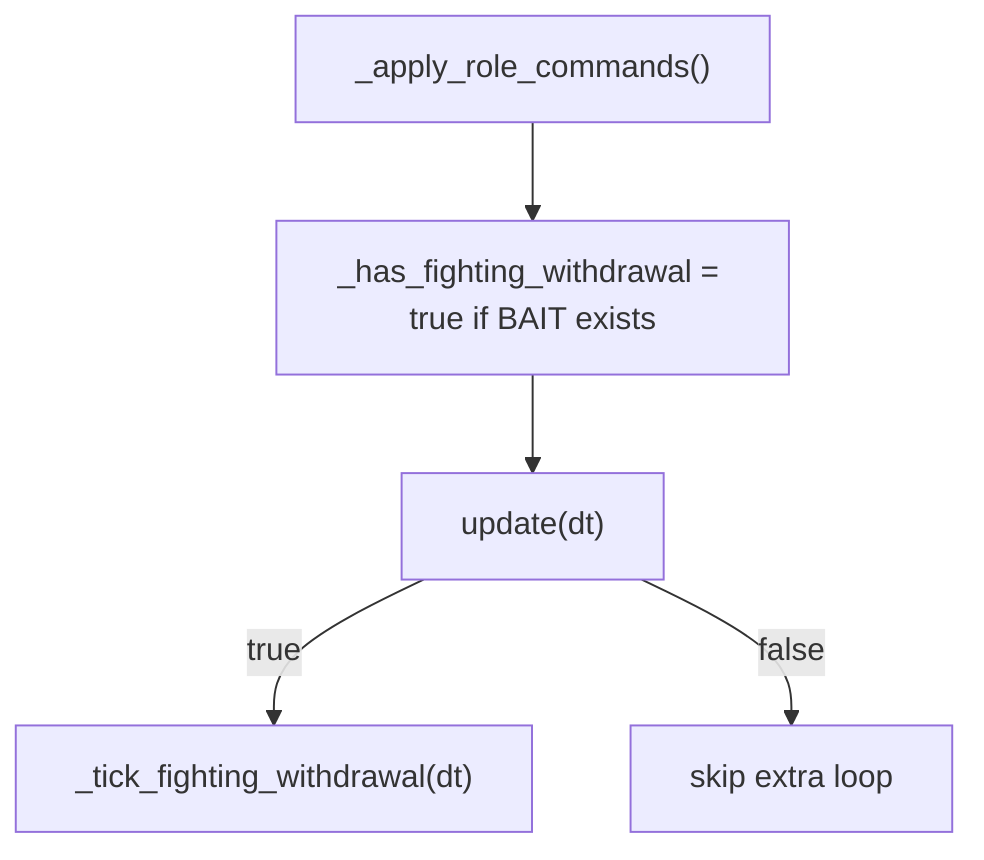
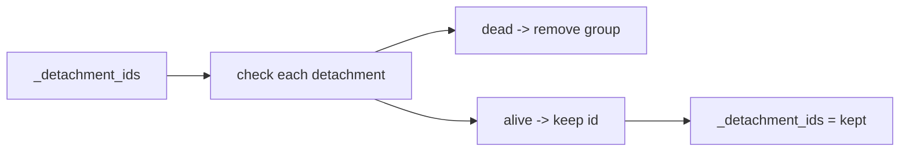

# Playbook Cleanup Pass

This file documents the structural cleanup that happened after the first doctrine/playbook implementation.

It is not a behavior doc first. It is a maintenance/readability doc:

- what was simplified
- what was de-duplicated
- what was gated
- what still remains messy

## Cleanup Overview

## 1. Parse Fix And Helper Consolidation

The immediate bug was a duplicate constant declaration for `_RANGED_TYPES`.

That was resolved by removing the duplicate local constant and consolidating both center-finder helpers onto one shared helper:

- [battle_simple_ai.gd#L1927-L1946](/Users/developer-cloudprimero/Desktop/Godot/new-game-project/scripts/battle/battle_simple_ai.gd#L1927)

What this means:

- friend-group center logic is now one shared implementation
- infantry and ranged center helpers are now small wrappers
- the earlier parse conflict is gone

## 2. Removed Redundant Doctrine Name State

The older playbook pass tracked a separate `_doctrine_name` string. That was redundant because the name can always be derived from `_DOCTRINE_NAMES[_doctrine]`.

Current state:

- [battle_simple_ai.gd#L67-L69](/Users/developer-cloudprimero/Desktop/Godot/new-game-project/scripts/battle/battle_simple_ai.gd#L67)
- [battle_simple_ai.gd#L188-L189](/Users/developer-cloudprimero/Desktop/Godot/new-game-project/scripts/battle/battle_simple_ai.gd#L188)

Result:

- less duplicated state
- fewer chances for a doctrine enum and doctrine string to drift apart

## 3. Fighting-Withdrawal Is Now Gated

One of the biggest cleanup wins is that the bait-loop ticker no longer runs every frame unconditionally.

Relevant code:

- [battle_simple_ai.gd#L70](/Users/developer-cloudprimero/Desktop/Godot/new-game-project/scripts/battle/battle_simple_ai.gd#L70) `_has_fighting_withdrawal`
- [battle_simple_ai.gd#L322-L324](/Users/developer-cloudprimero/Desktop/Godot/new-game-project/scripts/battle/battle_simple_ai.gd#L322) update-loop gate
- [battle_simple_ai.gd#L2758-L2772](/Users/developer-cloudprimero/Desktop/Godot/new-game-project/scripts/battle/battle_simple_ai.gd#L2758) role-command pass sets the flag
- [battle_simple_ai.gd#L2837-L2839](/Users/developer-cloudprimero/Desktop/Godot/new-game-project/scripts/battle/battle_simple_ai.gd#L2837) ticker docstring confirms the gate

Why it matters:

- less wasted per-frame work
- clearer ownership: the bait loop only exists when the playbook actually created BAIT groups

## 4. Magic Numbers Were Named

Relevant code:

- [battle_simple_ai.gd#L72-L79](/Users/developer-cloudprimero/Desktop/Godot/new-game-project/scripts/battle/battle_simple_ai.gd#L72)

Named constants added:

- `FW_ENGAGE_DURATION`
- `FW_BACKOFF_DURATION`
- `FW_RALLY_DISTANCE`
- `FLANK_OFFSET_DISTANCE`
- `SCREEN_OFFSET_DISTANCE`
- `BAIT_MIN_SPLIT_SIZE`
- `BAIT_SPLIT_FRACTION`

This is basic cleanup, but it matters a lot in a file this dense.

It makes role behavior readable without hunting numeric literals through multiple functions.

## 5. Doctrine Execution Signatures Were Tightened

Current doctrine executors now only take the inputs they actually use:

- [battle_simple_ai.gd#L2671-L2683](/Users/developer-cloudprimero/Desktop/Godot/new-game-project/scripts/battle/battle_simple_ai.gd#L2671)
- [battle_simple_ai.gd#L2696-L2753](/Users/developer-cloudprimero/Desktop/Godot/new-game-project/scripts/battle/battle_simple_ai.gd#L2696)

This removed unused `blue_groups` parameters from the doctrine setup functions.

Why it matters:

- doctrine assignment and role execution are more clearly separated now
- `_execute_*` functions assign roles
- `_apply_role_commands()` interprets those roles against live BLUE positions

That split is still not perfect, but it is cleaner than before.

## 6. Detachment Cleanup Is Simpler

The detachment cleanup path is now a single-pass filter:

- [battle_simple_ai.gd#L2861-L2872](/Users/developer-cloudprimero/Desktop/Godot/new-game-project/scripts/battle/battle_simple_ai.gd#L2861)

That is cleaner than maintaining a remove-list and then mutating the array in a second pass.

## 7. What This Cleanup Did Not Solve

- doctrine selection is still computed in a separate strategic layer while lower tactical helpers recompute many of the same facts
- `_apply_role_commands()` still recalculates group centers every time it runs
- the army still starts in `ENGAGED`, so structural cleanup did not restore staged battle choreography
- the 5-doctrine system is still large and intertwined with the older assess system

Relevant anchors:

- [battle_simple_ai.gd#L172-L183](/Users/developer-cloudprimero/Desktop/Godot/new-game-project/scripts/battle/battle_simple_ai.gd#L172)
- [battle_simple_ai.gd#L2755-L2835](/Users/developer-cloudprimero/Desktop/Godot/new-game-project/scripts/battle/battle_simple_ai.gd#L2755)

## Reading Guidance

If you want to understand the cleanup in the right order:

1. [battle_simple_ai.gd#L72-L79](/Users/developer-cloudprimero/Desktop/Godot/new-game-project/scripts/battle/battle_simple_ai.gd#L72)
2. [battle_simple_ai.gd#L322-L324](/Users/developer-cloudprimero/Desktop/Godot/new-game-project/scripts/battle/battle_simple_ai.gd#L322)
3. [battle_simple_ai.gd#L1927-L1946](/Users/developer-cloudprimero/Desktop/Godot/new-game-project/scripts/battle/battle_simple_ai.gd#L1927)
4. [battle_simple_ai.gd#L2758-L2772](/Users/developer-cloudprimero/Desktop/Godot/new-game-project/scripts/battle/battle_simple_ai.gd#L2758)
5. [battle_simple_ai.gd#L2861-L2872](/Users/developer-cloudprimero/Desktop/Godot/new-game-project/scripts/battle/battle_simple_ai.gd#L2861)
