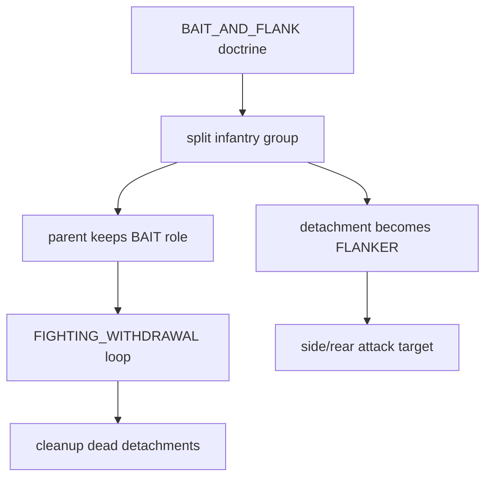
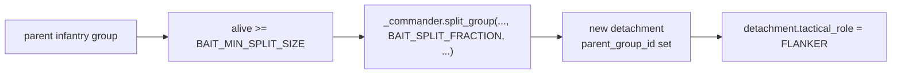
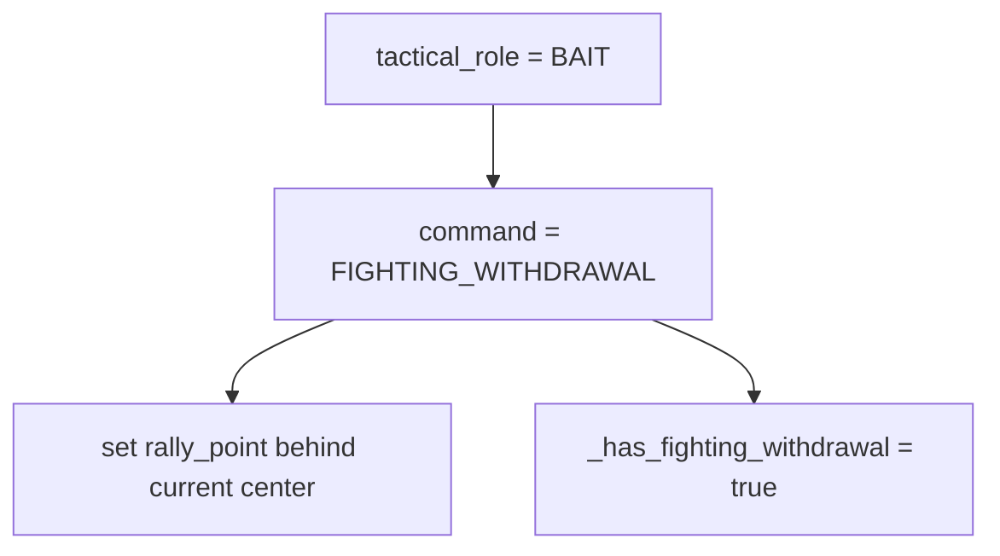
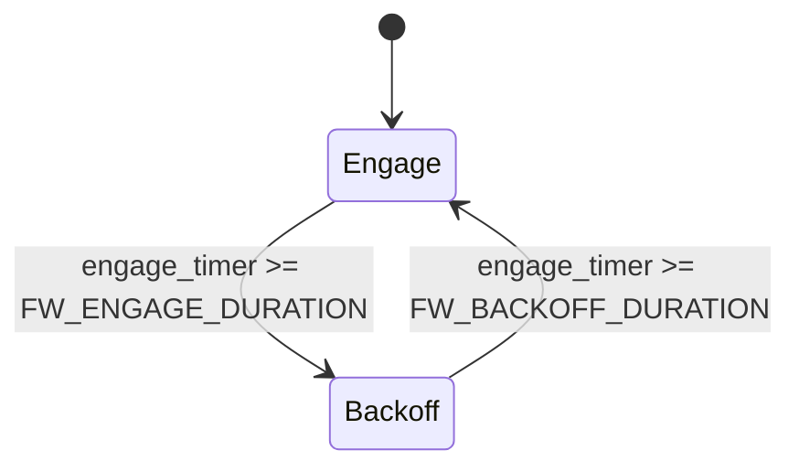
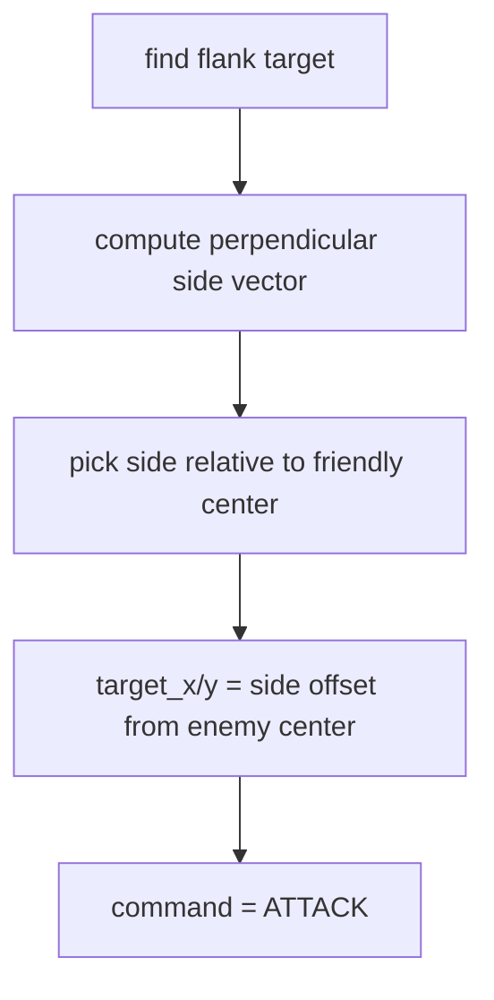
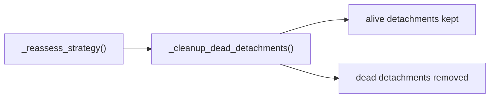

# Detachments And Fighting Withdrawal

This file covers the most specific new playbook mechanic in the RTS AI:

- splitting a parent group into detachments
- assigning BAIT / FLANKER roles
- running the `FIGHTING_WITHDRAWAL` cycle
- cleaning dead detachments out of the system

## High-Level Flow

## 1. Group Model Support

The commander group model now directly supports playbook state:

- [battle_commander.gd#L43-L48](/Users/developer-cloudprimero/Desktop/Godot/new-game-project/scripts/battle/battle_commander.gd#L43)

Important fields:

- `tactical_role`
- `parent_group_id`
- `rally_point`
- `engage_timer`
- `engage_phase`

These are the fields that make doctrine-driven behavior possible without modifying every unit directly.

## 2. Splitting A Group

Relevant code:

- [battle_commander.gd#L94-L122](/Users/developer-cloudprimero/Desktop/Godot/new-game-project/scripts/battle/battle_commander.gd#L94)
- [battle_simple_ai.gd#L2728-L2738](/Users/developer-cloudprimero/Desktop/Godot/new-game-project/scripts/battle/battle_simple_ai.gd#L2728)

What actually happens:

- the parent group is scanned for alive units
- a fraction of them are reassigned to a new group id
- the new detachment inherits faction/unit type/formation
- the detachment records `parent_group_id`

Important constants:

- [battle_simple_ai.gd#L78-L79](/Users/developer-cloudprimero/Desktop/Godot/new-game-project/scripts/battle/battle_simple_ai.gd#L78)

## 3. BAIT Role Becomes `FIGHTING_WITHDRAWAL`

Relevant code:

- [battle_simple_ai.gd#L2769-L2777](/Users/developer-cloudprimero/Desktop/Godot/new-game-project/scripts/battle/battle_simple_ai.gd#L2769)

This is a distinct command type in the commander model:

- [battle_commander.gd#L4](/Users/developer-cloudprimero/Desktop/Godot/new-game-project/scripts/battle/battle_commander.gd#L4)

That matters because the runtime branch can treat it differently from plain `ATTACK` or `MOVE`.

## 4. The Runtime Tick

Relevant code:

- [battle_simple_ai.gd#L322-L324](/Users/developer-cloudprimero/Desktop/Godot/new-game-project/scripts/battle/battle_simple_ai.gd#L322)
- [battle_simple_ai.gd#L2837-L2859](/Users/developer-cloudprimero/Desktop/Godot/new-game-project/scripts/battle/battle_simple_ai.gd#L2837)

Important details:

- the loop is gated by `_has_fighting_withdrawal`
- BLUE groups are fetched lazily only when the BAIT group enters backoff
- when backoff begins, a fresh `rally_point` is computed away from the nearest BLUE group

This is the embryo of the behavior you want:

- engage briefly
- pull the enemy line forward
- reset spacing
- let flankers and skirmishers exploit the gap

## 5. Flanker Geometry

Relevant code:

- [battle_simple_ai.gd#L2778-L2800](/Users/developer-cloudprimero/Desktop/Godot/new-game-project/scripts/battle/battle_simple_ai.gd#L2778)

This is not a full tactical planner. It is geometric role assignment:

- find engaged enemy
- choose side
- issue an offset attack point

That is enough to create visible flanking motion, but not enough by itself to guarantee good timing or target prioritization.

## 6. Cleanup Path

Relevant code:

- [battle_simple_ai.gd#L1129-L1131](/Users/developer-cloudprimero/Desktop/Godot/new-game-project/scripts/battle/battle_simple_ai.gd#L1129)
- [battle_simple_ai.gd#L2861-L2872](/Users/developer-cloudprimero/Desktop/Godot/new-game-project/scripts/battle/battle_simple_ai.gd#L2861)

Important limitation:

- this cleanup removes dead detachments cleanly
- but it does not itself merge surviving detachments back into the parent group
- that means structural cleanup is better, but lifecycle unification is still incomplete unless another doctrine-shift path handles merge behavior elsewhere

## 7. What To Read In Code

Best order:

1. [battle_commander.gd#L43-L48](/Users/developer-cloudprimero/Desktop/Godot/new-game-project/scripts/battle/battle_commander.gd#L43)
2. [battle_commander.gd#L94-L122](/Users/developer-cloudprimero/Desktop/Godot/new-game-project/scripts/battle/battle_commander.gd#L94)
3. [battle_simple_ai.gd#L2709-L2738](/Users/developer-cloudprimero/Desktop/Godot/new-game-project/scripts/battle/battle_simple_ai.gd#L2709)
4. [battle_simple_ai.gd#L2769-L2777](/Users/developer-cloudprimero/Desktop/Godot/new-game-project/scripts/battle/battle_simple_ai.gd#L2769)
5. [battle_simple_ai.gd#L2837-L2859](/Users/developer-cloudprimero/Desktop/Godot/new-game-project/scripts/battle/battle_simple_ai.gd#L2837)
6. [battle_simple_ai.gd#L2861-L2872](/Users/developer-cloudprimero/Desktop/Godot/new-game-project/scripts/battle/battle_simple_ai.gd#L2861)

## High-Stakes Notes

- [battle_simple_ai.gd#L2769](/Users/developer-cloudprimero/Desktop/Godot/new-game-project/scripts/battle/battle_simple_ai.gd#L2769) is the entrypoint for the bait loop.
- [battle_simple_ai.gd#L2837](/Users/developer-cloudprimero/Desktop/Godot/new-game-project/scripts/battle/battle_simple_ai.gd#L2837) is the timing brain for that loop.
- [battle_commander.gd#L94](/Users/developer-cloudprimero/Desktop/Godot/new-game-project/scripts/battle/battle_commander.gd#L94) is the structural mutation point where a group becomes two groups.
- [battle_simple_ai.gd#L2861](/Users/developer-cloudprimero/Desktop/Godot/new-game-project/scripts/battle/battle_simple_ai.gd#L2861) only handles dead-detachment cleanup, not full strategic reintegration.
