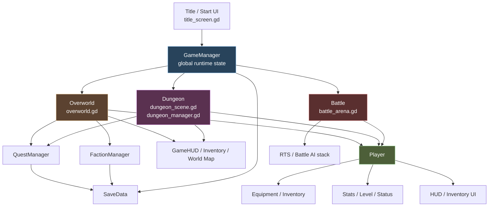

# System Overview

## Whole Game Map

## Main Runtime Domains

- `boot/start`: title screen, save slots, class selection
- `global state`: `GameManager`, `QuestManager`, `FactionManager`, audio/VFX managers
- `player runtime`: player stats, equipment, abilities, HUD-facing signals
- `world runtime`: overworld streaming, zone state, NPC/enemy/world object spawning
- `dungeon runtime`: procedural run state, room events, reward flow
- `battle runtime`: RTS arena, groups, units, command overlay, AI
- `meta progression`: save data, tokens, relics, war/faction territory state

## High-Connectivity Hubs

- [/Users/developer-cloudprimero/Desktop/Godot/new-game-project/scripts/systems/game_manager.gd](/Users/developer-cloudprimero/Desktop/Godot/new-game-project/scripts/systems/game_manager.gd)
  The global spine. Scene transitions and persistent run state flow through this file.
- [/Users/developer-cloudprimero/Desktop/Godot/new-game-project/scripts/player.gd](/Users/developer-cloudprimero/Desktop/Godot/new-game-project/scripts/player.gd)
  The local gameplay spine. Stats, equipment, spellbook, HUD signals, and moment-to-moment combat flow through this file.
- [/Users/developer-cloudprimero/Desktop/Godot/new-game-project/scripts/overworld/overworld.gd](/Users/developer-cloudprimero/Desktop/Godot/new-game-project/scripts/overworld/overworld.gd)
  The world shell. It bridges player, HUD, quests, factions, chunks, spawns, and battle entry.
- [/Users/developer-cloudprimero/Desktop/Godot/new-game-project/scripts/dungeon/dungeon_manager.gd](/Users/developer-cloudprimero/Desktop/Godot/new-game-project/scripts/dungeon/dungeon_manager.gd)
  The dungeon shell. It bridges generation, run state, rewards, events, and player lifecycle in runs.
- [/Users/developer-cloudprimero/Desktop/Godot/new-game-project/scripts/battle/battle_arena.gd](/Users/developer-cloudprimero/Desktop/Godot/new-game-project/scripts/battle/battle_arena.gd)
  The RTS shell. It bridges battle setup, player insertion, group control, AI, and results.

## What This First Pass Does

- maps file-to-file and system-to-system relationships
- identifies where scene boundaries and autoload boundaries are
- identifies which files are good future branch boundaries

## What This First Pass Does Not Do

- explain every algorithm
- explain every combat rule
- explain every dungeon generation rule

Those belong in later subsystem packs.

