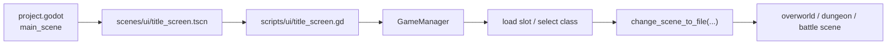
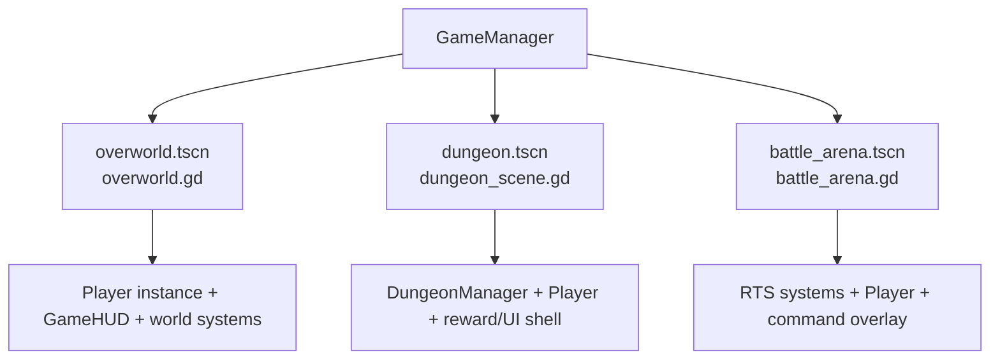

# Runtime Entrypoints

## Boot Sequence

Relevant files:

- [/Users/developer-cloudprimero/Desktop/Godot/new-game-project/project.godot](/Users/developer-cloudprimero/Desktop/Godot/new-game-project/project.godot)
- [/Users/developer-cloudprimero/Desktop/Godot/new-game-project/scenes/ui/title_screen.tscn](/Users/developer-cloudprimero/Desktop/Godot/new-game-project/scenes/ui/title_screen.tscn)
- [/Users/developer-cloudprimero/Desktop/Godot/new-game-project/scripts/ui/title_screen.gd](/Users/developer-cloudprimero/Desktop/Godot/new-game-project/scripts/ui/title_screen.gd)
- [/Users/developer-cloudprimero/Desktop/Godot/new-game-project/scripts/systems/game_manager.gd](/Users/developer-cloudprimero/Desktop/Godot/new-game-project/scripts/systems/game_manager.gd)

## Scene Entrypoint Shells

Key shell files:

- [/Users/developer-cloudprimero/Desktop/Godot/new-game-project/scripts/overworld/overworld.gd](/Users/developer-cloudprimero/Desktop/Godot/new-game-project/scripts/overworld/overworld.gd)
- [/Users/developer-cloudprimero/Desktop/Godot/new-game-project/scripts/dungeon/dungeon_scene.gd](/Users/developer-cloudprimero/Desktop/Godot/new-game-project/scripts/dungeon/dungeon_scene.gd)
- [/Users/developer-cloudprimero/Desktop/Godot/new-game-project/scripts/battle/battle_arena.gd](/Users/developer-cloudprimero/Desktop/Godot/new-game-project/scripts/battle/battle_arena.gd)

## Why These Matter

- these are the first runtime files to read for any subsystem
- they are the composition roots where managers, UI, and the player get wired together
- later refactors should keep these files thin and move logic down into subsystem collaborators

