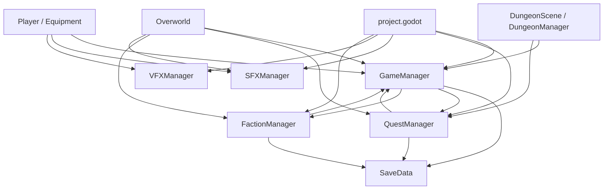
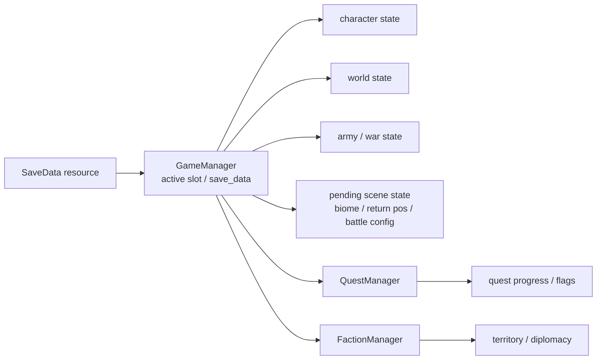

# State And Autoloads

## Autoload Graph

Autoload declarations live in:

- [/Users/developer-cloudprimero/Desktop/Godot/new-game-project/project.godot](/Users/developer-cloudprimero/Desktop/Godot/new-game-project/project.godot)

Primary autoload scripts:

- [/Users/developer-cloudprimero/Desktop/Godot/new-game-project/scripts/systems/game_manager.gd](/Users/developer-cloudprimero/Desktop/Godot/new-game-project/scripts/systems/game_manager.gd)
- [/Users/developer-cloudprimero/Desktop/Godot/new-game-project/scripts/quests/quest_manager.gd](/Users/developer-cloudprimero/Desktop/Godot/new-game-project/scripts/quests/quest_manager.gd)
- [/Users/developer-cloudprimero/Desktop/Godot/new-game-project/scripts/systems/faction_manager.gd](/Users/developer-cloudprimero/Desktop/Godot/new-game-project/scripts/systems/faction_manager.gd)
- [/Users/developer-cloudprimero/Desktop/Godot/new-game-project/scripts/systems/sfx_manager.gd](/Users/developer-cloudprimero/Desktop/Godot/new-game-project/scripts/systems/sfx_manager.gd)
- [/Users/developer-cloudprimero/Desktop/Godot/new-game-project/scripts/systems/vfx_manager.gd](/Users/developer-cloudprimero/Desktop/Godot/new-game-project/scripts/systems/vfx_manager.gd)

## Persistent State Ownership

Relevant files:

- [/Users/developer-cloudprimero/Desktop/Godot/new-game-project/scripts/systems/save_data.gd](/Users/developer-cloudprimero/Desktop/Godot/new-game-project/scripts/systems/save_data.gd)
- [/Users/developer-cloudprimero/Desktop/Godot/new-game-project/scripts/systems/game_manager.gd](/Users/developer-cloudprimero/Desktop/Godot/new-game-project/scripts/systems/game_manager.gd)
- [/Users/developer-cloudprimero/Desktop/Godot/new-game-project/scripts/quests/quest_manager.gd](/Users/developer-cloudprimero/Desktop/Godot/new-game-project/scripts/quests/quest_manager.gd)
- [/Users/developer-cloudprimero/Desktop/Godot/new-game-project/scripts/systems/faction_manager.gd](/Users/developer-cloudprimero/Desktop/Godot/new-game-project/scripts/systems/faction_manager.gd)

## First-Pass Read

If you want to understand global coupling first, read in this order:

1. `project.godot`
2. `game_manager.gd`
3. `save_data.gd`
4. `quest_manager.gd`
5. `faction_manager.gd`

