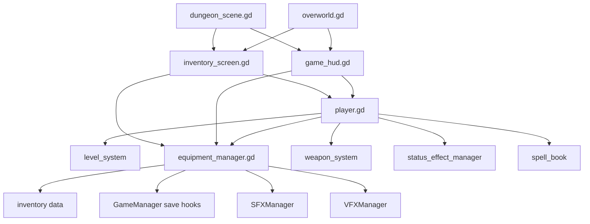
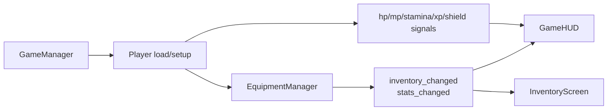

# Player Inventory UI Links

## Player-Centered Connection Map

Core files:

- [/Users/developer-cloudprimero/Desktop/Godot/new-game-project/scripts/player.gd](/Users/developer-cloudprimero/Desktop/Godot/new-game-project/scripts/player.gd)
- [/Users/developer-cloudprimero/Desktop/Godot/new-game-project/scripts/stats/equipment_manager.gd](/Users/developer-cloudprimero/Desktop/Godot/new-game-project/scripts/stats/equipment_manager.gd)
- [/Users/developer-cloudprimero/Desktop/Godot/new-game-project/scripts/ui/game_hud.gd](/Users/developer-cloudprimero/Desktop/Godot/new-game-project/scripts/ui/game_hud.gd)
- [/Users/developer-cloudprimero/Desktop/Godot/new-game-project/scripts/ui/inventory_screen.gd](/Users/developer-cloudprimero/Desktop/Godot/new-game-project/scripts/ui/inventory_screen.gd)

## Data And Signal Flow

## Why This Cluster Matters

- `player.gd` is not just movement/combat; it is also a local integration root
- `EquipmentManager` is the real inventory/equipment persistence bridge
- `GameHUD` and `InventoryScreen` are consumers of player and equipment state, not owners

## Good Future Branch Boundary

This cluster can later be separated into:

- `player-runtime`
- `inventory-equipment`
- `player-ui`

