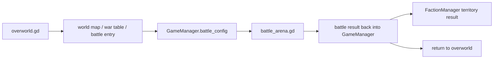
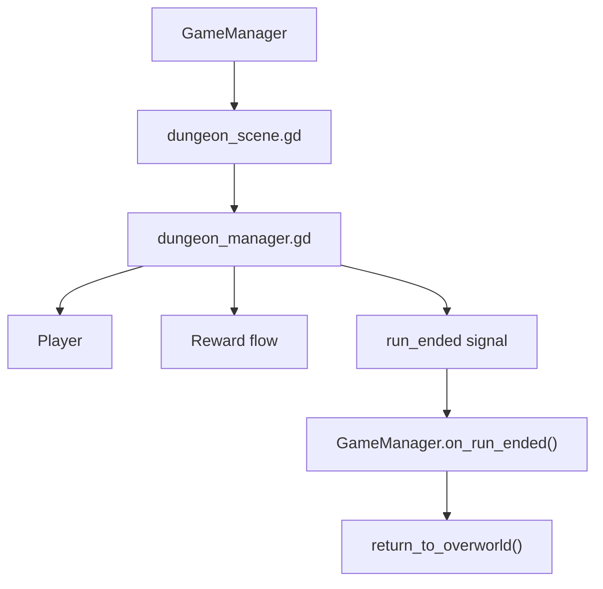
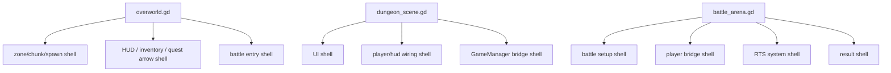

# World Dungeon Battle Links

## Macro World Flow

Relevant files:

- [/Users/developer-cloudprimero/Desktop/Godot/new-game-project/scripts/overworld/overworld.gd](/Users/developer-cloudprimero/Desktop/Godot/new-game-project/scripts/overworld/overworld.gd)
- [/Users/developer-cloudprimero/Desktop/Godot/new-game-project/scripts/ui/world_map_screen.gd](/Users/developer-cloudprimero/Desktop/Godot/new-game-project/scripts/ui/world_map_screen.gd)
- [/Users/developer-cloudprimero/Desktop/Godot/new-game-project/scripts/objects/war_table.gd](/Users/developer-cloudprimero/Desktop/Godot/new-game-project/scripts/objects/war_table.gd)
- [/Users/developer-cloudprimero/Desktop/Godot/new-game-project/scripts/battle/battle_arena.gd](/Users/developer-cloudprimero/Desktop/Godot/new-game-project/scripts/battle/battle_arena.gd)

## Dungeon Entry And Exit

Relevant files:

- [/Users/developer-cloudprimero/Desktop/Godot/new-game-project/scripts/dungeon/dungeon_scene.gd](/Users/developer-cloudprimero/Desktop/Godot/new-game-project/scripts/dungeon/dungeon_scene.gd)
- [/Users/developer-cloudprimero/Desktop/Godot/new-game-project/scripts/dungeon/dungeon_manager.gd](/Users/developer-cloudprimero/Desktop/Godot/new-game-project/scripts/dungeon/dungeon_manager.gd)
- [/Users/developer-cloudprimero/Desktop/Godot/new-game-project/scripts/dungeon/dungeon_events.gd](/Users/developer-cloudprimero/Desktop/Godot/new-game-project/scripts/dungeon/dungeon_events.gd)

## Scene Shell Responsibilities

## First-Pass Takeaway

The scene scripts are not pure visuals. They are subsystem wiring roots. Later refactors should preserve them as thin coordinators while moving mechanics into collaborators.

