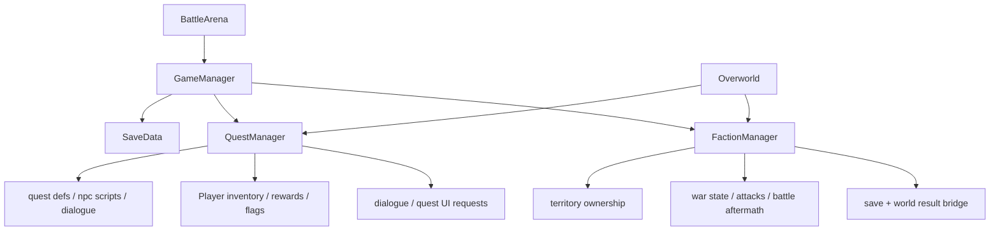

# Quest Faction Save Links

## Meta-Progression Linkage

Core files:

- [/Users/developer-cloudprimero/Desktop/Godot/new-game-project/scripts/quests/quest_manager.gd](/Users/developer-cloudprimero/Desktop/Godot/new-game-project/scripts/quests/quest_manager.gd)
- [/Users/developer-cloudprimero/Desktop/Godot/new-game-project/scripts/systems/faction_manager.gd](/Users/developer-cloudprimero/Desktop/Godot/new-game-project/scripts/systems/faction_manager.gd)
- [/Users/developer-cloudprimero/Desktop/Godot/new-game-project/scripts/systems/save_data.gd](/Users/developer-cloudprimero/Desktop/Godot/new-game-project/scripts/systems/save_data.gd)
- [/Users/developer-cloudprimero/Desktop/Godot/new-game-project/scripts/systems/game_manager.gd](/Users/developer-cloudprimero/Desktop/Godot/new-game-project/scripts/systems/game_manager.gd)

## Ownership Model

- `GameManager` owns the active slot and the live `SaveData`
- `QuestManager` owns runtime quest progression and dialogue-facing quest scripting
- `FactionManager` owns territory and diplomacy runtime state
- `SaveData` is the persistence schema all of them ultimately serialize through

## High-Stakes Boundaries

- battle result to territory change
- run result to save mutation
- quest reward to inventory mutation
- class/slot selection to player loadout initialization

