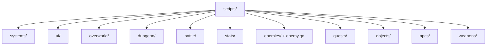

# File Cluster Catalog

## Main Clusters

## Cluster Notes

### `systems/`

- global runtime and persistence hubs
- first files to inspect: [game_manager.gd](/Users/developer-cloudprimero/Desktop/Godot/new-game-project/scripts/systems/game_manager.gd), [save_data.gd](/Users/developer-cloudprimero/Desktop/Godot/new-game-project/scripts/systems/save_data.gd), [faction_manager.gd](/Users/developer-cloudprimero/Desktop/Godot/new-game-project/scripts/systems/faction_manager.gd)

### `ui/`

- shell UIs, HUD, inventory, title/start, map, army management
- these mostly consume state owned elsewhere

### `overworld/`

- world runtime shell
- chunk, zone, spawn, and world interaction logic

### `dungeon/`

- run-oriented runtime shell
- generation, events, traps, room state, reward and exit flow

### `battle/`

- RTS arena, units, commander, command overlay, AI, renderer, projectile system
- already has a deep doc pack under [battle_rts](/Users/developer-cloudprimero/Desktop/Godot/new-game-project/docs/mermaid/battle_rts/README.md)

### `stats/`

- player-affecting systems like equipment and stat processors
- the practical bridge between character state and UI/save

### `enemy.gd` and `enemies/`

- enemy runtime plus content-specific enemy scripts/resources
- this is another future high-priority documentation pack

## Suggested Next Documentation Order

1. overworld
2. dungeon
3. player + inventory
4. enemy runtime
5. quests + save + faction internals

## Suggested Future Branch Boundaries

- `arch/overworld-core`
- `arch/dungeon-core`
- `arch/player-runtime`
- `arch/inventory-equipment`
- `arch/enemy-runtime`
- `arch/quest-save-faction`
- `arch/battle-rts`

