# Scene Script Matrix

This file is the fastest way to answer:

- which scenes matter
- which scripts are their composition roots
- which runtime systems get wired there

## Main Scene Matrix

```mermaid
flowchart TD
    TS["scenes/ui/title_screen.tscn"] --> TSG["scripts/ui/title_screen.gd"]
    OW["scenes/overworld/overworld.tscn
    or overworld.scn"] --> OWG["scripts/overworld/overworld.gd"]
    DG["scenes/dungeon/dungeon.tscn"] --> DSG["scripts/dungeon/dungeon_scene.gd"]
    BA["scenes/battle/battle_arena.tscn"] --> BAG["scripts/battle/battle_arena.gd"]
    PL["scenes/player.tscn"] --> PG["scripts/player.gd"]
    EN["scenes/enemy.tscn"] --> EG["scripts/enemy.gd"]
    INV["scenes/ui/inventory_screen.tscn"] --> INVG["scripts/ui/inventory_screen.gd"]
    RW["scenes/ui/reward_screen.tscn"] --> RWG["scripts/ui/reward_screen.gd"]
    DS["scenes/ui/death_screen.tscn"] --> DSG2["scripts/ui/death_screen.gd"]
```

## Composition Roots

### Boot

- Scene: [/Users/developer-cloudprimero/Desktop/Godot/new-game-project/scenes/ui/title_screen.tscn](/Users/developer-cloudprimero/Desktop/Godot/new-game-project/scenes/ui/title_screen.tscn)
- Script: [/Users/developer-cloudprimero/Desktop/Godot/new-game-project/scripts/ui/title_screen.gd](/Users/developer-cloudprimero/Desktop/Godot/new-game-project/scripts/ui/title_screen.gd)
- Wires:
  - save slot selection
  - class selection
  - `GameManager` start flow

### Overworld

- Scene: [/Users/developer-cloudprimero/Desktop/Godot/new-game-project/scenes/overworld/overworld.tscn](/Users/developer-cloudprimero/Desktop/Godot/new-game-project/scenes/overworld/overworld.tscn)
- Script: [/Users/developer-cloudprimero/Desktop/Godot/new-game-project/scripts/overworld/overworld.gd](/Users/developer-cloudprimero/Desktop/Godot/new-game-project/scripts/overworld/overworld.gd)
- Wires:
  - player spawn
  - HUD + inventory
  - chunks + zones
  - world objects
  - quest/faction/world-state bridges
  - battle entry

### Dungeon

- Scene: [/Users/developer-cloudprimero/Desktop/Godot/new-game-project/scenes/dungeon/dungeon.tscn](/Users/developer-cloudprimero/Desktop/Godot/new-game-project/scenes/dungeon/dungeon.tscn)
- Script: [/Users/developer-cloudprimero/Desktop/Godot/new-game-project/scripts/dungeon/dungeon_scene.gd](/Users/developer-cloudprimero/Desktop/Godot/new-game-project/scripts/dungeon/dungeon_scene.gd)
- Wires:
  - `DungeonManager`
  - player
  - reward screen
  - death screen
  - HUD + inventory shell
  - `GameManager` run transition bridge

### Battle

- Scene: [/Users/developer-cloudprimero/Desktop/Godot/new-game-project/scenes/battle/battle_arena.tscn](/Users/developer-cloudprimero/Desktop/Godot/new-game-project/scenes/battle/battle_arena.tscn)
- Script: [/Users/developer-cloudprimero/Desktop/Godot/new-game-project/scripts/battle/battle_arena.gd](/Users/developer-cloudprimero/Desktop/Godot/new-game-project/scripts/battle/battle_arena.gd)
- Wires:
  - unit system
  - commander/groups
  - command overlay
  - AI
  - player bridge
  - battle result bridge

## Support Scenes With Important Scripts

- [/Users/developer-cloudprimero/Desktop/Godot/new-game-project/scenes/player.tscn](/Users/developer-cloudprimero/Desktop/Godot/new-game-project/scenes/player.tscn) -> [/Users/developer-cloudprimero/Desktop/Godot/new-game-project/scripts/player.gd](/Users/developer-cloudprimero/Desktop/Godot/new-game-project/scripts/player.gd)
- [/Users/developer-cloudprimero/Desktop/Godot/new-game-project/scenes/enemy.tscn](/Users/developer-cloudprimero/Desktop/Godot/new-game-project/scenes/enemy.tscn) -> [/Users/developer-cloudprimero/Desktop/Godot/new-game-project/scripts/enemy.gd](/Users/developer-cloudprimero/Desktop/Godot/new-game-project/scripts/enemy.gd)
- [/Users/developer-cloudprimero/Desktop/Godot/new-game-project/scenes/ui/inventory_screen.tscn](/Users/developer-cloudprimero/Desktop/Godot/new-game-project/scenes/ui/inventory_screen.tscn) -> [/Users/developer-cloudprimero/Desktop/Godot/new-game-project/scripts/ui/inventory_screen.gd](/Users/developer-cloudprimero/Desktop/Godot/new-game-project/scripts/ui/inventory_screen.gd)
- [/Users/developer-cloudprimero/Desktop/Godot/new-game-project/scenes/ui/reward_screen.tscn](/Users/developer-cloudprimero/Desktop/Godot/new-game-project/scenes/ui/reward_screen.tscn) -> [/Users/developer-cloudprimero/Desktop/Godot/new-game-project/scripts/ui/reward_screen.gd](/Users/developer-cloudprimero/Desktop/Godot/new-game-project/scripts/ui/reward_screen.gd)
- [/Users/developer-cloudprimero/Desktop/Godot/new-game-project/scenes/ui/death_screen.tscn](/Users/developer-cloudprimero/Desktop/Godot/new-game-project/scenes/ui/death_screen.tscn) -> [/Users/developer-cloudprimero/Desktop/Godot/new-game-project/scripts/ui/death_screen.gd](/Users/developer-cloudprimero/Desktop/Godot/new-game-project/scripts/ui/death_screen.gd)

