# High Connectivity Hubs

This file lists the scripts that are most important to understand first because they connect many other systems.

## Hub Map

```mermaid
flowchart TD
    GM["game_manager.gd"] --> OW["overworld.gd"]
    GM --> DS["dungeon_scene.gd"]
    GM --> DM["dungeon_manager.gd"]
    GM --> BA["battle_arena.gd"]
    GM --> P["player.gd"]
    GM --> QM["quest_manager.gd"]
    GM --> FM["faction_manager.gd"]

    P --> EQ["equipment_manager.gd"]
    P --> HUD["game_hud.gd"]
    P --> SB["spell_book.gd"]
    P --> WS["weapon_system.gd"]

    OW --> HUD
    OW --> INV["inventory_screen.gd"]
    OW --> WM["world_map_screen.gd"]
    OW --> WT["war_table.gd"]
    OW --> QM
    OW --> FM

    DM --> EV["dungeon_events.gd"]
    DM --> FG["floor_generator.gd"]
    DM --> RS["run_state.gd"]

    BA --> AI["battle_simple_ai.gd"]
    BA --> COM["battle_commander.gd"]
    BA --> US["battle_unit_system.gd"]
```

## Ranked Reading Targets

### Tier 1: Global And Scene Shell Hubs

- [/Users/developer-cloudprimero/Desktop/Godot/new-game-project/scripts/systems/game_manager.gd](/Users/developer-cloudprimero/Desktop/Godot/new-game-project/scripts/systems/game_manager.gd)
- [/Users/developer-cloudprimero/Desktop/Godot/new-game-project/scripts/overworld/overworld.gd](/Users/developer-cloudprimero/Desktop/Godot/new-game-project/scripts/overworld/overworld.gd)
- [/Users/developer-cloudprimero/Desktop/Godot/new-game-project/scripts/dungeon/dungeon_scene.gd](/Users/developer-cloudprimero/Desktop/Godot/new-game-project/scripts/dungeon/dungeon_scene.gd)
- [/Users/developer-cloudprimero/Desktop/Godot/new-game-project/scripts/dungeon/dungeon_manager.gd](/Users/developer-cloudprimero/Desktop/Godot/new-game-project/scripts/dungeon/dungeon_manager.gd)
- [/Users/developer-cloudprimero/Desktop/Godot/new-game-project/scripts/battle/battle_arena.gd](/Users/developer-cloudprimero/Desktop/Godot/new-game-project/scripts/battle/battle_arena.gd)

### Tier 2: Player And Global Meta Systems

- [/Users/developer-cloudprimero/Desktop/Godot/new-game-project/scripts/player.gd](/Users/developer-cloudprimero/Desktop/Godot/new-game-project/scripts/player.gd)
- [/Users/developer-cloudprimero/Desktop/Godot/new-game-project/scripts/stats/equipment_manager.gd](/Users/developer-cloudprimero/Desktop/Godot/new-game-project/scripts/stats/equipment_manager.gd)
- [/Users/developer-cloudprimero/Desktop/Godot/new-game-project/scripts/quests/quest_manager.gd](/Users/developer-cloudprimero/Desktop/Godot/new-game-project/scripts/quests/quest_manager.gd)
- [/Users/developer-cloudprimero/Desktop/Godot/new-game-project/scripts/systems/faction_manager.gd](/Users/developer-cloudprimero/Desktop/Godot/new-game-project/scripts/systems/faction_manager.gd)
- [/Users/developer-cloudprimero/Desktop/Godot/new-game-project/scripts/systems/save_data.gd](/Users/developer-cloudprimero/Desktop/Godot/new-game-project/scripts/systems/save_data.gd)

### Tier 3: UI And Specialized Bridges

- [/Users/developer-cloudprimero/Desktop/Godot/new-game-project/scripts/ui/game_hud.gd](/Users/developer-cloudprimero/Desktop/Godot/new-game-project/scripts/ui/game_hud.gd)
- [/Users/developer-cloudprimero/Desktop/Godot/new-game-project/scripts/ui/inventory_screen.gd](/Users/developer-cloudprimero/Desktop/Godot/new-game-project/scripts/ui/inventory_screen.gd)
- [/Users/developer-cloudprimero/Desktop/Godot/new-game-project/scripts/ui/world_map_screen.gd](/Users/developer-cloudprimero/Desktop/Godot/new-game-project/scripts/ui/world_map_screen.gd)
- [/Users/developer-cloudprimero/Desktop/Godot/new-game-project/scripts/objects/war_table.gd](/Users/developer-cloudprimero/Desktop/Godot/new-game-project/scripts/objects/war_table.gd)
- [/Users/developer-cloudprimero/Desktop/Godot/new-game-project/scripts/enemy.gd](/Users/developer-cloudprimero/Desktop/Godot/new-game-project/scripts/enemy.gd)

## Why These Hubs Matter

- they are the first files to split when refactoring by ownership
- they are the first files to document deeply if you want behavior-level understanding
- they are the most dangerous files for parallel AI editing without strict file ownership

