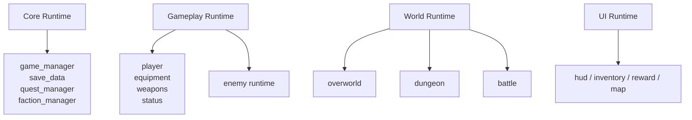

# Branch And System Split

This file turns the connection map into actual work boundaries.

## Target System Split

## Suggested Branches

- `arch/core-runtime`
- `arch/player-runtime`
- `arch/enemy-runtime`
- `arch/overworld-core`
- `arch/dungeon-core`
- `arch/battle-rts`
- `arch/ui-runtime`

## File Ownership By Branch

### `arch/core-runtime`

- [/Users/developer-cloudprimero/Desktop/Godot/new-game-project/scripts/systems/game_manager.gd](/Users/developer-cloudprimero/Desktop/Godot/new-game-project/scripts/systems/game_manager.gd)
- [/Users/developer-cloudprimero/Desktop/Godot/new-game-project/scripts/systems/save_data.gd](/Users/developer-cloudprimero/Desktop/Godot/new-game-project/scripts/systems/save_data.gd)
- [/Users/developer-cloudprimero/Desktop/Godot/new-game-project/scripts/quests/quest_manager.gd](/Users/developer-cloudprimero/Desktop/Godot/new-game-project/scripts/quests/quest_manager.gd)
- [/Users/developer-cloudprimero/Desktop/Godot/new-game-project/scripts/systems/faction_manager.gd](/Users/developer-cloudprimero/Desktop/Godot/new-game-project/scripts/systems/faction_manager.gd)

### `arch/player-runtime`

- [/Users/developer-cloudprimero/Desktop/Godot/new-game-project/scripts/player.gd](/Users/developer-cloudprimero/Desktop/Godot/new-game-project/scripts/player.gd)
- [/Users/developer-cloudprimero/Desktop/Godot/new-game-project/scripts/stats/equipment_manager.gd](/Users/developer-cloudprimero/Desktop/Godot/new-game-project/scripts/stats/equipment_manager.gd)
- [/Users/developer-cloudprimero/Desktop/Godot/new-game-project/scripts/stats/level_system.gd](/Users/developer-cloudprimero/Desktop/Godot/new-game-project/scripts/stats/level_system.gd)
- [/Users/developer-cloudprimero/Desktop/Godot/new-game-project/scripts/weapons/weapon_system.gd](/Users/developer-cloudprimero/Desktop/Godot/new-game-project/scripts/weapons/weapon_system.gd)
- [/Users/developer-cloudprimero/Desktop/Godot/new-game-project/scripts/systems/status_effect_manager.gd](/Users/developer-cloudprimero/Desktop/Godot/new-game-project/scripts/systems/status_effect_manager.gd)

### `arch/enemy-runtime`

- [/Users/developer-cloudprimero/Desktop/Godot/new-game-project/scripts/enemy.gd](/Users/developer-cloudprimero/Desktop/Godot/new-game-project/scripts/enemy.gd)
- [/Users/developer-cloudprimero/Desktop/Godot/new-game-project/scripts/enemy_spawner.gd](/Users/developer-cloudprimero/Desktop/Godot/new-game-project/scripts/enemy_spawner.gd)
- [/Users/developer-cloudprimero/Desktop/Godot/new-game-project/scripts/enemies/enemy_definition.gd](/Users/developer-cloudprimero/Desktop/Godot/new-game-project/scripts/enemies/enemy_definition.gd)

### `arch/overworld-core`

- [/Users/developer-cloudprimero/Desktop/Godot/new-game-project/scripts/overworld/overworld.gd](/Users/developer-cloudprimero/Desktop/Godot/new-game-project/scripts/overworld/overworld.gd)
- [/Users/developer-cloudprimero/Desktop/Godot/new-game-project/scripts/world/harvest_node.gd](/Users/developer-cloudprimero/Desktop/Godot/new-game-project/scripts/world/harvest_node.gd)
- [/Users/developer-cloudprimero/Desktop/Godot/new-game-project/scripts/objects/war_table.gd](/Users/developer-cloudprimero/Desktop/Godot/new-game-project/scripts/objects/war_table.gd)

### `arch/dungeon-core`

- [/Users/developer-cloudprimero/Desktop/Godot/new-game-project/scripts/dungeon/dungeon_scene.gd](/Users/developer-cloudprimero/Desktop/Godot/new-game-project/scripts/dungeon/dungeon_scene.gd)
- [/Users/developer-cloudprimero/Desktop/Godot/new-game-project/scripts/dungeon/dungeon_manager.gd](/Users/developer-cloudprimero/Desktop/Godot/new-game-project/scripts/dungeon/dungeon_manager.gd)
- [/Users/developer-cloudprimero/Desktop/Godot/new-game-project/scripts/dungeon/floor_generator.gd](/Users/developer-cloudprimero/Desktop/Godot/new-game-project/scripts/dungeon/floor_generator.gd)
- [/Users/developer-cloudprimero/Desktop/Godot/new-game-project/scripts/dungeon/dungeon_events.gd](/Users/developer-cloudprimero/Desktop/Godot/new-game-project/scripts/dungeon/dungeon_events.gd)

### `arch/battle-rts`

- [/Users/developer-cloudprimero/Desktop/Godot/new-game-project/scripts/battle/battle_arena.gd](/Users/developer-cloudprimero/Desktop/Godot/new-game-project/scripts/battle/battle_arena.gd)
- [/Users/developer-cloudprimero/Desktop/Godot/new-game-project/scripts/battle/battle_simple_ai.gd](/Users/developer-cloudprimero/Desktop/Godot/new-game-project/scripts/battle/battle_simple_ai.gd)
- [/Users/developer-cloudprimero/Desktop/Godot/new-game-project/scripts/battle/battle_commander.gd](/Users/developer-cloudprimero/Desktop/Godot/new-game-project/scripts/battle/battle_commander.gd)
- [/Users/developer-cloudprimero/Desktop/Godot/new-game-project/scripts/battle/battle_unit_system.gd](/Users/developer-cloudprimero/Desktop/Godot/new-game-project/scripts/battle/battle_unit_system.gd)
- [/Users/developer-cloudprimero/Desktop/Godot/new-game-project/scripts/battle/battle_command_overlay.gd](/Users/developer-cloudprimero/Desktop/Godot/new-game-project/scripts/battle/battle_command_overlay.gd)

### `arch/ui-runtime`

- [/Users/developer-cloudprimero/Desktop/Godot/new-game-project/scripts/ui/game_hud.gd](/Users/developer-cloudprimero/Desktop/Godot/new-game-project/scripts/ui/game_hud.gd)
- [/Users/developer-cloudprimero/Desktop/Godot/new-game-project/scripts/ui/inventory_screen.gd](/Users/developer-cloudprimero/Desktop/Godot/new-game-project/scripts/ui/inventory_screen.gd)
- [/Users/developer-cloudprimero/Desktop/Godot/new-game-project/scripts/ui/world_map_screen.gd](/Users/developer-cloudprimero/Desktop/Godot/new-game-project/scripts/ui/world_map_screen.gd)
- [/Users/developer-cloudprimero/Desktop/Godot/new-game-project/scripts/ui/army_management_screen.gd](/Users/developer-cloudprimero/Desktop/Godot/new-game-project/scripts/ui/army_management_screen.gd)

## Practical Rule For Parallel AI Agents

- one branch owns one hub file cluster
- no two agents touch the same hub file at the same time
- shared dependencies like `GameManager` require explicit integration review

