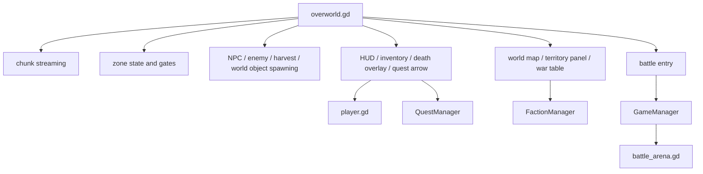

# Overworld Overview

## System Shape

## What The Overworld Actually Is

This is not just a walking map.

It is the game's world shell:

- persistent exploration space
- zone and chunk loader
- spawn manager for enemies and interactables
- home for war tables and territory interaction
- fast-travel and world-map UI bridge
- launch point for RTS battles
- return target after dungeons and battles

## Genre Read

From the code, the game looks like a hybrid of:

- top-down ARPG exploration
- roguelite dungeon runs
- kingdom or territory meta-progression
- Mount-and-Blade-like army management and territorial warfare
- RTS battle instances for field engagements

So the closest short description is:

`ARPG + roguelite dungeon crawler + light Mount & Blade style campaign/army layer + RTS battle layer`

It is not a pure Mount & Blade clone because:

- the core avatar gameplay is still direct character action gameplay
- dungeons are run-based and procedural
- the world layer is more zone-and-territory driven than an open sandbox simulation

But the war-table, army divisions, territory conquest, and faction ownership absolutely push it in that direction.

