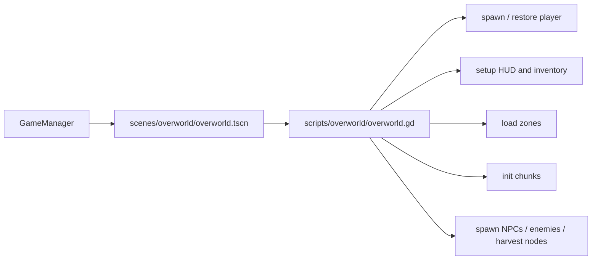

# Entrypoints And Shell

## Overworld Entry Flow

Relevant files:

- [/Users/developer-cloudprimero/Desktop/Godot/new-game-project/scenes/overworld/overworld.tscn](/Users/developer-cloudprimero/Desktop/Godot/new-game-project/scenes/overworld/overworld.tscn)
- [/Users/developer-cloudprimero/Desktop/Godot/new-game-project/scripts/overworld/overworld.gd](/Users/developer-cloudprimero/Desktop/Godot/new-game-project/scripts/overworld/overworld.gd)
- [/Users/developer-cloudprimero/Desktop/Godot/new-game-project/scripts/systems/game_manager.gd](/Users/developer-cloudprimero/Desktop/Godot/new-game-project/scripts/systems/game_manager.gd)

## What `_ready()` Owns

In [overworld.gd](/Users/developer-cloudprimero/Desktop/Godot/new-game-project/scripts/overworld/overworld.gd), `_ready()` is the composition root for:

- spawn position and return position restore
- temporary portal restore after returning from dungeon
- zone data load and QuestManager handoff
- inventory screen setup
- chunk system setup
- victory notification when returning from battle
- deferred async initialization for spawns and world shell setup

This means `overworld.gd` is both:

- a scene controller
- a world runtime coordinator

## Why This Matters

If you want to split the overworld later, keep `overworld.gd` as a thin shell and extract:

- chunk streamer
- zone tracker
- spawn manager
- war/territory bridge
- HUD/quest bridge

