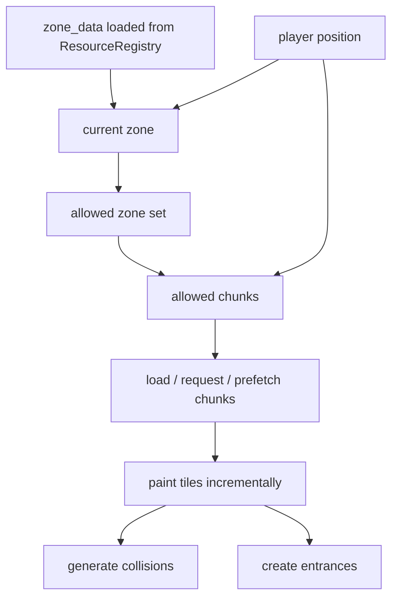

# Chunks And Zones

## Zone And Chunk Flow

Core code anchors:

- [/Users/developer-cloudprimero/Desktop/Godot/new-game-project/scripts/overworld/overworld.gd#L184](/Users/developer-cloudprimero/Desktop/Godot/new-game-project/scripts/overworld/overworld.gd#L184)
- [/Users/developer-cloudprimero/Desktop/Godot/new-game-project/scripts/overworld/overworld.gd#L405](/Users/developer-cloudprimero/Desktop/Godot/new-game-project/scripts/overworld/overworld.gd#L405)
- [/Users/developer-cloudprimero/Desktop/Godot/new-game-project/scripts/overworld/overworld.gd#L449](/Users/developer-cloudprimero/Desktop/Godot/new-game-project/scripts/overworld/overworld.gd#L449)
- [/Users/developer-cloudprimero/Desktop/Godot/new-game-project/scripts/overworld/overworld.gd#L2379](/Users/developer-cloudprimero/Desktop/Godot/new-game-project/scripts/overworld/overworld.gd#L2379)

## Zone State Model

The zone subsystem owns:

- `zone_data`
- `_current_zone`
- `_allowed_zone_ids`
- `_zone_bboxes`
- `_zone_gates`

It answers:

- where the player is
- which chunks are allowed to stream
- which zone gates should exist
- which zone name gets shown
- what speed modifier applies in town-safe spaces

## Chunk Streaming Model

The chunk subsystem owns:

- `_chunk_keys_set`
- `_chunk_cache`
- `_loaded_chunks`
- `_tile_queue`
- `_unload_queue`
- `_pending_loads`
- `_last_chunk`

It answers:

- which chunks exist
- which chunks are already resident
- which chunks are being requested
- which chunks are currently being painted or unloaded

## High-Stakes Parts

- `_rebuild_allowed_zones()`
- `_update_current_zone()`
- `_load_chunks_around()`
- `_process_ready_chunks()`
- `_generate_chunk_collisions()`

These are the best future extraction boundaries.

