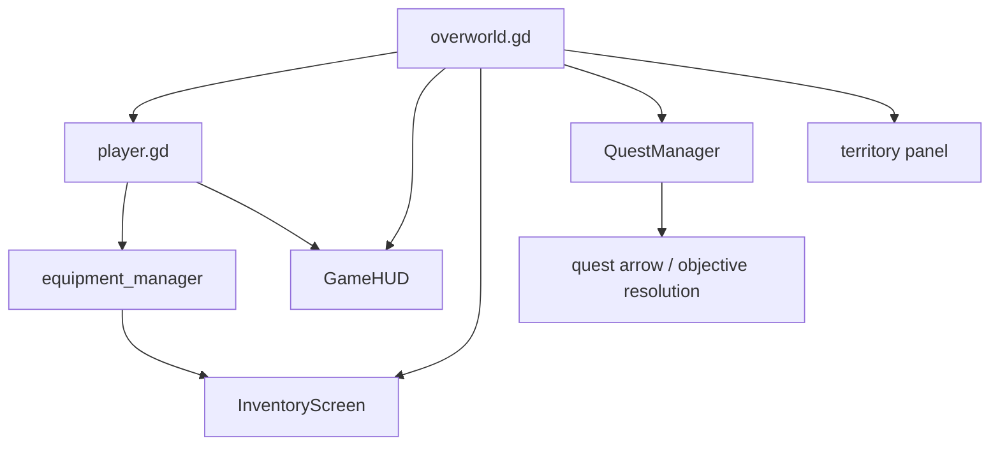

# Player UI Quest Bridges

## Bridge Map

Relevant files:

- [/Users/developer-cloudprimero/Desktop/Godot/new-game-project/scripts/overworld/overworld.gd](/Users/developer-cloudprimero/Desktop/Godot/new-game-project/scripts/overworld/overworld.gd)
- [/Users/developer-cloudprimero/Desktop/Godot/new-game-project/scripts/player.gd](/Users/developer-cloudprimero/Desktop/Godot/new-game-project/scripts/player.gd)
- [/Users/developer-cloudprimero/Desktop/Godot/new-game-project/scripts/ui/game_hud.gd](/Users/developer-cloudprimero/Desktop/Godot/new-game-project/scripts/ui/game_hud.gd)
- [/Users/developer-cloudprimero/Desktop/Godot/new-game-project/scripts/ui/inventory_screen.gd](/Users/developer-cloudprimero/Desktop/Godot/new-game-project/scripts/ui/inventory_screen.gd)
- [/Users/developer-cloudprimero/Desktop/Godot/new-game-project/scripts/quests/quest_manager.gd](/Users/developer-cloudprimero/Desktop/Godot/new-game-project/scripts/quests/quest_manager.gd)

## What Gets Wired Here

`overworld.gd` explicitly wires:

- `InventoryScreen.setup(player.equipment_manager)`
- quest zone data into `QuestManager`
- HUD creation and player handoff
- zone-entered events back into `QuestManager`

So the overworld is where:

- exploration state
- player state
- quest destination state
- and runtime UI

all meet.

## Practical Reading Rule

If a bug feels like:

- wrong spawn
- wrong quest arrow
- wrong inventory visibility
- wrong world map interaction

start with `overworld.gd` before going deeper.

