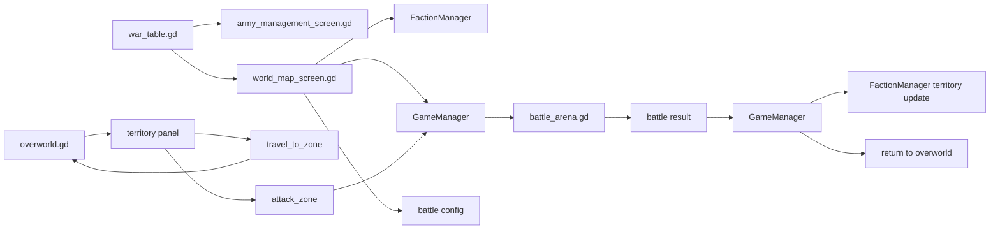

# War Table World Map Battle

## Territory And Battle Flow

Relevant files:

- [/Users/developer-cloudprimero/Desktop/Godot/new-game-project/scripts/objects/war_table.gd](/Users/developer-cloudprimero/Desktop/Godot/new-game-project/scripts/objects/war_table.gd)
- [/Users/developer-cloudprimero/Desktop/Godot/new-game-project/scripts/ui/army_management_screen.gd](/Users/developer-cloudprimero/Desktop/Godot/new-game-project/scripts/ui/army_management_screen.gd)
- [/Users/developer-cloudprimero/Desktop/Godot/new-game-project/scripts/ui/world_map_screen.gd](/Users/developer-cloudprimero/Desktop/Godot/new-game-project/scripts/ui/world_map_screen.gd)
- [/Users/developer-cloudprimero/Desktop/Godot/new-game-project/scripts/overworld/overworld.gd](/Users/developer-cloudprimero/Desktop/Godot/new-game-project/scripts/overworld/overworld.gd)
- [/Users/developer-cloudprimero/Desktop/Godot/new-game-project/scripts/systems/game_manager.gd](/Users/developer-cloudprimero/Desktop/Godot/new-game-project/scripts/systems/game_manager.gd)
- [/Users/developer-cloudprimero/Desktop/Godot/new-game-project/scripts/systems/faction_manager.gd](/Users/developer-cloudprimero/Desktop/Godot/new-game-project/scripts/systems/faction_manager.gd)

## War Table Role

`war_table.gd` is not the war system itself.

It is a launcher:

- opens army management
- opens map/territory interaction

## World Map Role

`world_map_screen.gd` is a strategic UI bridge:

- territory list
- faction info
- attack eligibility
- player army assembly
- enemy army assembly
- battle region selection
- `GameManager.start_battle(config)`

## Overworld Role In This Flow

`overworld.gd` also has a parallel direct territory/battle path through:

- `_try_start_battle()`
- `_on_territory_attack()`
- `_on_territory_travel()`
- `_on_territory_attacked()`

That means the war/battle launch flow is currently split across:

- `overworld.gd`
- `world_map_screen.gd`
- `war_table.gd`

This is one of the strongest future refactor targets.

