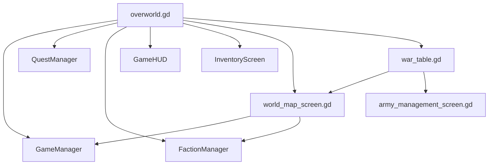

# High Stakes Hubs

## Hub Diagram

## Highest-Risk Files

### [/Users/developer-cloudprimero/Desktop/Godot/new-game-project/scripts/overworld/overworld.gd](/Users/developer-cloudprimero/Desktop/Godot/new-game-project/scripts/overworld/overworld.gd)

Owns too much:

- chunk loading
- zone state
- world spawning
- player/UI bridges
- territory attack/travel
- battle config assembly
- notifications and world shell behaviors

### [/Users/developer-cloudprimero/Desktop/Godot/new-game-project/scripts/ui/world_map_screen.gd](/Users/developer-cloudprimero/Desktop/Godot/new-game-project/scripts/ui/world_map_screen.gd)

Owns:

- strategic territory UI
- player/enemy army construction
- battle config generation

### [/Users/developer-cloudprimero/Desktop/Godot/new-game-project/scripts/objects/war_table.gd](/Users/developer-cloudprimero/Desktop/Godot/new-game-project/scripts/objects/war_table.gd)

Acts as a shell entrypoint into the strategic layer.

## Recommended Future Split

- `overworld/chunks`
- `overworld/zones`
- `overworld/spawn`
- `overworld/ui`
- `overworld/territory`
- `overworld/battle_entry`

