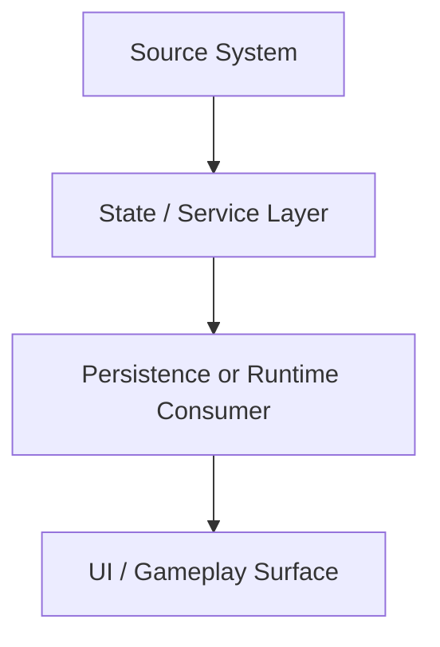

# DESIGN.md Template

Copy this structure exactly for new features.

## Goal

One sentence describing the feature and the user-visible outcome.

## Why This Exists

- What gameplay or system problem this solves.
- What existing system it must integrate with.
- What must not break.

## Scope

### In Scope

- Explicitly list what this feature will do.

### Out Of Scope

- Explicitly list what this feature will not do in this phase.

## Touched Files

- List exact file paths that will be created or changed.
- Split by `existing` and `new` if useful.
- Do not include speculative files.

## Architecture

Describe the data flow and ownership boundaries in 1-3 short paragraphs.

### Mermaid Flow

## State Ownership

- Which object owns the source-of-truth state.
- Which systems may read it.
- Which systems may mutate it.
- What must stay write-restricted.

## Implementation Phases

### Phase 1

- Smallest safe slice.
- Expected changed files.
- Explicit stop point for review.

### Phase 2

- Next dependent slice.
- Expected changed files.
- Explicit stop point for review.

### Phase 3

- Integration / polish / cleanup.

## Risks

- Runtime risks.
- Save compatibility risks.
- Scene coupling risks.
- Parallel-agent risks.

## Verification

- Exact Godot/manual checks.
- Exact diff-review focus areas.
- Exact rollback plan if this phase fails.

## Approval Gate

The implementing agent must stop after the approved phase and wait for review.
