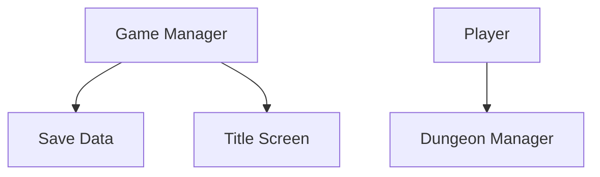

# Mermaid Link Test

Use this file as the tracked template only.

Expected behavior:

1. Run `./tools/workflow/bootstrap_local_workflow.sh`.
2. Open the generated file `docs/workflow/local/MERMAID_LINK_TEST.local.md`.
3. Use Markdown preview for that generated file.
4. Click each node.
5. Confirm the editor opens the referenced file.

Do not rely on this tracked file for clickable testing across machines because `vscode://file/...` requires machine-local absolute paths.

If the generated local test does not work:

- test plain markdown links first
- confirm your preview extension allows custom links
- confirm the repo path on disk matches the generated absolute path

Template reference chart:

Tracked plain links:

- `scripts/systems/game_manager.gd`
- `scripts/systems/save_data.gd`
- `scripts/ui/title_screen.gd`
- `scripts/player.gd`
- `scripts/dungeon/dungeon_manager.gd`
*** Add File: /Users/developer-cloudprimero/Desktop/Godot/new-game-project/docs/workflow/OPERATING_PROCEDURE.md
# Operating Procedure

This is the step-based workflow for AI-assisted development in this repo.

Every feature should have a small state file copied from [WORKFLOW_STATE_TEMPLATE.md](/Users/developer-cloudprimero/Desktop/Godot/new-game-project/docs/workflow/WORKFLOW_STATE_TEMPLATE.md).

Both the human operator and the AI should be able to answer one question at any time:

`What step are we on right now?`

## Steps

### Step 0. Bootstrap

Goal:

- local machine is ready for this repo's workflow

Required:

- run `tools/workflow/bootstrap_local_workflow.sh`
- Mermaid preview works
- diff review tool is available
- repomix is available

Gate to exit:

- local workflow test passed

### Step 1. Context Pack

Goal:

- gather the minimum clean context for a feature

Required:

- verify `.repomixignore`
- generate repomix snapshot if needed
- collect only the relevant local files and docs

Gate to exit:

- context is clean enough to reason from

### Step 2. Design

Goal:

- produce the feature `DESIGN.md`

Required:

- use the strict design template
- list exact touched files
- define implementation phases
- define verification

Gate to exit:

- design is reviewed and approved by the human

### Step 3. Assign Ownership

Goal:

- prevent multi-agent collisions

Required:

- assign write zones
- identify shared files
- choose integration owner

Gate to exit:

- no overlap in file ownership

### Step 4. Build Current Phase

Goal:

- implement only the approved phase

Required:

- AI must state the current phase before coding
- AI may touch only approved files
- AI must stop at the phase boundary

Gate to exit:

- code for the current phase is complete and summarized

### Step 5. Diff Review

Goal:

- inspect the exact change shape before trusting the implementation

Required:

- review the diff in a diff-first tool
- check for scope creep
- inspect shared files carefully

Gate to exit:

- diff is approved or review findings are fed back

### Step 6. Runtime Verification

Goal:

- confirm behavior, not just code shape

Required:

- run the matching verification checklist
- boot the relevant scene or runtime path
- confirm no obvious regressions

Gate to exit:

- verification passed or a fix loop is opened

### Step 7. Integrate Or Iterate

Goal:

- either commit the phase or route it back for a surgical fix

Required:

- if approved, integrate and update workflow state
- if rejected, create a narrow fix request

Gate to exit:

- feature moves to next phase or current phase is reopened

## Fix Loop

If a phase fails review or verification:

1. stay on the same phase
2. write a narrow fix request
3. re-run diff review
4. re-run verification

Do not silently advance the workflow state.

## Human Responsibilities

- approve the design
- approve phase boundaries
- review diffs
- verify runtime behavior
- decide when to commit or reopen

## AI Responsibilities

- state the current workflow step before acting
- obey phase and file boundaries
- update workflow state at checkpoints
- stop when scope expansion is needed
- summarize what changed and what still needs review
2. Render the Mermaid chart.
3. Click each node.
4. Confirm the editor opens the referenced file.

If `vscode://file/...` does not work in your preview tool, test plain markdown links instead and adjust the workflow before relying on it.

Fallback plain links:

- [game_manager.gd](/Users/developer-cloudprimero/Desktop/Godot/new-game-project/scripts/systems/game_manager.gd)
- [save_data.gd](/Users/developer-cloudprimero/Desktop/Godot/new-game-project/scripts/systems/save_data.gd)
- [title_screen.gd](/Users/developer-cloudprimero/Desktop/Godot/new-game-project/scripts/ui/title_screen.gd)
- [player.gd](/Users/developer-cloudprimero/Desktop/Godot/new-game-project/scripts/player.gd)
- [dungeon_manager.gd](/Users/developer-cloudprimero/Desktop/Godot/new-game-project/scripts/dungeon/dungeon_manager.gd)
